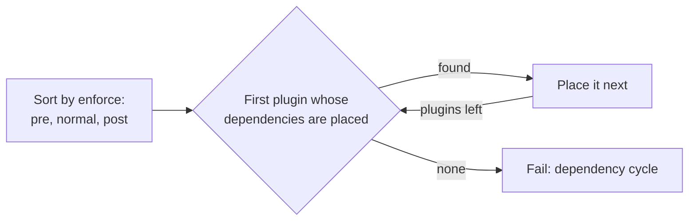
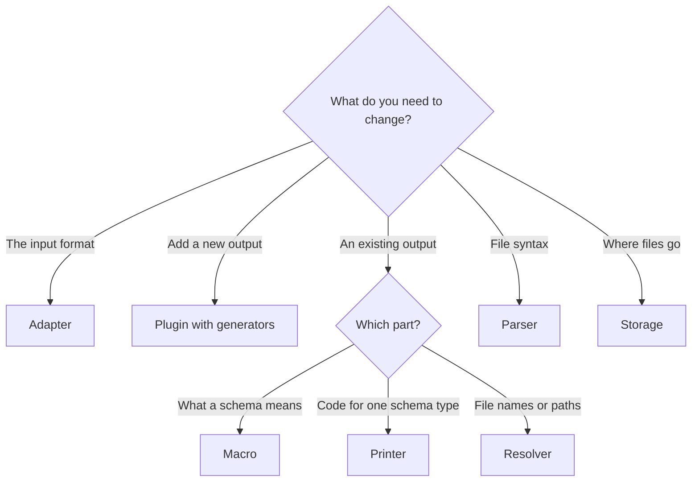

# How Kubb works

Every Kubb run moves a spec through one pipeline. Each stage has one job, and you can replace or extend each one.

::architecture-pipeline
::

| Stage | Job | Output |
| --- | --- | --- |
| [Adapter](#adapters) | Reads the spec and resolves its references | An `InputNode` |
| [AST](#ast) | Describes schemas and operations without naming a spec format or a library | Schema and operation nodes |
| [Plugins](#plugins) | Run generators that decide which files and declarations to emit | `FileNode`s |
| [Parsers](#parsers) | Turn each file's nodes into source text | Source code |
| [Storage](#storage) | Writes the files | Files on disk or in memory |

## From one operation to generated files

Take `GET /pet/{petId}` with the operation ID `getPetById` and a response that refers to a `Pet` schema:

1. The adapter resolves the `$ref` into one operation node and one `Pet` schema node.
2. The AST holds the path parameter, the response, and the `Pet` fields. It names no client library.
3. `plugin-ts` emits the `Pet` and `GetPetById` types, `plugin-axios` emits a `getPetById` function that imports them, and `plugin-zod` can emit schemas from the same nodes.
4. A parser prints each file, and storage writes it.

The [first-client tutorial](/docs/5.x/tutorials/quickstart) builds this example.

## Adapters {#adapters}

An adapter handles everything specific to the input format: references, nullability, discriminators, and formats. The default is the [OpenAPI adapter](/extensions/kubb-labs/adapter-oas). A [custom adapter](/docs/5.x/reference/kit/adapters) converts another format into the same AST, so every plugin works with it unchanged.

::flow-diagram{preset="adapter"}
::

## AST {#ast}

The AST is the model the adapter and the plugins share. The input is normalized once, so no plugin resolves references itself, and any adapter feeds any plugin.

An `InputNode` holds the reusable schemas and the operations. Operations link parameters, request bodies, and responses to schema nodes, with one `ContentNode` per content type.

::ast-tree
::

Every node has a `kind`, and schema nodes also have a `type`. `ast.node.transform` rewrites nodes and `ast.node.collect` gathers matches. Import `ast` from `kubb/kit`, and see the [AST reference](/docs/5.x/reference/kit/ast).

## Plugins {#plugins}

Each plugin owns one output: types, a client, hooks, validators, mocks, or your own files. [`defineExtension({ kind: 'plugin' })`](/docs/5.x/reference/kit/plugins) returns the factory you call in `kubb.config.ts`. Its `setup` runs once and registers generators, a resolver, and macros through the [setup context](/docs/5.x/reference/kit/plugins#setup-context) or composables such as `addGenerator()`.

::plugin-anatomy
::

### Generators {#generators}

A generator turns AST nodes into files, one task per generator.

| Handler | Kubb calls it |
| --- | --- |
| `schema` | Once per schema node |
| `operation` | Once per operation node |
| `operations` | Once per plugin, with every operation node its filters keep |

An optional `match` predicate skips `schema` and `operation` for nodes it rejects. It does not filter `operations`. A handler returns `FileNode`s or elements for a [renderer](#renderers). See the [generator reference](/docs/5.x/reference/kit/generators).

### Resolvers {#resolvers}

A resolver decides identifiers, file names, and paths. A plugin that builds on another reads that plugin's resolver, so the Axios client still imports the right names when you rename the types. The `resolver` plugin option patches the defaults: see [Customize resolvers](/docs/5.x/how-to/customize#resolvers).

### Macros and printers {#macros}

A macro rewrites AST nodes before the generators see them. A printer turns a schema node into code for one target, such as a TypeScript type or a Zod expression. Macros run first and per plugin, so a macro change reaches every generator of its plugin and no other plugin. A printer change stays in one output. See [Customize macros](/docs/5.x/how-to/customize#macros) and [Customize printers](/docs/5.x/how-to/customize#printers).

### Renderers {#renderers}

A generator either builds `FileNode`s with `ast.factory` or returns elements that a renderer turns into `FileNode`s. `jsxRenderer` from `kubb/jsx` renders JSX without React. Set a renderer per generator with `renderer`, or write your own for another template format. See the [JSX reference](/docs/5.x/reference/jsx#renderers).

### Lifecycle {#lifecycle}

::lifecycle-timeline
::

1. The adapter parses the spec.
2. Each plugin's `setup` and `kubb:plugin:setup` run once, in [plugin order](#dependencies).
3. Kubb walks the AST once, schemas first. Each node goes to every plugin in plugin order, through that plugin's macros and `include`, `exclude`, and `override` filters.
4. Each plugin's `operations` handler runs, then `kubb:plugin:end` fires.
5. After `kubb:plugins:end`, Kubb writes all files in one pass through the parsers and storage.
6. Format, lint, and `postGenerate` run when the config sets them.

The [hooks reference](/docs/5.x/reference/kit/hooks) lists every hook a plugin can listen to.

### Dependencies and ordering {#dependencies}

Kubb puts the plugins in one order before setup:

Dependencies win over `enforce`, and ties keep their order in `plugins`. With `plugins: [pluginAxios(), pluginTs()]`, `plugin-ts` comes first because `plugin-axios` depends on it. `plugin-barrel`, which `defineConfig` adds, comes last because it sets `enforce: 'post'`, so it sees every file the others emitted and writes re-exports for them.

[`dependencies`](/docs/5.x/reference/kit/extensions#dependencies) is an array of plugin names, which only sets the order, or a record keyed by plugin name, which also fails the run before any plugin runs when a required plugin is missing or out of range.

## Parsers {#parsers}

Each parser claims file extensions, and Kubb sends each `FileNode` to the parser for its extension. Without a `parsers` option, `defineConfig` adds `parserTs` (`.ts`, `.js`), `parserTsx` (`.tsx`, `.jsx`), and `parserMd` (`.md`, `.markdown`). A file no parser claims gets its sources joined as they are.

The TypeScript parser prints a file's banner, imports, and source nodes into its text:

::flow-diagram{preset="parsers"}
::

To write one, see [parsers in the Kit reference](/docs/5.x/reference/kit/parsers).

## Storage {#storage}

Storage separates generation from where the files go, so the same build writes to disk from the CLI or to memory in a test. A file whose content has not changed is not written again.

| Driver | Writes to |
| --- | --- |
| `fsStorage()` | Disk. The default. |
| `memoryStorage()` | A `Map` in memory |
| Your own | Any backend that implements the [Storage interface](/docs/5.x/reference/kit/storage#storage-interface) |

## Choose an extension {#choose-an-extension}

Use an existing [plugin](/extensions/kind/plugins) when it generates the output you need. Otherwise, build on `kubb/kit`, which ships with `kubb`.

| Extension | Example | Start with |
| --- | --- | --- |
| Adapter | Read a format other than OpenAPI | [Adapters](/docs/5.x/reference/kit/adapters) |
| Plugin | Generate a new kind of file | [Create a plugin](/docs/5.x/tutorials/creating-plugins) |
| Macro | Treat every `integer` as a `string` in one plugin | [Customize macros](/docs/5.x/how-to/customize#macros) |
| Printer | Print `date` schemas as the TypeScript `Date` type | [Customize printers](/docs/5.x/how-to/customize#printers) |
| Resolver | Move model files into a folder | [Customize resolvers](/docs/5.x/how-to/customize#resolvers) |
| Parser | Emit a new file type | [Parsers](/docs/5.x/reference/kit/parsers) |
| Storage | Write to a remote store | [Storage](/docs/5.x/reference/kit/storage) |
