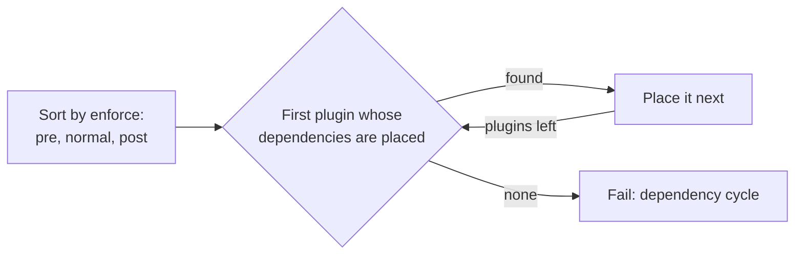
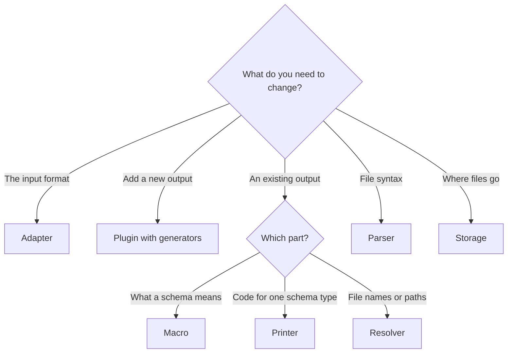

# How Kubb works

Kubb runs your spec through one pipeline, and you can replace or extend each stage.

::architecture-pipeline
::

| Stage | Job | Output |
| --- | --- | --- |
| [Adapter](#adapters) | Reads the spec and resolves its references | An `InputNode` |
| [AST](#ast) | Describes schemas and operations without naming a spec format or a library | Schema and operation nodes |
| [Plugins](#plugins) | Run generators that decide which files and declarations to emit | `FileNode`s |
| [Parsers](#parsers) | Turn each file's nodes into source text | Source code |
| [Storage](#storage) | Writes the files | Files on disk or in memory |

## From one operation to generated files

Take `GET /pet/{petId}` (`getPetById`), whose response refers to a `Pet` schema:

1. The adapter resolves the `$ref` into an operation node and a `Pet` schema node.
2. `plugin-ts` emits the `Pet` and `GetPetById` types, and `plugin-axios` emits a `getPetById` function that imports them.
3. A parser prints each file, and storage writes it.

[Generate your first client](/docs/5.x/tutorials/quickstart) builds this example.

## Adapters {#adapters}

An adapter handles everything specific to the input format: references, nullability, discriminators, and formats. The default is the [OpenAPI adapter](/extensions/kubb-labs/adapter-oas). A [custom adapter](/docs/5.x/reference/kit/adapters) converts another format into the same AST, so every plugin works with it.

::flow-diagram{preset="adapter"}
::

## AST {#ast}

The AST is the model the adapter and the plugins share, so no plugin resolves references itself. An `InputNode` holds the reusable schemas and the operations, and operations link parameters, request bodies, and responses to schema nodes.

::ast-tree
::

Every node has a `kind`, and schema nodes also have a `type`. See [AST and node builders](/docs/5.x/reference/kit/ast).

## Plugins {#plugins}

Each plugin owns one output, such as types, a client, or your own files. [`defineExtension({ kind: 'plugin' })`](/docs/5.x/reference/kit/plugins) returns the factory you call in `kubb.config.ts`. Its `setup` runs once and registers generators, a resolver, and macros.

::plugin-anatomy
::

### Generators {#generators}

A generator turns AST nodes into files.

| Handler | Kubb calls it |
| --- | --- |
| `schema` | Once per schema node |
| `operation` | Once per operation node |
| `operations` | Once per plugin, with every operation node its filters keep |

A handler returns `FileNode`s or elements for a [renderer](#renderers). See [Generators](/docs/5.x/reference/kit/generators).

### Resolvers {#resolvers}

A resolver decides identifiers, file names, and paths. A plugin that builds on another reads its resolver, so the Axios client still imports the right names after you rename the types. See [Resolvers](/docs/5.x/how-to/customize#resolvers).

### Macros and printers {#macros}

A macro rewrites AST nodes before the generators see them, per plugin, so a change reaches every generator of that plugin and no other. A printer turns a schema node into code for one target, such as a TypeScript type or a Zod expression. See [Macros](/docs/5.x/how-to/customize#macros) and [Printers](/docs/5.x/how-to/customize#printers).

### Renderers {#renderers}

A renderer turns the elements a generator returns into `FileNode`s. `jsxRenderer` from `kubb/jsx` renders JSX without React. Set it per generator with `renderer`. See [JSX renderer](/docs/5.x/reference/jsx#renderers).

### Lifecycle {#lifecycle}

::lifecycle-timeline
::

1. The adapter parses the spec.
2. Each plugin's `setup` and `kubb:plugin:setup` run once, in [plugin order](#dependencies).
3. Kubb walks the AST once, schemas first. Each node goes to every plugin, through its macros and `include`, `exclude`, and `override` filters.
4. Each plugin's `operations` handler runs, then `kubb:plugin:end` fires.
5. After `kubb:plugins:end`, Kubb writes all files through the parsers and storage.
6. Format, lint, and `postGenerate` run when the config sets them.

[Lifecycle hooks](/docs/5.x/reference/kit/hooks) lists every hook.

### Dependencies and ordering {#dependencies}

Kubb orders the plugins before setup:

[Dependencies](/docs/5.x/reference/kit/extensions#dependencies) win over `enforce`, and ties keep their order in `plugins`. With `plugins: [pluginAxios(), pluginTs()]`, `plugin-ts` comes first because `plugin-axios` depends on it. `plugin-barrel`, which `defineConfig` adds, sets `enforce: 'post'`, so it runs last and sees every file the others emitted.

## Parsers {#parsers}

Kubb sends each `FileNode` to the parser that claims its extension. Without a `parsers` option, `defineConfig` adds `parserTs` (`.ts`, `.js`), `parserTsx` (`.tsx`, `.jsx`), and `parserMd` (`.md`, `.markdown`). The TypeScript parser prints a file's banner, imports, and source nodes:

::flow-diagram{preset="parsers"}
::

To write one, see [Parsers](/docs/5.x/reference/kit/parsers).

## Storage {#storage}

Storage decides where files go, so the same build writes to disk from the CLI or to memory in a test. Kubb skips files whose content has not changed.

| Driver | Writes to |
| --- | --- |
| `fsStorage()` | Disk. The default. |
| `memoryStorage()` | A `Map` in memory |
| Your own | Any backend that implements the [Storage interface](/docs/5.x/reference/kit/storage#storage-interface) |

## Choose an extension {#choose-an-extension}

If an existing [plugin](/extensions/kind/plugins) generates the output you need, use it. Otherwise, build on `kubb/kit`, which ships with `kubb`.

| Extension | Example | Start with |
| --- | --- | --- |
| Adapter | Read a format other than OpenAPI | [Adapters](/docs/5.x/reference/kit/adapters) |
| Plugin | Generate a new kind of file | [Create a plugin](/docs/5.x/tutorials/creating-plugins) |
| Macro | Treat every `integer` as a `string` in one plugin | [Macros](/docs/5.x/how-to/customize#macros) |
| Printer | Print `date` schemas as the TypeScript `Date` type | [Printers](/docs/5.x/how-to/customize#printers) |
| Resolver | Move model files into a folder | [Resolvers](/docs/5.x/how-to/customize#resolvers) |
| Parser | Emit a new file type | [Parsers](/docs/5.x/reference/kit/parsers) |
| Storage | Write to a remote store | [Storage](/docs/5.x/reference/kit/storage) |
