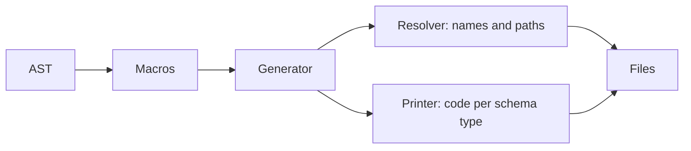

# Customize generated code

You change what a plugin generates with one of these options, without forking it:

| You want to change | Use | Applies to |
| --- | --- | --- |
| What a type, function, or file is called, or where a file lands | [`resolver`](#resolvers) | The plugin you set it on |
| The schema itself, such as a field type, a name, or metadata | [`macros`](#macros) | Every plugin you pass the macro to |
| The code printed for one schema type, such as `date` | [`printer.nodes`](#printers) | `@kubb/plugin-ts`, `@kubb/plugin-zod`, `@kubb/plugin-faker` |

Macros run before the resolver, so when a macro changes a name, the generated names, paths, and files follow:



> [!TIP]
> An override gets its context as `this` and as its second argument. In an arrow function, read it from the second argument, such as `(node, ctx) => ctx!.base(node)`. The second argument is typed as optional, so assert it with `!`.

## Resolvers {#resolvers}

A resolver names every symbol and file a plugin writes. Pass only the methods you replace to the plugin's `resolver` option. The rest keep their defaults.

| Method | Builds | Plugin |
| --- | --- | --- |
| `name(name)` | Every identifier | All |
| `file.baseName({ name, extname })` | A file name, extension included | All |
| `file.path({ baseName, output })` | The full file path | All |
| `query.keyName(node)` | A query key, such as `getPetByIdQueryKey` | `@kubb/plugin-react-query`, `@kubb/plugin-vue-query` |
| `response.status(node, statusCode)` | A response name, such as `GetPetByIdStatus200` | `@kubb/plugin-ts`, `@kubb/plugin-zod`, `@kubb/plugin-faker` |

Each plugin's options page lists its own namespaces. [Resolver overrides](/docs/5.x/reference/kit/resolvers#resolver-overrides) has the signatures. [`resolver`](/docs/5.x/reference/plugin-options#resolver) lists the shared members.

::code-group

```typescript [Prefix names]
import { pluginTs, resolverTs } from '@kubb/plugin-ts'

pluginTs({
  resolver: {
    // Calls the preset to keep PascalCase: Pet becomes ApiPet
    name(name) {
      return `Api${resolverTs.name(name)}`
    },
  },
})
```

```typescript [Rename files]
import { pluginFaker } from '@kubb/plugin-faker'

pluginFaker({
  resolver: {
    file: {
      // Pet.mock.ts instead of the default createPet.ts
      baseName({ name, extname }) {
        return `${name}.mock${extname}`
      },
    },
  },
})
```

```typescript [Move files]
import { pluginFaker } from '@kubb/plugin-faker'

pluginFaker({
  resolver: {
    file: {
      // src/gen/fixtures/ instead of src/gen/mocks/
      path({ baseName }) {
        return `fixtures/${baseName}`
      },
    },
  },
})
```

```typescript [Query keys]
import { pluginReactQuery } from '@kubb/plugin-react-query'

pluginReactQuery({
  resolver: {
    query: {
      // this.name keeps the active naming rule: getPetByIdKey
      keyName(node) {
        return `${this.name(node.operationId)}Key`
      },
    },
  },
})
```

```typescript [Response types]
import { pluginTs } from '@kubb/plugin-ts'

pluginTs({
  resolver: {
    response: {
      // GetPetById200Response instead of GetPetByIdStatus200
      status(node, statusCode) {
        return this.name(`${node.operationId} ${statusCode} response`)
      },
    },
  },
})
```

::

> [!WARNING]
> `file.path` replaces the plugin's `output.path` and `group` layout. The returned path resolves against the root `output.path` and must stay inside it. Moved files get no `index.ts` barrel.

## Macros {#macros}

A macro rewrites schema or operation nodes before any generator runs. Define one with `defineMacro` from `kubb/kit`:

| Field | What it does |
| --- | --- |
| `name` | Identifies the macro |
| A callback per node kind, such as `schema` or `operation` | Returns a replacement node, or `undefined` to keep the node |
| `match` | Skips nodes the macro does not care about |
| `enforce: 'pre' \| 'post'` | Runs the macro before or after macros without `enforce` |

[`ast.macro`](/docs/5.x/reference/kit/ast#macros) lists every callback.

::code-group

```typescript [macroIntegerToString.ts]
import { ast, defineMacro } from 'kubb/kit'

export const macroIntegerToString = defineMacro({
  name: 'integer-to-string',
  schema(node) {
    if (node.type !== 'integer') return undefined
    // Copy only fields a string schema has: `min`, `max`, `primitive`, and `format` mean something else on an integer.
    const { name, title, description, nullable, optional, deprecated, readOnly, writeOnly } = node
    return ast.factory.createSchema({ type: 'string', name, title, description, nullable, optional, deprecated, readOnly, writeOnly })
  },
})
```

```typescript [macroUntagged.ts]
import { defineMacro } from 'kubb/kit'

export const macroUntagged = defineMacro({
  name: 'untagged',
  enforce: 'post',
  match: (node) => node.kind === 'Operation',
  operation(node) {
    return node.tags?.length ? undefined : { ...node, tags: ['untagged'] }
  },
})
```

::

### Register a macro

Pass macros through a plugin's `macros` option, or register them in your own plugin's `setup` with the `addMacro` or `setMacros` composable. Macros run per plugin, so they never change the nodes another plugin sees.

```typescript [plugin.ts]
import { addMacro, defineExtension, defineMacro } from 'kubb/kit'

const macroDropDescriptions = defineMacro({
  name: 'drop-descriptions',
  schema(node) {
    return 'description' in node && node.description ? { ...node, description: undefined } : undefined
  },
})

export const pluginRename = defineExtension({
  kind: 'plugin',
  meta: { name: 'plugin-rename' },
  setup(options) {
    addMacro(macroDropDescriptions)
    return options
  },
})
```

The diagram applies `macroIntegerToString` and `macroDropDescriptions` to a `Pet` node. Hover a line to see which macro changed it.

::flow-diagram{preset="macros"}
::

> [!TIP]
> Keep macros pure. Return a new node instead of mutating the input, because every plugin shares the same AST nodes.

### Rename a schema

> [!WARNING]
> Renaming only the declaration leaves every `$ref` on the old name, so imports point at a file the plugin no longer writes. Rename the declaration and set `targetName` on every ref in one macro, and register it on every plugin that reads the schema.

`macroRenameSchema` does both. Pass one shared `macros` array to each plugin:

::code-group

```typescript [macroRenameSchema.ts]
import { ast, defineMacro } from 'kubb/kit'

export function macroRenameSchema({ from, to }: { from: string; to: string }) {
  return defineMacro({
    name: 'rename-schema',
    schema(node) {
      const refNode = ast.schema.narrow(node, 'ref')

      if (!refNode) {
        return node.name === from ? { ...node, name: to } : undefined
      }

      // A ref node can be the renamed schema's own declaration, a pointer to it, or both at once.
      const renamesDeclaration = refNode.name === from
      const renamesTarget = ast.ref.getName(refNode) === from
      if (!renamesDeclaration && !renamesTarget) return undefined

      return {
        ...refNode,
        ...(renamesDeclaration ? { name: to } : {}),
        ...(renamesTarget ? { targetName: to } : {}),
      }
    },
  })
}
```

```typescript [kubb.config.ts]
import { defineConfig } from 'kubb/config'
import { pluginTs } from '@kubb/plugin-ts'
import { pluginZod } from '@kubb/plugin-zod'
import { macroRenameSchema } from './macroRenameSchema.ts'

const macros = [macroRenameSchema({ from: 'Order', to: 'StoreOrder' })]

export default defineConfig({
  input: './petStore.yaml',
  output: { path: './src/gen' },
  plugins: [pluginTs({ macros }), pluginZod({ macros })],
})
```

::

### Use the built-in macros

`kubb/kit` exports [built-in macros](/docs/5.x/reference/kit/ast#macros) for common normalizations. Combine them with your own:

```typescript [kubb.config.ts]
import { defineConfig } from 'kubb/config'
import { macroDedupeUnion, macroDiscriminatorEnum } from 'kubb/kit'
import { pluginTs } from '@kubb/plugin-ts'

export default defineConfig({
  input: './petStore.yaml',
  output: { path: './src/gen' },
  plugins: [
    pluginTs({
      macros: [macroDedupeUnion, macroDiscriminatorEnum({ propertyName: 'kind', values: ['cat', 'dog'] })],
    }),
  ],
})
```

## Printers {#printers}

`printer.nodes` replaces the handler that prints one schema type, such as `date` or `object`. A handler returns code as a string. To change the schema itself, use [macros](#macros).

| Plugin | A handler returns | Inside a handler |
| --- | --- | --- |
| `@kubb/plugin-ts` | A TypeScript type | `this.transform(node)`: a nested node's printed type |
| `@kubb/plugin-zod` | A Zod expression, Zod Mini with `mini: true` | `this.base(node)`: the default output. `this.options.direction`: see [Zod encode and decode](#zod-encode-and-decode). |
| `@kubb/plugin-faker` | A Faker expression | `this.transform(node)`, `this.options` |

[Printer handlers and context](/docs/5.x/reference/kit/ast#printer-handlers-and-context) has the full context.

::code-group

```typescript [plugin-ts]
import { pluginTs } from '@kubb/plugin-ts'

pluginTs({
  printer: {
    nodes: {
      // A JavaScript Date instead of string
      date() {
        return 'Date'
      },
    },
  },
})
```

```typescript [plugin-zod]
import { pluginZod } from '@kubb/plugin-zod'

pluginZod({
  printer: {
    nodes: {
      date() {
        return 'z.iso.date()'
      },
      // Decorate the default output. Nested nodes still print through the regular handlers.
      object(node) {
        return `${this.base(node)}.openapi(${JSON.stringify({ description: node.description })})`
      },
    },
  },
})
```

```typescript [plugin-faker]
import { pluginFaker } from '@kubb/plugin-faker'

pluginFaker({
  printer: {
    nodes: {
      // Floats where the spec declares integers
      integer() {
        return 'faker.number.float()'
      },
    },
  },
})
```

::

### TypeScript handlers

`this.transform(node)` returns a string, so a handler that passes it to `ts.factory` breaks. Build the type as a string.

### Zod encode and decode

`this.options.direction` is `'decode'` for response schemas and `'encode'` for request bodies and parameters. Type the handlers as `PrinterZodNodes` from `@kubb/plugin-zod` to read it. [Encode custom types](/extensions/kubb-labs/plugin-zod/guides/customization#encode-custom-types) shows a direction-aware handler.
