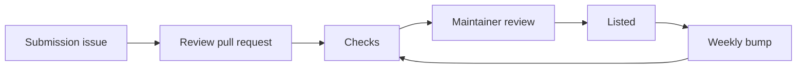

# Publish a plugin

Package a plugin, publish it, and list it in the Kubb registry. Users then install it with `kubb add` and find it on [kubb.dev/extensions](/extensions) and in Kubb Studio. Adapters and parsers follow the same steps. Start from a working plugin with a test, such as the one from [Create a plugin](/docs/5.x/tutorials/creating-plugins).

> [!TIP]
> A package already on npm still needs the manifest and the `docs/` folder in a published version. Add them, publish a new version, then go to [Submit to the registry](#submit-to-the-registry).

::steps{level="2"}

## Build the package

Export the factory from the package entry point. Give relative imports a `.js` extension so the compiled ESM works in Node:

```typescript [src/index.ts]
export { pluginExample } from './plugin.js'
```

Add a TypeScript build config and these `package.json` fields, next to the dev dependencies you already have. Replace the package name with an available name you own:

:::code-group

```json [package.json]
{
  "name": "kubb-plugin-example",
  "version": "1.0.0",
  "type": "module",
  "files": ["dist", "kubb-extension.json", "docs"],
  "repository": { "type": "git", "url": "https://github.com/acme/kubb-plugin-example" },
  "scripts": {
    "build": "tsc -p tsconfig.json",
    "test": "vitest run src/plugin.test.ts",
    "prepack": "npm run build && npm test"
  },
  "exports": {
    ".": {
      "types": "./dist/index.d.ts",
      "import": "./dist/index.js"
    },
    "./kubb-extension.json": "./kubb-extension.json",
    "./package.json": "./package.json"
  },
  "peerDependencies": { "kubb": "^5.0.0" }
}
```

```json [tsconfig.json]
{
  "compilerOptions": {
    "target": "ES2022",
    "module": "NodeNext",
    "moduleResolution": "NodeNext",
    "strict": true,
    "declaration": true,
    "skipLibCheck": true,
    "rootDir": "src",
    "outDir": "dist"
  },
  "include": ["src/index.ts", "src/plugin.ts"]
}
```

:::

Check these points before you publish:

- `files` ships the build, the manifest, and the `docs/` folder.
- `exports` lists `kubb-extension.json` and `package.json`, because an `exports` map hides every path it does not list.
- `repository` points to a GitHub repository you own, or one owned by an organization you belong to.
- `kubb` or `@kubb/core` is a peer dependency, not a bundled one. Keep `kubb` as a dev dependency as well, so you can build and test locally.
- A `preinstall`, `install`, or `postinstall` script is allowed only when the overview explains what it does.

## Add the manifest

Create `kubb-extension.json` at the package root. It tells the registry, `kubb add`, and Studio what the package is and which factory to call:

```json [kubb-extension.json]
{
  "$schema": "https://kubb.dev/schemas/kubb-extension.json",
  "kind": "plugin",
  "name": "plugin-example",
  "export": "pluginExample",
  "displayName": "Example",
  "description": "Writes a comment with the HTTP method and path of every operation.",
  "maintainers": [{ "name": "Acme", "github": "acme" }],
  "compatibility": { "kubb": ">=5.8.3", "node": ">=22" }
}
```

Set `name` to the plugin's `meta.name` and `export` to the factory that `src/index.ts` exports. Give `meta.compatibility` in `src/plugin.ts` the same ranges, so Kubb checks them at runtime too, or [import `compatibility` from the manifest](/docs/5.x/reference/kit/manifest#import-compatibility-into-meta) with a bundler. [Extension manifest](/docs/5.x/reference/kit/manifest) lists every field, which ones are required, and the `options` Studio shows as a form.

## Write the docs {#write-the-docs}

Create a `docs/` folder next to the manifest. kubb.dev renders it as the extension's page:

```text [docs/]
docs/
├── overview.md        required
├── options.md         optional, the full option reference
└── guides/
    └── <id>.md        optional, one file per task
```

Start each file with a `#` title and a one-paragraph description:

```md [docs/overview.md]
# Example

Writes a comment with the HTTP method and path of every operation.

## Setup

Runs on its own and needs no other plugin.
```

Leave install commands out of the overview, because the page already shows how to install and validation fails on them. [Extension docs](/docs/5.x/reference/kit/extension-docs) covers what the overview should say, the guide naming rules, and the Markdown that renders. Keep a README with installation and a Kubb config example, and include a license file.

## Check the tarball

Build, list the files npm would include, and create a local tarball:

```shell [Terminal]
npm run build
npm pack --dry-run
npm pack
```

The dry run should list the `dist/` files, `kubb-extension.json`, the `docs/` files, and `package.json`, and no fixtures, tests, or generated client files. `prepack` runs the build and the test first.

## Publish a version

:::tabs

::::tabs-item{label="npm"}

Set a version that npm does not have yet, then sign in and publish:

```shell [Terminal]
npm login
npm publish --access public
```

::::

::::tabs-item{label="GitHub release"}

A package that is not on npm can install from a GitHub release. `kubb add` then installs `github:<owner>/<repo>#<commit>`, so nothing builds on the user's machine. The release must meet these rules:

- The package sits at the repository root. A scoped name uses your GitHub owner, such as `@acme/` for `github.com/acme`.
- `dist/` is committed. `main`, `module`, and `exports` point to committed files, and `files` lists them and `kubb-extension.json`.
- `package.json` has no `preinstall`, `install`, `postinstall`, `prepare`, `prepack`, `prepublish`, `publish`, or `build` script, and no `workspaces`. Rename `build`, for example to `compile`, and drop `prepack`.
- The tag equals the `package.json` version, with or without a leading `v`, such as `v1.0.0`.

Commit the manifest, the docs, and the build, then create a GitHub release from that commit.

::::

:::

## Submit to the registry {#submit-to-the-registry}

Open a [submission issue](https://github.com/kubb-labs/registry/issues/new?template=submit-extension.yml) on kubb-labs/registry. In **Source**, enter one of these:

| You have | Enter |
| --- | --- |
| An npm package (pins `latest`) | `kubb-plugin-example` |
| A specific npm version | `kubb-plugin-example@1.0.0` |
| An npm page | `https://www.npmjs.com/package/kubb-plugin-example` |
| A package on npm, by its folder in a GitHub monorepo | `https://github.com/acme/kubb-plugins/tree/main/packages/example` |
| A GitHub release, package not on npm | `https://github.com/acme/kubb-plugin-example/tree/v1.0.0` |

In **Categories**, tick every category that fits. The first tick is the main one.

Within minutes, a workflow opens a review pull request with the [record](/docs/5.x/reference/registry#records) and comments its link on your issue. If it reports a problem instead, fix it and edit the issue to run the submission again. Your id is `<owner>/<slug>`, such as `acme/kubb-plugin-example`. [Registry ids](/docs/5.x/reference/registry#registry-ids) has the rules.

## Wait for the review {#review}



Checks on the pull request validate the record and the docs, and load your extension with install scripts off. Validation reads `kubb-extension.json` and the `docs/` folder from the npm tarball or the GitHub release, plus `package.json` for a GitHub release. A maintainer then reviews the package against [`REVIEW.md`](https://github.com/kubb-labs/registry/blob/main/REVIEW.md).

Once the pull request exists, editing the issue no longer runs the submission again. When a check fails or the maintainer asks for changes, publish a fixed version and reply in the pull request.

After a maintainer merges the pull request, the registry lists the extension within minutes. Users install it with:

```shell [Terminal]
kubb add acme/kubb-plugin-example
```

::

## Release a new version

Publishing a new version does not change what `kubb add` installs. Every Monday, a workflow opens a pull request that moves each pin to the latest npm version or GitHub release, and that version gets the same review. After the merge, users get it with [`kubb update`](/docs/5.x/reference/commands/extensions#update).
