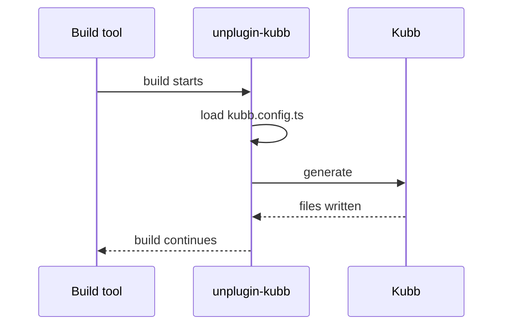

# Generate code from your build tool

`unplugin-kubb` runs your `kubb.config.ts` when your build tool starts a build. It ships with `kubb`, so you import it from `kubb/<tool>` and install nothing else.



> [!IMPORTANT]
> Vite, Nuxt, and Astro generate during builds only, not in their development servers. Run `kubb generate` before you start a development server.

## Pick your build tool

Every tool follows the same three steps: install Kubb, pass your `kubb.config.ts` as `config`, and run the build. Without `config`, the plugin finds `kubb.config.ts` like the CLI does and builds every config in it that has an `input`.

| Tool | Import | Config file |
| --- | --- | --- |
| [Vite](/docs/5.x/integrations/vite) | `kubb/vite` | `vite.config.ts` |
| [webpack](/docs/5.x/integrations/webpack) | `kubb/webpack` | `webpack.config.ts` |
| [Rspack](/docs/5.x/integrations/rspack) | `kubb/rspack` | `rspack.config.ts` |
| [Rollup](/docs/5.x/integrations/rollup) | `kubb/rollup` | `rollup.config.ts` |
| [Rolldown](/docs/5.x/integrations/rolldown) | `kubb/rolldown` | `rolldown.config.ts` |
| [esbuild](/docs/5.x/integrations/esbuild) | `kubb/esbuild` | `build.ts` |
| [Farm](/docs/5.x/integrations/farm) | `kubb/farm` | `farm.config.ts` |
| [Nuxt](/docs/5.x/integrations/nuxt) | `kubb/nuxt` | `nuxt.config.ts` |
| [Astro](/docs/5.x/integrations/astro) | `kubb/astro` | `astro.config.mjs` |

## How the build runs Kubb

- The plugin applies the same [defaults](/docs/5.x/reference/configuration#defaults) as `defineConfig`. It runs `output.format`, `output.lint`, and `output.postGenerate`.
- It prints the run summary but not the `json`, `file`, or `html` reports. Use `kubb generate` when you need those.
- Watch rebuilds reuse the first output. Restart the build after you change the spec or `kubb.config.ts`.

## Import a spec as a module {#import-a-spec}

Import a `*.openapi.yaml` or `*.openapi.yml` file to get the output of every plugin in your config as one module. Kubb writes no files for the import, and it works in the Vite development server too.

```ts [src/pets.ts]
import { type Pet, petStatusEnum } from './petStore.openapi.yaml'
```

The import uses the config whose `input` is that spec, or else the first config without an `input`. A config without `input` only serves imports. Code a plugin writes to a separate file, such as a bundled client runtime, is not part of the module.

For types in `tsc` and your editor, add [openapi-import](/docs/5.x/integrations/openapi-import).
