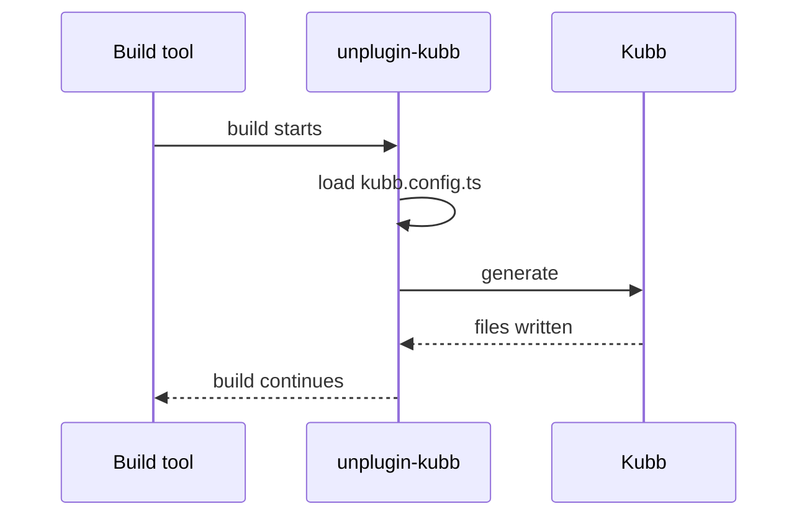

# Generate code from your build tool

`unplugin-kubb` runs your `kubb.config.ts` when your build tool starts a build. It ships with `kubb`, so you import it from `kubb/<tool>` and install nothing else.



> [!IMPORTANT]
> Vite, Nuxt, and Astro generate during builds only, not in their development servers. Run `kubb generate` before you start a development server.

::steps{level="2"}

## Install Kubb and your plugins

Follow [Installation](/docs/5.x/how-to/installation) to add `kubb` and the plugins your output needs.

## Add Kubb to your build config

Import your `kubb.config.ts` and pass it as `config`. It must be one config object, not the array or function forms `defineConfig` accepts. Without `config`, the plugin finds `kubb.config.ts` like the CLI does and builds every config in it that has an `input`.

:::tabs

::::tabs-item{label="Vite" icon="i-simple-icons-vite"}

```typescript [vite.config.ts]
import kubb from 'kubb/vite'
import { defineConfig } from 'vite'
import config from './kubb.config.ts'

export default defineConfig({
  plugins: [kubb({ config })],
})
```

::::

::::tabs-item{label="webpack" icon="i-simple-icons-webpack"}

```typescript [webpack.config.ts]
import kubb from 'kubb/webpack'
import config from './kubb.config'

export default {
  plugins: [kubb({ config })],
}
```

::::

::::tabs-item{label="Rspack" icon="i-iconoir-journal"}

```typescript [rspack.config.ts]
import kubb from 'kubb/rspack'
import config from './kubb.config'

export default {
  plugins: [kubb({ config })],
}
```

::::

::::tabs-item{label="Rollup" icon="i-simple-icons-rollupdotjs"}

```typescript [rollup.config.ts]
import kubb from 'kubb/rollup'
import config from './kubb.config.ts'

export default {
  input: 'src/index.ts',
  plugins: [kubb({ config })],
}
```

::::

::::tabs-item{label="Rolldown" icon="i-simple-icons-rolldown"}

```typescript [rolldown.config.ts]
import kubb from 'kubb/rolldown'
import { defineConfig } from 'rolldown'
import config from './kubb.config.ts'

export default defineConfig({
  input: 'src/index.ts',
  plugins: [kubb({ config })],
})
```

::::

::::tabs-item{label="esbuild" icon="i-simple-icons-esbuild"}

```typescript [build.ts]
import { build } from 'esbuild'
import kubb from 'kubb/esbuild'
import config from './kubb.config.ts'

await build({
  entryPoints: ['src/index.ts'],
  bundle: true,
  outfile: 'dist/bundle.js',
  plugins: [kubb({ config })],
})
```

::::

::::tabs-item{label="Farm" icon="i-iconoir-light-bulb"}

```typescript [farm.config.ts]
import { defineConfig } from '@farmfe/core'
import kubb from 'kubb/farm'
import config from './kubb.config'

export default defineConfig({
  plugins: [kubb({ config })],
})
```

::::

::::tabs-item{label="Nuxt" icon="i-simple-icons-nuxt"}

```typescript [nuxt.config.ts]
import config from './kubb.config'

export default defineNuxtConfig({
  modules: [['kubb/nuxt', { config }]],
})
```

::::

::::tabs-item{label="Astro" icon="i-simple-icons-astro"}

```typescript [astro.config.mjs]
import { defineConfig } from 'astro/config'
import kubb from 'kubb/astro'
import config from './kubb.config'

export default defineConfig({
  integrations: [kubb({ config })],
})
```

::::

:::

## Run the build

Run your tool's build command. Kubb generates once, when the first build starts, and the build waits for it. A missing config or a failed generation fails the build.

::

## How the build runs Kubb

- The plugin applies the same [defaults](/docs/5.x/reference/configuration#defaults) as `defineConfig`. It runs `output.format`, `output.lint`, and `output.postGenerate`.
- It prints the run summary but not the `json`, `file`, or `html` reports. Use `kubb generate` when you need those.
- Watch rebuilds reuse the first output. Restart the build after you change the spec or `kubb.config.ts`.

## Per tool

### Vite {#vite}

Import `kubb/vite` in `vite.config.ts`. It generates on `vite build` only.

### webpack {#webpack}

Import `kubb/webpack` in `webpack.config.ts`.

### Rspack {#rspack}

Import `kubb/rspack` in `rspack.config.ts`.

### Rollup {#rollup}

Import `kubb/rollup` in `rollup.config.ts`.

### Rolldown {#rolldown}

Import `kubb/rolldown` in `rolldown.config.ts`.

### esbuild {#esbuild}

Import `kubb/esbuild` and add it to `plugins` in your `build()` call.

### Farm {#farm}

Import `kubb/farm` in `farm.config.ts`.

### Nuxt {#nuxt}

Add the `kubb/nuxt` module in `nuxt.config.ts`. It works with the Vite, webpack, and Rspack builders. It generates in the client build, which runs before the server build, and skips the development server.

### Astro {#astro}

Add the `kubb/astro` integration in `astro.config.mjs`. It adds the Vite plugin to Astro, so it generates on `astro build` only.

## Import a spec as a module {#import-a-spec}

Import a `*.openapi.yaml` or `*.openapi.yml` file to get the output of every plugin in your config as one module. Kubb writes no files for the import, and it works in the Vite development server too.

```ts [src/pets.ts]
import { type Pet, petStatusEnum } from './petStore.openapi.yaml'
```

The import uses the config whose `input` is that spec, or else the first config without an `input`. A config without `input` only serves imports. Code a plugin writes to a separate file, such as a bundled client runtime, is not part of the module.

For types in `tsc` and your editor, add [openapi-import](/docs/5.x/integrations/openapi-import).
