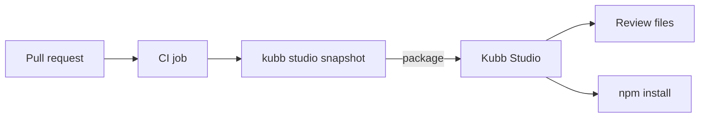

# Publish Kubb Studio snapshots from CI

A snapshot is an installable npm package of your generated code. `kubb studio snapshot` builds it on the CI runner, uploads it to [Studio](/docs/5.x/integrations/studio), and exits. Run it on pull or merge requests and on the default branch, so each request compares with the default branch.



## Prerequisites

- A working `kubb.config.ts` on Kubb 5.6.2 or later. See [Installation](/docs/5.x/how-to/installation).
- `tsdown` next to `kubb` in the development dependencies (`npm i -D tsdown`). Snapshots build their `dist` files with it.
- Two Studio API keys, created under **Settings › Developers › Tokens**:

| Key type | Store it as | Used for |
| --- | --- | --- |
| CI | `KUBB_TOKEN`, in a secret only trusted pipelines can read | Publishing snapshots |
| Registry | `KUBB_REGISTRY_TOKEN`, which `.npmrc` reads | [Installing a snapshot](#install-the-snapshot) |

## Supported providers

| Provider | Agent identity | Compares with the base branch | Setup |
| --- | --- | --- | --- |
| GitHub Actions | Detected | Detected | [GitHub Actions](/docs/5.x/integrations/github-actions) |
| GitLab CI | Detected | Detected | [GitLab CI](/docs/5.x/integrations/gitlab) |
| Bitbucket Pipelines, CircleCI | Detected | Pass `--base-id` | Run `kubb studio snapshot` with `KUBB_TOKEN` set |
| Other | Pass `--id` | Pass `--base-id` | [Other providers](#other-ci-providers) |

### Other CI providers

Without automatic detection, pass a stable `--id` on the base branch, and pass that id as `--base-id` on pull request runs:

```shell [Terminal]
kubb studio snapshot --id jenkins:api:main                              # on main
kubb studio snapshot --id jenkins:api:pr-12 --base-id jenkins:api:main  # on a pull request
```

To pass the tarball URL to another step, use `kubb studio snapshot --json | jq -r '.url'`. See [CI agent identity](/docs/5.x/reference/commands/studio#ci-agent-identity) and [Snapshot output](/docs/5.x/reference/commands/studio#snapshot-output) for every field.

## Review the snapshot

Studio has no diff view for snapshots. The GitHub Action lists the changed files in its comment, and `--json` reports them in `changes` and `branchChanges` on any provider.

Open the CI agent's editor in Studio to read its latest unexpired package, comment on source lines, or preview generated HTML, after the runner exits. Run the pipeline again to publish new output.

> [!NOTE]
> Snapshots expire after seven days. Schedule a default-branch run if the branch can go a week without a push.

## Install the snapshot

Add the registry key to `.npmrc`, then run the install command from the snapshot result:

```ini [.npmrc]
//kubb.studio/:_authToken=${KUBB_REGISTRY_TOKEN}
```

```shell [Terminal]
npm i https://kubb.studio/packages/<agent>/<package>.tgz
```

pnpm and Yarn install the same URL with the same `.npmrc`. Yarn 1 also needs the registry for the package's scope, or the install fails with HTTP 403:

```ini [.npmrc]
@<scope>:registry=https://kubb.studio/
```
