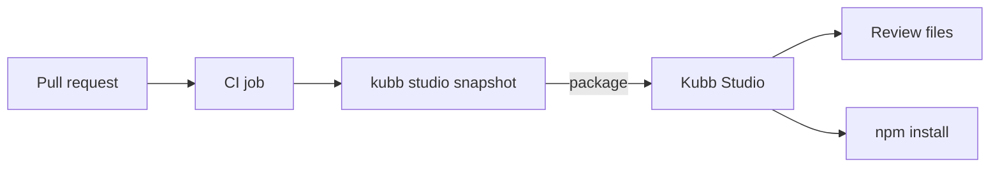

# Publish Kubb Studio snapshots from CI

A snapshot is an installable npm package of your generated code. `kubb studio snapshot` builds it on the CI runner, uploads it to [Studio](/docs/5.x/integrations/studio), and exits. Run it on pull or merge requests and on the default branch, so each request compares with the default branch.



## Prerequisites

- A working `kubb.config.ts` on Kubb 5.6.2 or later. See [Installation](/docs/5.x/how-to/installation).
- `tsdown` next to `kubb` in the development dependencies (`npm i -D tsdown`). Snapshots build their `dist` files with it.
- Two Studio API keys, created under **Settings › Developers › Tokens**:

| Key type | Store it as | Used for |
| --- | --- | --- |
| CI | `KUBB_TOKEN`, in a secret only trusted pipelines can read | Publishing snapshots |
| Registry | `KUBB_REGISTRY_TOKEN`, which `.npmrc` reads | [Installing a snapshot](#install-the-snapshot) |

## Supported providers

| Provider | Agent identity | Compares with the base branch | Setup |
| --- | --- | --- | --- |
| GitHub Actions | Detected | Detected | [Workflow](#github-actions) |
| GitLab CI | Detected | Detected | [Job](#gitlab) |
| Bitbucket Pipelines, CircleCI | Detected | Pass `--base-id` | Run `kubb studio snapshot` with `KUBB_TOKEN` set |
| Other | Pass `--id` | Pass `--base-id` | [Other providers](#other-ci-providers) |

### GitHub Actions {#github-actions}

Store `KUBB_TOKEN` as an Actions repository secret, then add this workflow:

```yaml [.github/workflows/kubb.yml]
name: Kubb snapshot

on:
  pull_request:
    # `closed` deletes the pull request's Studio agent. GitHub leaves it out by default.
    types: [opened, synchronize, reopened, closed]
  # A snapshot of main is what pull requests compare with.
  push:
    branches: [main]

permissions:
  contents: write
  pull-requests: write

jobs:
  snapshot:
    runs-on: ubuntu-latest
    steps:
      - uses: actions/checkout@v5
      - uses: kubb-labs/action@v0
        with:
          token: ${{ secrets.KUBB_TOKEN }}
```

| Permission | Lets the action |
| --- | --- |
| `pull-requests: write` | Post and update the snapshot comment. |
| `contents: write` | Open an initialization pull request when the repository has no Kubb config. Also turn on **Allow GitHub Actions to create and approve pull requests** under **Settings › Actions › General**. |

The pull request comment lists the generated files that changed against the base branch and against the previous run. See the [action reference](/docs/5.x/reference/github-actions) for inputs, outputs such as `tarball-url`, and runtime behavior.

### GitLab CI {#gitlab}

Store `KUBB_TOKEN` as a masked CI/CD variable and commit your npm lockfile. `npm ci` is then the only setup:

```yaml [.gitlab-ci.yml]
snapshot:
  stage: build
  image: node:22
  script:
    - npm ci
    - npx kubb studio snapshot
  rules:
    - if: $CI_MERGE_REQUEST_IID
    - if: $CI_COMMIT_BRANCH == $CI_DEFAULT_BRANCH
```

The `rules` run the job on merge requests and on the default branch, so a merge request has a target branch snapshot to compare with.

To post the result as a merge request note, save the `--json` output and run the script below. It updates one note per merge request and needs only Node:

```yaml [.gitlab-ci.yml]
  script:
    - npm ci
    - npx kubb studio snapshot --json > snapshot.json
    - '[ -z "$CI_MERGE_REQUEST_IID" ] || node scripts/kubb-note.mjs'
```

> [!IMPORTANT]
> Writing a note needs a project access token with the `api` scope, stored as `GITLAB_API_TOKEN`. `CI_JOB_TOKEN` does not carry that scope.

::code-collapse{name="scripts/kubb-note.mjs"}

```js [scripts/kubb-note.mjs]
import { readFileSync } from 'node:fs'

const snapshot = JSON.parse(readFileSync('snapshot.json', 'utf8'))
const marker = '<!-- kubb-snapshot -->'
const counts = (c) => `${c.added.length} added · ${c.changed.length} changed · ${c.removed.length} removed`
const lines = [marker, `Kubb snapshot: \`npm i ${snapshot.url}\``]

const { branchChanges: branch, changes } = snapshot
if (branch) {
  if (branch.base) lines.push(`Changes against \`${branch.branch}\`: ${counts(branch)}`)
  else if (branch.baseFound) lines.push(`No snapshot of \`${branch.branch}\` for this package yet`)
  else lines.push(`No snapshot of \`${branch.branch}\` to compare with`)
}
if (changes?.base) lines.push(`Changes since ${changes.base.commit?.slice(0, 7) ?? changes.base.createdAt}: ${counts(changes)}`)

const { CI_API_V4_URL, CI_PROJECT_ID, CI_MERGE_REQUEST_IID, GITLAB_API_TOKEN } = process.env
const notes = `${CI_API_V4_URL}/projects/${CI_PROJECT_ID}/merge_requests/${CI_MERGE_REQUEST_IID}/notes`
const headers = { 'PRIVATE-TOKEN': GITLAB_API_TOKEN, 'Content-Type': 'application/json' }
const existing = (await (await fetch(`${notes}?per_page=100`, { headers })).json()).find((note) => note.body.startsWith(marker))
const response = await fetch(existing ? `${notes}/${existing.id}` : notes, {
  method: existing ? 'PUT' : 'POST',
  headers,
  body: JSON.stringify({ body: lines.join('\n\n') }),
})
if (!response.ok) throw new Error(`GitLab answered ${response.status}`)
```

::

### Other CI providers

Without automatic detection, pass a stable `--id` on the base branch, and pass that id as `--base-id` on pull request runs:

```shell [Terminal]
kubb studio snapshot --id jenkins:api:main                              # on main
kubb studio snapshot --id jenkins:api:pr-12 --base-id jenkins:api:main  # on a pull request
```

To pass the tarball URL to another step, use `kubb studio snapshot --json | jq -r '.url'`. See [CI agent identity](/docs/5.x/reference/commands/studio#ci-agent-identity) and [Snapshot output](/docs/5.x/reference/commands/studio#snapshot-output) for every field.

## Review the snapshot

Studio has no diff view for snapshots. The GitHub Action lists the changed files in its comment, and `--json` reports them in `changes` and `branchChanges` on any provider.

Open the CI agent's editor in Studio to read its latest unexpired package, comment on source lines, or preview generated HTML, after the runner exits. Run the pipeline again to publish new output.

> [!NOTE]
> Snapshots expire after seven days. Schedule a default-branch run if the branch can go a week without a push.

## Install the snapshot

Add the registry key to `.npmrc`, then run the install command from the snapshot result:

```ini [.npmrc]
//kubb.studio/:_authToken=${KUBB_REGISTRY_TOKEN}
```

```shell [Terminal]
npm i https://kubb.studio/packages/<agent>/<package>.tgz
```

pnpm and Yarn install the same URL with the same `.npmrc`. Yarn 1 also needs the registry for the package's scope, or the install fails with HTTP 403:

```ini [.npmrc]
@<scope>:registry=https://kubb.studio/
```
