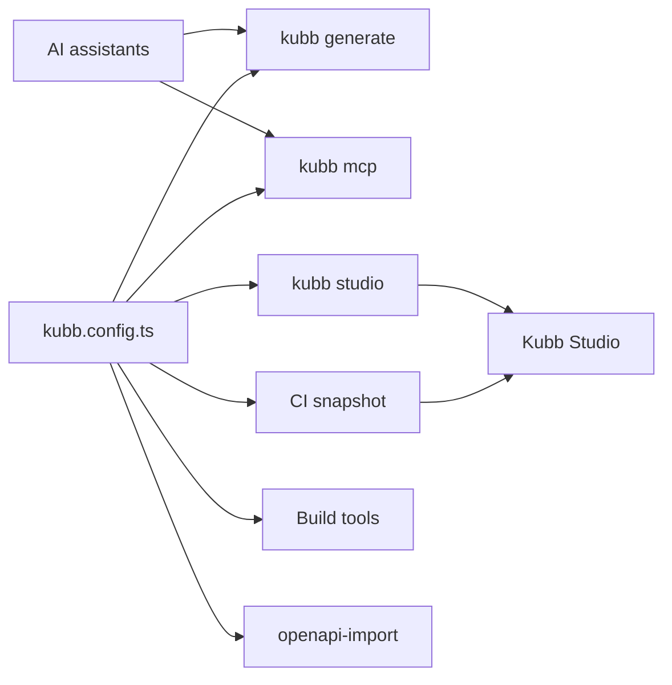

# Integrate Kubb with Studio, CI, and build tools

Every integration runs the same `kubb.config.ts`. You pick where Kubb runs.

## Pick an integration

::card-group

:::card{title="Kubb Studio" icon="i-iconoir-cube" to="/docs/5.x/integrations/studio"}
Connect a local project and review generated files in the browser.
:::

:::card{title="CI snapshots" icon="i-iconoir-git-merge" to="/docs/5.x/integrations/ci"}
Publish an installable package per pull request from GitHub Actions, GitLab CI, or any CI.
:::

:::card{title="Build tools" icon="i-iconoir-hammer" to="/docs/5.x/integrations/build-tools"}
Generate when a Vite, webpack, Rollup, Rolldown, Rspack, esbuild, Farm, Nuxt, or Astro build starts.
:::

:::card{title="openapi-import" icon="i-simple-icons-typescript" to="/docs/5.x/integrations/openapi-import"}
Import a `*.openapi.yaml` spec in TypeScript and type-check the plugin output, without generated files.
:::

:::card{title="AI assistants" icon="i-iconoir-sparks" to="/docs/5.x/ai"}
Run Kubb from Claude Code, Cursor, or another assistant through the CLI or the MCP server.
:::

::
