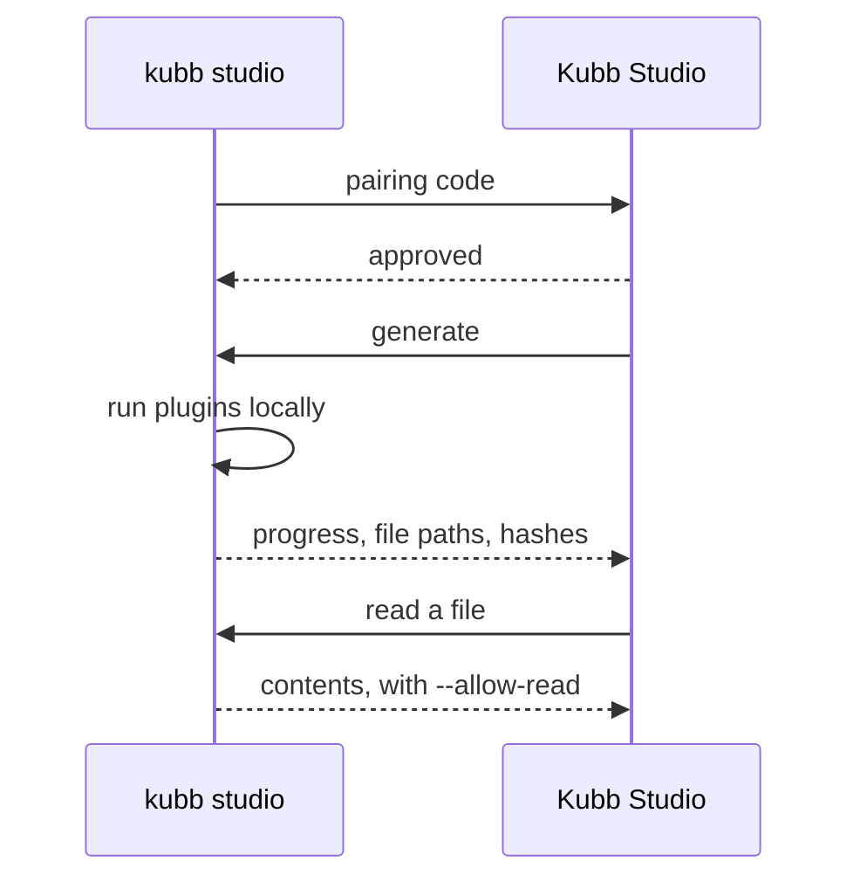

# Connect a project to Kubb Studio

[Kubb Studio](https://kubb.studio) generates and reviews a project's clients, types, schemas, hooks, and mocks from the browser. `kubb studio` connects your project as an agent: Studio sends the job, and generation runs on your machine.



`kubb studio` needs Kubb 5.11.6 or later. Studio refuses older agents. Pick the agent that fits:

| Agent | Runs on | Use it for |
| --- | --- | --- |
| `kubb studio` | Your machine | Your own project |
| [Docker agent](https://hub.docker.com/r/kubblabs/kubb-agent) | Your infrastructure | A team connection that stays up. An organization admin approves its pairing code. |
| Shared sandbox | Studio | A quick trial, with a spec you are fine sharing |
| `kubb studio snapshot` | CI | A package per pull request: [CI snapshots](/docs/5.x/integrations/ci) |

## Connect your project

Run this from the project directory:

```shell [Terminal]
kubb studio
```

Approve the pairing code in Studio and answer the permission prompts. Keep the command running, select the agent in Studio, and generate. Each project directory pairs as its own agent.

## Choose permissions {#permissions}

Every permission is off by default. Without any, Studio sees file paths, progress, and a hash of each generated file, and the agent never uploads a local spec. The CLI remembers your answers per project.

| Flag | Lets Studio |
| --- | --- |
| `--allow-read` | Read generated file contents and diffs. |
| `--allow-read-ast` | Read the spec as Kubb parsed it. |
| `--allow-write` | Write generated files to your output folder. |
| `--allow-exec` | Run the formatter, the linter, and `output.postGenerate`. Needs `--allow-write` too. |

See [Permissions](/docs/5.x/reference/commands/studio#permissions) for every flag, such as `--allow-config-edit`.

## Review and save generated files

Connect with both flags to view contents and diffs, then write the files to disk:

```shell [Terminal]
kubb studio --allow-read --allow-write
```

- Without `--allow-write`, a generation stages its files in a temporary folder and leaves your output folder unchanged.
- With `--allow-read`, Studio opens your existing output before you generate, so line comments and HTML previews work at once. Each later generation compares with the previous one.
- The agent keeps recent generations in `node_modules/.cache/kubb`. See [Environment variables](/docs/5.x/reference/commands#environment-variables) for the limits.

## Keep an agent running in the background

```shell [Terminal]
kubb studio start --allow-read   # pair if needed, then connect in the background
kubb studio status               # check that the worker is connected
kubb studio stop                 # end the background connection
```

See [Background connection](/docs/5.x/reference/commands/studio#background-connection) for worker states, logs, and restarts.

> [!IMPORTANT]
> Without a TTY, the CLI skips the permission prompts, so pass the flags the run needs. In CI it does not pair either: use [`kubb studio snapshot`](/docs/5.x/integrations/ci) with a CI API key there.

## Give your AI tools your API

On the Pro plan, Studio turns an agent's OpenAPI spec into a plugin for Claude Code, Cursor, and Codex. Its skills list the API's servers, authentication, operations, and schemas. Your organization gets one marketplace, with one plugin per published agent.

1. Connect the agent with `--allow-read-ast` and generate. Studio reads the spec of the latest successful generation.
2. In Studio, open **Settings › your organization › AI**, select **Publish an agent**, and choose the agent.
3. Create a token of type **AI (read-only)** under **Settings › Developers › Tokens**. A registry key does not work. Git asks for this key as the password, with any username.
4. Add the marketplace once, then install the plugin for each API:

:::code-group{sync="ai-tool"}

```shell [Claude Code]
claude plugin marketplace add https://kubb.studio/plugins/<organization-slug>.git
claude plugin install <plugin>@<marketplace>
```

```shell [Cursor]
agent plugin marketplace add https://kubb.studio/plugins/<organization-slug>.git
# Then start the Cursor CLI, run /plugin, and install the plugin from the Marketplace tab.
```

```shell [Codex]
codex plugin marketplace add https://kubb.studio/plugins/<organization-slug>.git
# Then start codex, run /plugins, and select Install plugin.
```

:::

Studio shows the exact commands for each plugin. After the spec changes, republish the agent and update the marketplace in your tool.

> [!WARNING]
> An AI key in the URL, such as `https://kubb:<key>@kubb.studio/...`, works in CI but ends up in shell history and logs.
