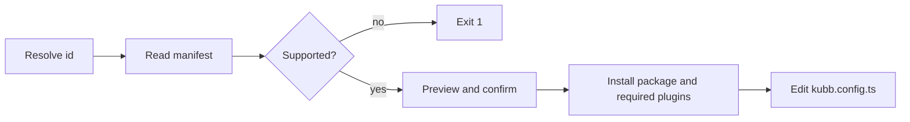

# kubb add

`kubb add` installs an extension at the version the registry pins. It adds a plugin or parser to your `kubb.config.ts`. For an adapter, it prints the code you add by hand.

Ids, versions, and project files work as in [Extension commands](/docs/5.x/reference/commands#extension-commands).

```shell [Terminal]
kubb add                             # search the registry
kubb add plugin-zod                  # an official plugin by slug
kubb add acme/plugin-graphql --yes   # a community plugin, no prompt
kubb add plugin-zod --no-install     # edit the config only
```



## Arguments

| Argument | What it does |
| --- | --- |
| `[id]` | The [registry id](/docs/5.x/reference/commands#ids). Without it, you [pick an extension](#add-search). |

## Pick an extension {#add-search}

Without an id, `kubb add` lists the registry. Type to filter on the id, display name, and description. You cannot pick an installed extension.

## Preview and summary {#add-preview}

Before it asks, the CLI shows the required plugins, the packages it installs, and the config lines it adds:

```text [Output]
◇  Plugin plugin-faker v5.3.2 · Generates a Faker.js mock-data factory for every schema in your…
│  Needs     plugin-ts ✓ installed
│  Installs  @kubb/plugin-faker@5.3.2
│  Config    kubb.config.ts
│    + import { pluginFaker } from '@kubb/plugin-faker'
│    + plugins: [pluginTs(), pluginFaker()],
◆  Add it?
```

After the install, the summary title gives the outcome. If it says `Plugin needs configuration`, add the printed snippet to the config by hand. See [Command output](#command-output).

## Required plugins {#add-required-plugins}

When the manifest lists `dependencies` that `kubb.config.ts` lacks, the CLI asks whether to add them too:

| Answer | Result |
| --- | --- |
| `Yes, add both` or `Yes, add all` | Installs them and adds them next to the extension. |
| `Only <name>` | Adds the extension alone. `kubb generate` fails until you add the rest. |

`--yes` adds them.

## Config changes {#add-config}

| Extension | Change |
| --- | --- |
| Plugin | Adds its import and a call at the end of the `plugins` array. |
| Parser | Adds its import and a call at the end of the `parsers` array. Without `parsers`, it also writes the defaults `parserTs()`, `parserTsx()`, and `parserMd()`. |
| Adapter | Changes nothing. The CLI prints the import and the `adapter` line to add by hand. |

> [!WARNING]
> When the CLI cannot edit the config, such as when `plugins` is not an array literal, it prints `Could not edit <file>: <reason>` and the snippet to add by hand, then exits with code 1. See [Config edits](#config-edits).

## Options {#options}

| Flag | Alias | Default | What it does |
| --- | --- | --- | --- |
| `--config <path>` | `-c` | | Path to the Kubb config to edit. |
| `--yes` | `-y` | `false` | Skip the confirmation and add the required plugins. Needs an id. |
| `--no-install` | | | Edit the config only. A plugin or parser is still added. |
| `--dry-run` | | `false` | Show what the command would install or write, then stop. |

> [!TIP]
> Pass `--yes` in scripts and CI, where no one can answer the prompt.

## Exit codes {#exit-codes}

| Code | When |
| --- | --- |
| `0` | The extension is added, or you canceled a prompt. |
| `1` | The id is invalid, unknown, or missing with `--yes`. |
| `1` | The registry cannot be read, or the extension does not support your Kubb or Node.js version. |
| `1` | No config is found for a plugin or parser, the install fails, or the config edit fails. |

## Less common cases {#less-common-cases}

### Command output {#command-output}

After the install, the summary lists the packages, the added calls, the next step (`kubb generate`), and the extension's options page. Its title gives the outcome.

| Summary title | When |
| --- | --- |
| `Plugin ready` | Installed and added to the config. |
| `Plugin configured` | Added to the config with `--no-install`. |
| `Plugin already configured` | The plugin was already in the config. |
| `Plugin needs configuration` | Installed, but the config needs a manual change. The CLI prints the snippet. |
| `Plugin configured; dependencies missing` | Added without the required plugins you declined. |

Adapters and parsers say `Adapter` and `Parser` instead, except in `Plugin configured; dependencies missing`, which every kind uses.

Without an id, `kubb add` lists the registry. An installed extension shows `installed` and cannot be picked.

### Config edits {#config-edits}

When `kubb add` cannot write the extension into the config, it prints a snippet. Add its import and call to the config, then run `kubb generate`.

- An extension already in its array is left alone.
- The CLI cannot edit the config when `plugins` is not an array literal, or the export name is already imported from another module. The CLI then prints `Could not edit <file>: <reason>` and the snippet, and exits with code 1.
- An adapter is never written, so its manual snippet does not set exit code 1.
