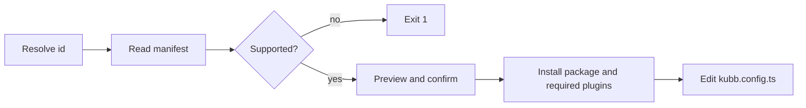

# kubb add

`kubb add` installs an extension at the version the registry pins. For a plugin or parser, it also adds it to `kubb.config.ts`. For an adapter, it prints the code to add.

Ids, versions, and the project files it reads work the same for every extension command: see [Extension commands](/docs/5.x/reference/commands#extension-commands).



```shell [Terminal]
kubb add                             # search the registry
kubb add plugin-zod                  # an official plugin by slug
kubb add acme/plugin-graphql --yes   # a community plugin, no prompt
kubb add plugin-zod --no-install     # edit the config only
```

| Argument or option | Description |
| --- | --- |
| `[id]` | The [registry id](/docs/5.x/reference/commands#ids). Without it, the CLI lets you search the registry. |
| `--no-install` | Do not install the package. A plugin or parser is still added to the config. |

## Pick an extension {#add-search}

Without an id, `kubb add` lists the registry by id. Typing filters on the id, display name, and description. An installed extension shows `installed` and cannot be picked.

## Preview and summary {#add-preview}

Before it asks, the CLI shows the required plugins, the packages it installs, and the config lines it adds:

```text [Output]
◇  Plugin plugin-faker v5.3.2 · Generates a Faker.js mock-data factory for every schema in your…
│  Needs     plugin-ts ✓ installed
│  Installs  @kubb/plugin-faker@5.3.2
│  Config    kubb.config.ts
│    + import { pluginFaker } from '@kubb/plugin-faker'
│    + plugins: [pluginTs(), pluginFaker()],
◆  Add it?
```

After the install, the summary lists the packages, the calls it added, the next step (`kubb generate`), and the extension's options page. Its title tells you the outcome:

| Summary title | When |
| --- | --- |
| `Plugin ready` | Installed and added to the config. |
| `Plugin configured` | Added to the config with `--no-install`. |
| `Plugin already configured` | The plugin was already in the config. |
| `Plugin needs configuration` | Installed, but the config needs a manual change. The CLI prints the snippet to add. |
| `Plugin configured; dependencies missing` | Added without the required plugins you declined. |

Adapters and parsers use `Adapter` and `Parser` in these titles.

## Required plugins {#add-required-plugins}

When the manifest lists `dependencies` that are not in `kubb.config.ts`, the CLI asks whether to add them too. `Yes, add both` (or `Yes, add all`) installs and adds them next to the extension. `Only <name>` adds the extension alone, and `kubb generate` fails until you add the rest. `--yes` adds them.

## Config changes {#add-config}

| Extension | Change |
| --- | --- |
| Plugin | Adds its import and a call at the end of the `plugins` array. |
| Parser | Adds its import and a call at the end of the `parsers` array. When the config has no `parsers`, it also writes the defaults `parserTs()`, `parserTsx()`, and `parserMd()`. |
| Adapter | Changes nothing. The CLI prints the import and the `adapter` line to add by hand. |

An extension already in its array is left alone. When the config cannot be edited, such as when `plugins` is not an array literal or the export name is already imported from another module, the CLI prints `Could not edit <file>: <reason>` and the snippet to add by hand, then exits with code 1.

## Options {#options}

| Option | Default | Description |
| --- | --- | --- |
| `--config <path>`, `-c` | | Path to the Kubb config to edit. |
| `--yes`, `-y` | `false` | Skip the confirmation. `add --yes` needs an id. |
| `--dry-run` | `false` | Show what the command would install or write, then stop. Nothing changes. |

> [!TIP]
> Pass `--yes` in scripts and CI, where no one can answer the prompt.

## Exit codes {#exit-codes}

It exits with code 0 on success and when you cancel a prompt. It exits with code 1 when the id is invalid, unknown, or missing with `--yes`; the registry is unreadable; the extension does not support your Kubb or Node.js version; no config is found for a plugin or parser; the install fails; or the config edit fails.
