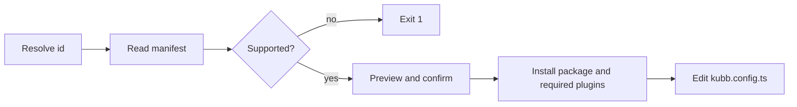

# kubb add, update, list, remove

These commands manage the plugins, adapters, and parsers a project installs from the [Kubb registry](/docs/5.x/reference/registry). Each one installs the version the registry pins.

| Command | What it does | Edits the config |
| --- | --- | --- |
| [`kubb add [id]`](#add) | Install an extension and add a plugin or parser to the config. | Yes |
| [`kubb update [ids...]`](#update) | Move installed extensions to the pinned version, then offer to regenerate. | No |
| [`kubb list`](#list) | Show installed extensions, their versions, and available updates. | No |
| [`kubb remove <id>`](#remove) | Delete a plugin or parser from the config and uninstall its package. | Yes |

## Shared behavior {#shared}

### Registry ids {#ids}

An id is `<owner>/<slug>`, such as `acme/plugin-graphql`. A bare `<slug>`, such as `plugin-zod`, means `kubb-labs/<slug>`. Both parts use lowercase letters and digits joined by single hyphens. Another shape is an error.

When `add` or `remove` gets an id the registry does not list, it prints `No extension named <id>` and up to three close ids as commands to run. `add` also links to [kubb.dev/extensions](https://kubb.dev/extensions).

### Versions and compatibility {#versions}

| Pinned to | Installs as |
| --- | --- |
| An npm version | `<package>@<version>` |
| A GitHub release | `github:<owner>/<repo>#<commit>` |

`add` and `update` refuse an extension that does not support the running Kubb or Node.js version. The registry comes from [`KUBB_REGISTRY`](/docs/5.x/reference/commands#environment-variables), `https://kubb.dev/registry` by default.

### Project files {#project-files}

| What | How the commands find it |
| --- | --- |
| Installed extensions | The `dependencies` and `devDependencies` of the `package.json` in the current folder. |
| Config file | `--config`, or the first `.kubbrc` or `kubb.config` file (`.ts`, `.mts`, `.cts`, `.js`, `.mjs`, `.cjs`) in the current folder, its `.config/` and `configs/` folders, then each parent folder, the same search as `kubb generate`. With several config entries, `add` and `remove` edit the first one. |
| Package manager | The `packageManager` field in `package.json`, then a lockfile, in the current folder. Falls back to `npm`. `npm`, `pnpm`, `yarn`, and `bun` are supported. `add` and `update` install packages as dev dependencies. |

### Options {#options}

| Option | Commands | Default | Description |
| --- | --- | --- | --- |
| `--config <path>`, `-c` | `add`, `remove` | | Path to the Kubb config to edit. |
| `--yes`, `-y` | `add`, `update`, `remove` | `false` | Skip the confirmation. `add --yes` needs an id. |
| `--dry-run` | `add`, `update`, `remove` | `false` | Show what the command would install, uninstall, or write, then stop. Nothing changes. |

> [!TIP]
> Pass `--yes` in scripts and CI, where no one can answer the prompt.

### Exit codes {#exit-codes}

Each command exits with code 0 on success and when you cancel a prompt.

| Command | Exits with code 1 when |
| --- | --- |
| `add` | The id is invalid, unknown, or missing with `--yes`; the registry is unreadable; the extension does not support your Kubb or Node.js version; no config is found for a plugin or parser; the install fails; or the config edit fails. |
| `update` | An id is invalid or not installed; a named extension's update is not compatible; the registry is unreadable; or the install fails. |
| `list` | `KUBB_REGISTRY` is not an `http://` or `https://` URL. An unreachable registry does not fail it. |
| `remove` | The id is invalid or unknown; no config is found; the extension cannot be removed; or the uninstall fails. |

## kubb add {#add}

`kubb add` installs an extension at the version the registry pins. For a plugin or parser, it also adds it to `kubb.config.ts`. For an adapter, it prints the code to add.



```shell [Terminal]
kubb add                             # search the registry
kubb add plugin-zod                  # an official plugin by slug
kubb add acme/plugin-graphql --yes   # a community plugin, no prompt
kubb add plugin-zod --no-install     # edit the config only
```

| Argument or option | Description |
| --- | --- |
| `[id]` | The [registry id](#ids). Without it, the CLI lets you search the registry. |
| `--no-install` | Do not install the package. A plugin or parser is still added to the config. |

`--config`, `--yes`, and `--dry-run` work as in [Options](#options).

### Pick an extension {#add-search}

Without an id, `kubb add` lists the registry by id. Typing filters on the id, display name, and description. An installed extension shows `installed` and cannot be picked.

### Preview and summary {#add-preview}

Before it asks, the CLI shows the required plugins, the packages it installs, and the config lines it adds:

```text [Output]
◇  Plugin plugin-faker v5.3.2 · Generates a Faker.js mock-data factory for every schema in your…
│  Needs     plugin-ts ✓ installed
│  Installs  @kubb/plugin-faker@5.3.2
│  Config    kubb.config.ts
│    + import { pluginFaker } from '@kubb/plugin-faker'
│    + plugins: [pluginTs(), pluginFaker()],
◆  Add it?
```

After the install, the summary lists the packages, the calls it added, the next step (`kubb generate`), and the extension's options page. Its title tells you the outcome:

| Summary title | When |
| --- | --- |
| `Plugin ready` | Installed and added to the config. |
| `Plugin configured` | Added to the config with `--no-install`. |
| `Plugin already configured` | The plugin was already in the config. |
| `Plugin needs configuration` | Installed, but the config needs a manual change. The CLI prints the snippet to add. |
| `Plugin configured; dependencies missing` | Added without the required plugins you declined. |

Adapters and parsers use `Adapter` and `Parser` in these titles.

### Required plugins {#add-required-plugins}

When the manifest lists `dependencies` that are not in `kubb.config.ts`, the CLI asks whether to add them too. `Yes, add both` (or `Yes, add all`) installs and adds them next to the extension. `Only <name>` adds the extension alone, and `kubb generate` fails until you add the rest. `--yes` adds them.

### Config changes {#add-config}

| Extension | Change |
| --- | --- |
| Plugin | Adds its import and a call at the end of the `plugins` array. |
| Parser | Adds its import and a call at the end of the `parsers` array. When the config has no `parsers`, it also writes the defaults `parserTs()`, `parserTsx()`, and `parserMd()`. |
| Adapter | Changes nothing. The CLI prints the import and the `adapter` line to add by hand. |

An extension already in its array is left alone. When the config cannot be edited, such as when `plugins` is not an array literal or the export name is already imported from another module, the CLI prints `Could not edit <file>: <reason>` and the snippet to add by hand, then exits with code 1.

## kubb update {#update}

`kubb update` moves installed extensions to the version the registry pins. It shows each version change, asks which updates to install, installs them, then offers to regenerate. It never changes `kubb.config.ts` and never downgrades.

```shell [Terminal]
kubb update                              # check every installed extension
kubb update --dry-run                    # list updates, install nothing
kubb update plugin-zod plugin-ts --yes   # two extensions, no prompt
```

| Argument | Description |
| --- | --- |
| `[ids...]` | The [registry ids](#ids) to update. Without ids, every installed extension the registry lists is checked. |

`--yes` and `--dry-run` work as in [Options](#options). With `--yes`, it installs every update except majors you did not name, and does not regenerate.

```text [Output]
◇  Checked 3 extensions against the registry
│  Extension         Current  Latest
│  @kubb/plugin-ts   5.0.0    5.2.0       minor
│  @kubb/plugin-zod  5.2.0    6.0.0       major · breaking
│  @kubb/plugin-msw  5.4.2    up to date
│
◆  Select the updates to install
│  ◼ @kubb/plugin-ts (5.0.0 → 5.2.0)
│  ◻ @kubb/plugin-zod (5.2.0 → 6.0.0)
│  ↑/↓ to navigate • Space: select • Enter: confirm
```

Minor and patch updates start selected. A major starts unselected, since it can break the generated code, unless you named its id.

After the install, `kubb update` finds the config the way [`kubb generate`](/docs/5.x/reference/commands/generate) does and asks whether to regenerate, since that rewrites the generated files. The summary lists the installed and skipped packages and the files that changed.

### Which extensions it updates {#update-scope}

An extension gets an update when its installed version is older than the pinned one, or when `package.json` lists it but it is not installed.

| Case | Result |
| --- | --- |
| An update does not support your Kubb or Node.js version | Skipped with `Skipped <id>: <reason>`. |
| A named id matches no installed extension | `<id> is not installed, or not in the registry.` The other ids still update, and the exit code is 1. |
| Nothing is outdated | The summary says `Already up to date`. |
| The generation after the install fails | The summary says `Extensions updated; generation failed`. The exit code stays 0. |

## kubb list {#list}

`kubb list` shows the extensions installed in the current project, the version the registry pins for each, and whether an update exists. It takes no arguments or options.

```shell [Terminal]
kubb list
```

```text [Output]
ID                    PACKAGE                    INSTALLED  REGISTRY  UPDATE
kubb-labs/plugin-ts   @kubb/plugin-ts            5.4.2      5.4.4     yes
kubb-labs/plugin-zod  @kubb/plugin-zod           5.4.4      5.4.4     no
-                     @acme/kubb-plugin-graphql  1.0.0      -         no
```

| Column | Description |
| --- | --- |
| `ID` | The registry id, or `-` when the registry does not list the package. |
| `PACKAGE` | The npm package name. |
| `INSTALLED` | The installed version, or `-` when the package is not installed. |
| `REGISTRY` | The version the registry pins, or `-` when the registry does not list the package. |
| `UPDATE` | `yes` when the installed version is older than the pinned one, or unknown. Run [`kubb update`](#update) to install it. |

It lists each package in `package.json` that ships a valid [`kubb-extension.json`](/docs/5.x/reference/kit/manifest) or is in the registry. Extensions that ship inside `kubb`, such as `@kubb/adapter-oas` and `@kubb/plugin-barrel`, appear only when `package.json` lists them directly.

When the registry cannot be read, it prints `Showing installed extensions only: <reason>` and lists the packages that ship a manifest. When it finds nothing, it prints `No installed extensions found.`

## kubb remove {#remove}

`kubb remove` deletes a plugin or parser from `kubb.config.ts` and uninstalls its package. It shows the lines it removes and asks first.

```shell [Terminal]
kubb remove plugin-zod                  # remove and uninstall
kubb remove plugin-zod --no-uninstall   # keep the package installed
```

| Argument or option | Description |
| --- | --- |
| `<id>` | The [registry id](#ids). Required. |
| `--no-uninstall` | Edit the config only and keep the package installed. |

`--config`, `--yes`, and `--dry-run` work as in [Options](#options).

```text [Output]
◇  Plugin plugin-zod v5.13.0
│  Config    kubb.config.ts
│    - import { pluginZod } from '@kubb/plugin-zod'
│    - pluginZod({ output: { path: 'zod' } }),
│  Uninstalls @kubb/plugin-zod
│
◆  Remove it?
```

The command removes the call, also when Kubb Studio switched it off, and drops the unused import. It leaves the plugin's generated files on disk. With [`output.clean`](/docs/5.x/reference/configuration#outputclean), the next `kubb generate` removes them.

| It refuses to remove | Because |
| --- | --- |
| The adapter | A config needs one. Change it by hand. |
| The last parser | A config needs at least one. |
| An extension another plugin in the config depends on | Remove that plugin first. |

`@kubb/adapter-oas`, `@kubb/parser-ts`, `@kubb/parser-md`, and `@kubb/plugin-barrel` ship with `kubb`. They leave the config but stay installed. A package that another config entry still imports also stays installed. When the extension is not in the project, the command changes nothing and exits with code 0.
