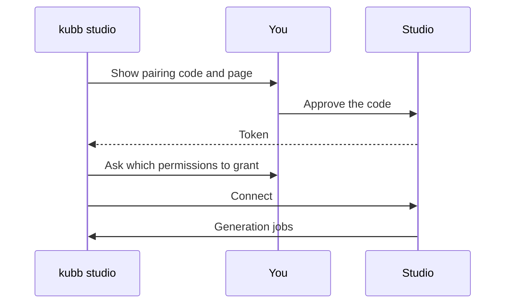
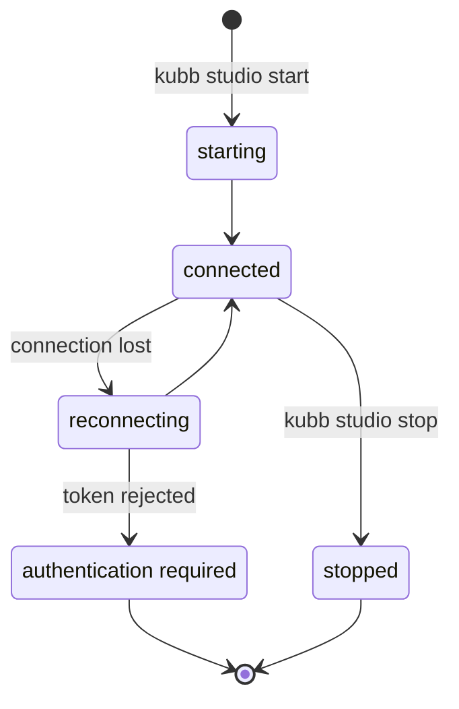

# kubb studio

`kubb studio` connects a project to [Kubb Studio](https://kubb.studio). The CLI generates on your machine and sends progress and file paths to Studio. Grant [permissions](#permissions), such as `--allow-read` for file contents, to share more.

```shell [Terminal]
kubb studio
```

## Pair the machine

On the first run, the CLI pairs the machine:



- Approve the code before it expires. The CLI copies it to the clipboard when it can.
- The permission list starts unchecked. The CLI remembers your answers per project folder.
- Each job logs one line: time, command, requester, and result. Steps and diagnostics stay in Studio.
- Press `b` to move the session to the background worker, like `kubb studio start`.

## Actions

The first argument picks the action, `connect` by default.

| Action | What it does |
| --- | --- |
| `connect` | Holds a foreground session open and generates on request |
| `start` | Resolves pairing and permissions, then connects in the background |
| `stop` | Stops the background worker and keeps its pairing |
| `login` | Pairs this machine again without a session. Saved permissions reset. |
| `logout` | Stops the worker and forgets this project's token |
| `status` | Shows pairing, worker state, permissions, and the log path, each with the command that changes it |
| `permissions` | Changes saved permissions without pairing again. Needs an interactive terminal. |
| `snapshot` | Generates, packs, and uploads a snapshot, then exits. See [Publish snapshots from CI](/docs/5.x/integrations/ci). |

## Background connection

Run `start`, `status`, and `stop` from the same project folder. `start` asks its questions, then returns while the worker connects. `status` reports its state:



- One worker owns a project. Stop it before a foreground `connect`.
- The worker survives a closed terminal and retries temporary failures. Start it again after a crash or reboot.
- When its token is rejected, run `kubb studio login`, then `kubb studio start`.
- To change the URL or config, stop the worker and start it with the new flags.

> [!WARNING]
> Flags only add permissions. To turn one off, run `kubb studio permissions`, then restart without that `--allow-*` flag. A running connection keeps the old permissions until it restarts.

### Credentials

Credentials, worker state, and the worker log live in [`KUBB_HOME`](/docs/5.x/reference/commands#environment-variables), `~/.kubb` by default. See [Studio credentials](/docs/5.x/topics/studio-and-ci#studio-credentials).

## Options

`connect`, `start`, and `login` take the connection and permission flags. `status` takes `--url` only, and `snapshot` has its own set.

### Connection

| Flag | Alias | Default | What it does |
| --- | --- | --- | --- |
| `--config <path>` | `-c` | | Config file path, such as `./kubb.staging.ts` |
| `--url <url>` | | `https://kubb.studio` | Studio URL. Plain `http://` works only for `localhost`, `127.0.0.1`, or `[::1]`. |
| `--no-open` | | | Skips opening the approval page |
| `--log-level <level>` | `-l` | `info` | `silent`, `info`, or `verbose` |

### Permissions {#permissions}

Each permission is off by default. The CLI asks once per project for each one you do not pass. Without a TTY it skips the questions, so pass the flags the run needs.

| Flag | Lets Studio |
| --- | --- |
| `--allow-read` | Read generated file contents |
| `--allow-read-ast` | Read the parsed spec (the Kubb AST) |
| `--allow-write` | Write generated files to disk |
| `--allow-config-edit` | Change plugin options in `kubb.config.ts` |
| `--allow-install` | Install extensions with `kubb add`. Needs `--allow-config-edit`. |
| `--allow-update` | Update extensions with `kubb update`, leaving the config as is |
| `--allow-remove` | Remove extensions with `kubb remove`. Needs `--allow-config-edit`. |
| `--allow-save-input` | Save the spec it sends and point `input` at it. Needs `--allow-config-edit`. |
| `--allow-file-refs` | Let a `$ref` read a local file outside the project |
| `--allow-exec` | Run the formatter, the linter, and `output.postGenerate` |

See [Studio permissions](/docs/5.x/topics/studio-and-ci#studio-permissions) for what each one changes.

### Snapshot

`snapshot` takes `--config`, `--url`, `--log-level`, and these flags, but no `--allow-*` flag.

| Flag | Default | What it does |
| --- | --- | --- |
| `--token <key>` | `KUBB_TOKEN` | Organization CI API key |
| `--id <id>` | Detected | Stable CI agent identity |
| `--base-id <id>` | Detected | Another CI agent's `--id` to also compare with, such as the base branch's |
| `--name <name>` | From `package.json` | Tarball package name, from the nearest `package.json` with a name and version |
| `--package-version <version>` | From `package.json` | Tarball package version, from the same `package.json` |
| `--json` | `false` | Prints the result as one JSON object |

`snapshot` generates like `kubb generate`, then runs the formatter, the linter, and `output.postGenerate`. It refuses a tarball over 50 MB. In CI, the CLI refuses to pair and needs stored credentials, so use `snapshot` there.

> [!IMPORTANT]
> `snapshot` builds the package's `dist` files with `tsdown`. Install it first: `npm i -D tsdown`.

## Snapshot output

`--json` prints one object with the snapshot's id, version, URLs, and comparisons. See [CI snapshots](/docs/5.x/topics/studio-and-ci#studio-ci-snapshots) for its fields.

## CI agent identity

`snapshot` detects GitHub Actions, GitLab CI, Bitbucket Pipelines, and CircleCI. Other providers need a stable `--id`. See [CI agent identity](/docs/5.x/topics/studio-and-ci#studio-ci-snapshots).

## Plugins in Studio {#plugins-in-studio}

Studio builds its plugin list and option forms from [extension manifests](/docs/5.x/reference/kit/manifest). A third-party plugin works once it is installed and ships a manifest with `kind: "plugin"`, without a registry entry. Install it with your package manager or [`kubb add`](/docs/5.x/reference/commands/add), then reconnect.

> [!NOTE]
> The agent imports only `@kubb/plugin-*` packages and installed packages whose manifest has `kind: "plugin"`. It refuses any other package name before importing anything.

See [Studio agent](/docs/5.x/topics/studio-and-ci#studio-agent) for where the agent finds extensions.

## Exit codes

| Code | When |
| --- | --- |
| `0` | The action succeeds. |
| `1` | The action fails. |
