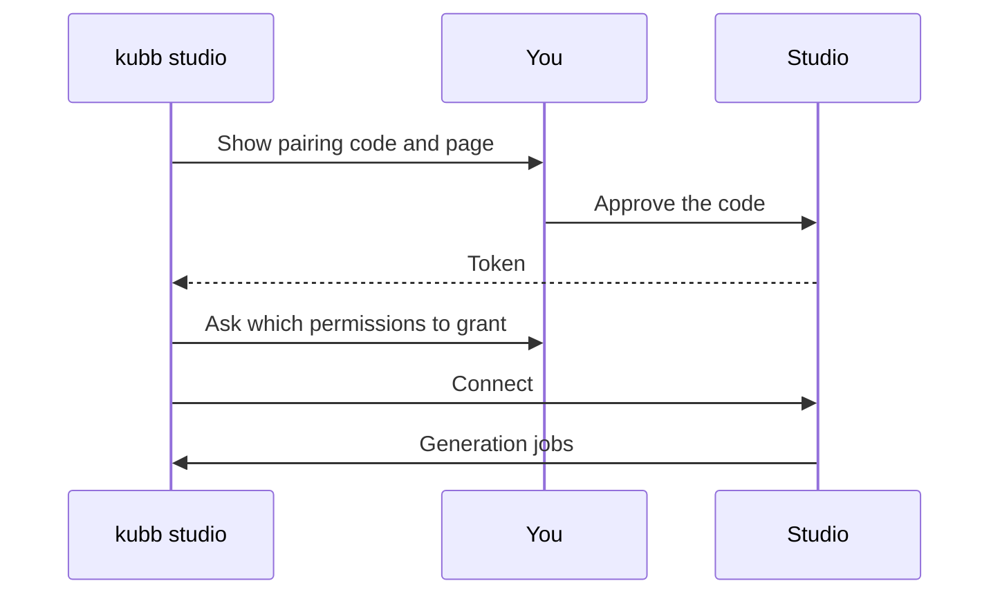
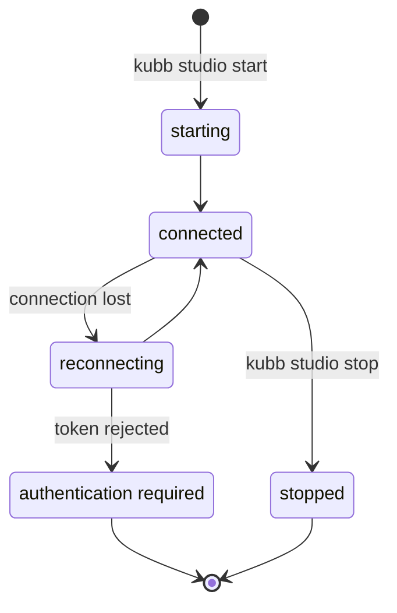

# kubb studio

`kubb studio` connects a project to [Kubb Studio](https://kubb.studio). The CLI runs generation on your machine and sends progress and generated file paths to Studio. Grant `--allow-read` to show file contents and diffs in the browser, and `--allow-read-ast` to share the parsed spec.

```shell [Terminal]
kubb studio
```

## Pair the machine

On the first run, the CLI pairs the machine:



- Approve the code before it expires. The CLI copies it to the clipboard when it can.
- The permission list starts with nothing checked. The CLI remembers your answers per project folder.
- Each job logs one line: the time, the command, who asked for it, and the result. Its steps and diagnostics stay in Studio.
- Press `b` to move the session to the background worker, the same as `kubb studio start`.

## Actions

The first argument picks the action. It defaults to `connect`.

| Action | What it does |
| --- | --- |
| `connect` | Hold a foreground session open and generate on request. |
| `start` | Resolve pairing and permissions, then connect in the background. |
| `stop` | Stop the background worker and keep its pairing. |
| `login` | Pair this machine again without opening a session. Saved permissions reset. |
| `logout` | Stop the background worker and forget this project's stored token. |
| `status` | Show pairing, worker state, saved permissions, and the log path, each with the command that changes it. |
| `permissions` | Change this project's saved permissions without pairing again. Needs an interactive terminal. |
| `snapshot` | Generate, pack, and upload a snapshot, then exit. See [Publish snapshots from CI](/docs/5.x/integrations/ci). |

## Background connection

Run `start`, `status`, and `stop` from the same project folder. `start` asks the pairing and permission questions, then returns while the worker connects. `status` reports the worker's state:



- One worker owns a project. Stop it before you use foreground `connect`.
- The worker survives a closed terminal and retries temporary connection failures. Start it again after a crash or reboot.
- When its token is rejected, run `kubb studio login`, then `kubb studio start`.
- To change the URL or config, stop the worker and start it with the new flags.

> [!WARNING]
> Flags only add permissions. To turn one off, run `kubb studio permissions`, then restart the connection without that `--allow-*` flag, since a flag grants it anyway. A running connection keeps the old permissions until you restart it.

### Credentials

The CLI keeps credentials, worker state, and the worker log in [`KUBB_HOME`](/docs/5.x/reference/commands#environment-variables), `~/.kubb` by default. `status` prints the log path. See [Studio credentials](EDGE:studio-credentials).

## Options

`connect`, `start`, and `login` take the connection and permission flags. `status` takes `--url` only, and `snapshot` takes its own set.

### Connection

| Flag | Alias | Default | What it does |
| --- | --- | --- | --- |
| `--config <path>` | `-c` | | Path to a config file, such as `./kubb.staging.ts`. |
| `--url <url>` | | `https://kubb.studio` | URL of Kubb Studio. Plain `http://` works only for `localhost`, `127.0.0.1`, or `[::1]`. |
| `--no-open` | | | Do not open the approval page in a browser. |
| `--log-level <level>` | `-l` | `info` | `silent`, `info`, or `verbose`. |

### Permissions {#permissions}

Each permission is off by default. The CLI asks once per project for each one you do not pass as a flag. Without a TTY it skips the questions, so pass the flags the run needs.

| Flag | Lets Studio |
| --- | --- |
| `--allow-read` | Read generated file contents. |
| `--allow-read-ast` | Read the parsed spec (the Kubb AST). |
| `--allow-write` | Write generated files to disk. |
| `--allow-config-edit` | Change plugin options in `kubb.config.ts`. |
| `--allow-install` | Install extensions with `kubb add`. Grant `--allow-config-edit` too. |
| `--allow-update` | Update installed extensions with `kubb update`. The config stays as it is. |
| `--allow-remove` | Remove extensions with `kubb remove`. Grant `--allow-config-edit` too. |
| `--allow-save-input` | Save the spec it sends and point `input` at it. Grant `--allow-config-edit` too. |
| `--allow-file-refs` | Let a `$ref` in the spec read a local file outside the project. |
| `--allow-exec` | Run the formatter, the linter, and `output.postGenerate`. |

Without `--allow-read`, Studio shows the generated file paths but not their contents. See [Studio permissions and agent output](EDGE:studio-permissions).

### Snapshot

`snapshot` takes `--config`, `--url`, `--log-level`, and these flags, but no `--allow-*` flag.

| Flag | Alias | Default | What it does |
| --- | --- | --- | --- |
| `--token <key>` | | `KUBB_TOKEN` | Organization CI API key. |
| `--id <id>` | | Detected | Stable identity for the CI agent. |
| `--base-id <id>` | | Detected | The `--id` of another CI agent, such as the base branch's, to also compare with. |
| `--name <name>` | | From `package.json` | Package name of the tarball, from the nearest `package.json` with a name and a version. |
| `--package-version <version>` | | From `package.json` | Package version of the tarball, from the same `package.json`. |
| `--json` | | `false` | Print the result as one JSON object instead of a summary. |

`snapshot` generates like `kubb generate`: it writes to `output.path`, then runs the formatter, the linter, and `output.postGenerate`. It refuses a tarball over 50 MB.

> [!IMPORTANT]
> `snapshot` builds the package's `dist` files with `tsdown`. Install it in the project first: `npm i -D tsdown`.

In CI, the CLI refuses to pair and needs stored credentials, so use `snapshot` there.

## Snapshot output

`--json` prints one object with `id`, `name`, `version`, `integrity`, `url`, `snapshotIdUrl`, `expiresAt`, and `agentUrl`. It adds `number` and `webUrl` when Studio sends them, and `changes` and `branchChanges` when a comparison is available. Installing a snapshot needs a separate `registry` API key. See [CI snapshots](EDGE:studio-ci-snapshots).

## CI agent identity

`snapshot` detects GitHub Actions, GitLab CI, Bitbucket Pipelines, and CircleCI. Other providers need a stable `--id`: pass it on the base branch, and pass the same value as `--base-id` on pull request runs. Passing `--id` turns off base detection, so also pass `--base-id` to get `branchChanges`. See [CI snapshots](EDGE:studio-ci-snapshots).

## Plugins in Studio {#plugins-in-studio}

Studio builds its plugin list and option forms from [extension manifests](/docs/5.x/reference/kit/manifest). On connect, the agent reports each extension that ships a valid `kubb-extension.json` and is in `package.json`, is imported by `kubb.config.ts`, or ships with `kubb`.

A third-party plugin works in Studio once it is installed and ships a manifest with `kind: "plugin"`. It needs no registry entry. Install it with your package manager, or with [`kubb add`](/docs/5.x/reference/commands/add), then reconnect.

> [!NOTE]
> The agent imports only `@kubb/plugin-*` packages and installed packages whose manifest has `kind: "plugin"`. It refuses any other package name before it imports anything, and config edits follow the same rule.

See [How the Studio agent loads plugins](EDGE:studio-agent).

## Exit codes

| Code | When |
| --- | --- |
| `0` | The action succeeds. |
| `1` | The action fails. |
