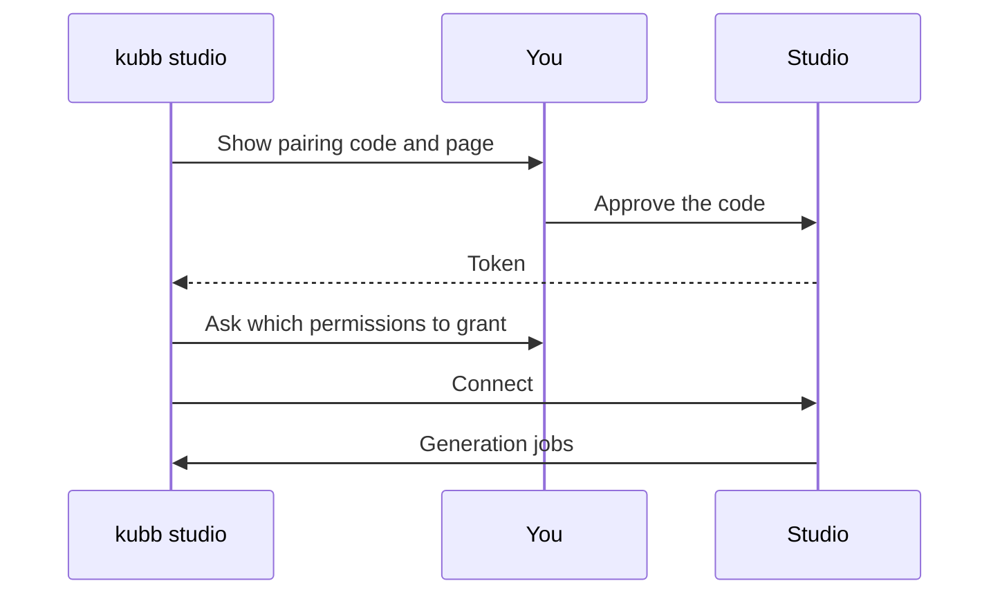
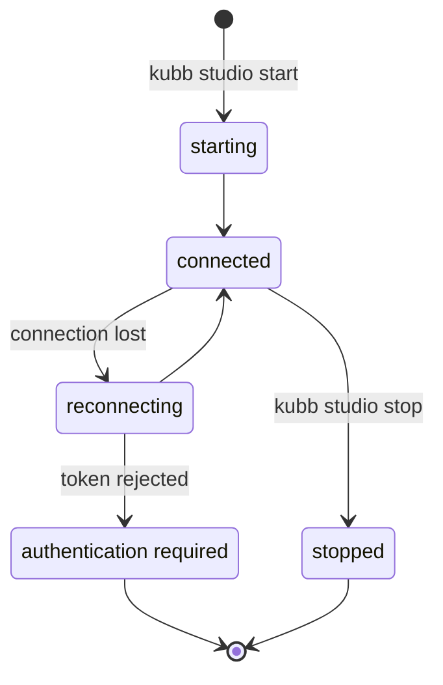

# kubb studio

`kubb studio` connects a project to [Kubb Studio](https://kubb.studio). The CLI runs generation on your machine and sends progress and generated file paths to Studio. Grant `--allow-read` to view file contents and diffs in the browser, and `--allow-read-ast` to share the parsed spec.

```shell [Terminal]
kubb studio
```

On the first run, the CLI pairs the machine:



- Approve the code before it expires. The CLI copies it to the clipboard with `pbcopy`, `clip.exe`, `xclip`, or `wl-copy` when one is available.
- The permission list starts with nothing checked. The CLI remembers the answers per project folder.
- The CLI logs each job on one line: the time, the command, who asked for it, and the result. Its steps and diagnostics stay in Studio.
- Press `b` to move the session to the background worker, the same as `kubb studio start`.

## Actions

The first argument picks the action. It defaults to `connect`.

| Action | Description |
| --- | --- |
| `connect` | Hold a foreground session open and generate on request. |
| `start` | Resolve pairing and permissions, then connect in the background. |
| `stop` | Stop the background worker and keep its pairing. |
| `login` | Pair this machine again without opening a session. Saved permissions reset. |
| `logout` | Stop the background worker and forget this project's stored token. |
| `status` | Show pairing, worker state and uptime, saved permissions, and the log path, each with the command that changes it. |
| `permissions` | Change this project's saved permissions in the same list `connect` shows, without pairing again. Needs an interactive terminal. |
| `snapshot` | Generate and pack a snapshot, upload it in one request, then exit. See [Publish snapshots from CI](/docs/5.x/integrations/ci). |

## Background connection

Run `start`, `status`, and `stop` from the same project folder. `start` asks the pairing and permission questions before it detaches, then returns while the worker connects. `status` reports the worker's state:



- One worker owns a project. Stop it before you use foreground `connect`.
- The worker survives a closed terminal and retries temporary connection failures. Start it again after a crash or reboot.
- When its token is rejected, run `kubb studio login`, then `kubb studio start`.
- To change the URL or config, stop the worker and start it with the new flags.
- `stop` waits for a running generation to clean up. An interrupted job does not run again.

Flags can only add permissions, and `login` resets the saved ones. To turn one off, run `kubb studio permissions`. A running connection keeps the old permissions until you restart it: keep `--url` and `--config`, and leave out the `--allow-*` flag of the permission you turned off, since a flag grants it anyway.

### Credentials

The CLI keeps credentials, worker state, and the worker log in [`KUBB_HOME`](/docs/5.x/reference/commands#environment-variables), `~/.kubb` by default. `status` prints the log path.

A connected CLI renews its token once a day, so it is not asked to pair again. Pairing also creates a key that never leaves your machine. It goes in the system keychain (macOS Keychain, Windows Credential Manager, or Secret Service on Linux), or next to the token when there is no keychain or it refuses access, such as in CI or a container. A project paired with an earlier release has no key and keeps working; `kubb studio login` adds one.

## Options

`connect`, `start`, and `login` take the connection and permission options. `status` takes `--url` only, and `snapshot` takes its own set.

### Connection

| Option | Default | Description |
| --- | --- | --- |
| `--config <path>`, `-c` | | Path to a config file, such as `./kubb.staging.ts`. |
| `--url <url>` | `https://kubb.studio` | URL of Kubb Studio. Plain `http://` works only for `localhost`, `127.0.0.1`, or `[::1]`. |
| `--no-open` | | Do not open the approval page in a browser. |
| `--log-level <level>`, `-l` | `info` | `silent`, `info`, or `verbose`. |

### Permissions {#permissions}

Each permission is off by default. The CLI asks once per project for each one you do not pass as a flag. Without a TTY it skips the questions, so pass the flags the run needs.

| Flag | Lets Studio |
| --- | --- |
| `--allow-read` | Read generated file contents. |
| `--allow-read-ast` | Read the parsed spec (the Kubb AST). |
| `--allow-write` | Write generated files to disk. |
| `--allow-config-edit` | Change plugin options in `kubb.config.ts`. |
| `--allow-install` | Install extensions with `kubb add`. Grant `--allow-config-edit` too. |
| `--allow-update` | Update installed extensions with `kubb update`. The config stays as it is. |
| `--allow-remove` | Remove extensions with `kubb remove`. Grant `--allow-config-edit` too. |
| `--allow-save-input` | Save the spec it sends and point `input` at it. A pasted document goes to `openapi.yaml`, or `openapi.json` for JSON (`openapi-<entry>` for a later config entry). A URL or git file is written to `input` as is. Grant `--allow-config-edit` too. |
| `--allow-file-refs` | Let a `$ref` in the spec read a local file outside the project. |
| `--allow-exec` | Run the formatter, the linter, and `output.postGenerate`. |

Without `--allow-read`, a session still generates and reports file paths, but Studio cannot show their contents. With it, Studio loads the files already in `output.path` when it connects, so you can browse them before you select **Generate**. The agent keeps recent generations up to the [`KUBB_AGENT_MAX_GENERATIONS`](/docs/5.x/reference/commands#environment-variables) caps. The initial output has its own budget with the same caps, and unchanged output keeps its ID across reconnects.

### Snapshot

`snapshot` takes `--config`, `--url`, `--log-level`, and these options, but no `--allow-*` flag.

| Option | Default | Description |
| --- | --- | --- |
| `--token <key>` | `KUBB_TOKEN` | Organization CI API key. |
| `--id <id>` | Detected | Stable identity for the CI agent. Detected on GitHub Actions, GitLab CI, Bitbucket Pipelines, and CircleCI. |
| `--base-id <id>` | Detected | The `--id` of another CI agent, such as the base branch's, to also compare with. Detected on GitHub pull requests and GitLab merge requests. |
| `--name <name>` | From `package.json` | Package name of the tarball, from the nearest `package.json` with a name and a version. |
| `--package-version <version>` | From `package.json` | Package version of the tarball, from the same `package.json`. |
| `--json` | `false` | Print the result as one JSON object instead of a summary. |

`snapshot` generates like `kubb generate`: it writes to `output.path`, then runs the formatter, the linter, and `output.postGenerate`. It builds the package's `dist` files with `tsdown`, so install it in the project with `npm i -D tsdown`. It refuses a tarball over 50 MB.

In CI, the CLI refuses to pair and needs stored credentials, so use `snapshot` there.

## Snapshot output

`--json` prints one object with `id`, `name`, `version`, `integrity`, `url`, `snapshotIdUrl`, `expiresAt`, and `agentUrl`. It adds `number` and `webUrl` when Studio sends them, and the summary then shows the snapshot number and a `View` link. It adds `changes` and `branchChanges` when a comparison is available. Installing a snapshot needs a separate `registry` API key.

| Field | Compared with |
| --- | --- |
| `changes` | The previous snapshot on the same pull request or branch. |
| `branchChanges` | The latest snapshot of the agent named by `--base-id`, or of the base branch of a GitHub pull request or GitLab merge request. `branch` names that agent. `baseFound` tells a branch with no CI agent apart from one whose agent has no snapshot of this package yet. |

## CI agent identity

`snapshot` detects GitHub Actions, GitLab CI, Bitbucket Pipelines, and CircleCI. Other providers need a stable `--id`. Use a stable `--id` on the base branch and pass it as `--base-id` on pull request runs. Passing `--id` turns off base detection, so also pass `--base-id` to get `branchChanges`.

### GitLab CI

| Pipeline | CI agent | Compared with |
| --- | --- | --- |
| Merge request | One agent per merge request | `branchChanges`: the target branch's latest snapshot. `changes`: the merge request's previous pipeline. |
| Branch | One agent per branch, so the default branch has one too | `changes`: the branch's previous pipeline. |

A merge request snapshot records the head commit of the source branch. Pass `--id` to group runs your own way.

## Plugins in Studio {#plugins-in-studio}

Studio builds its plugin list and option forms from [extension manifests](/docs/5.x/reference/kit/manifest). On connect, the agent reports each extension that ships a valid `kubb-extension.json` and comes from one of these places:

- The `dependencies` and `devDependencies` in the project's `package.json`.
- The packages `kubb.config.ts` imports.
- The extensions that ship with `kubb`: `@kubb/adapter-oas`, `@kubb/parser-ts`, `@kubb/parser-md`, and `@kubb/plugin-barrel`.

A third-party plugin works in Studio once it is installed and ships a manifest with `kind: "plugin"`. It needs no registry entry. Install it with [`kubb add`](/docs/5.x/reference/commands/extensions#add) or your package manager, then reconnect.

The adapter and the parsers in the config get a settings form from the `options` in their manifest. The agent sends a JSON copy of their options on connect, and Studio's edits on generate are merged over the options in `kubb.config.ts`. A `null` value unsets an option for that run, so the extension's default applies. An extension without a manifest, such as `parserTsx`, is listed without fields.

The agent imports a plugin package only when it is a `@kubb/plugin-*` package, or an installed package whose manifest has `kind: "plugin"`. It calls the factory the manifest names in `export`. It refuses any other package name before it imports anything, and config edits follow the same rule.

| Agent | Plugins it can run |
| --- | --- |
| `kubb studio` on your machine | `@kubb/plugin-*` packages and installed plugins that ship a manifest. |
| Docker agent and hosted sandbox | Only the packages in their image. They install nothing at runtime. |

Studio also lists plugins from the [kubb.dev registry](/docs/5.x/reference/registry). A plugin the agent cannot run shows as not installed, with a `kubb add <id>` hint.

## Exit codes

Each action exits with code 1 when it fails.
