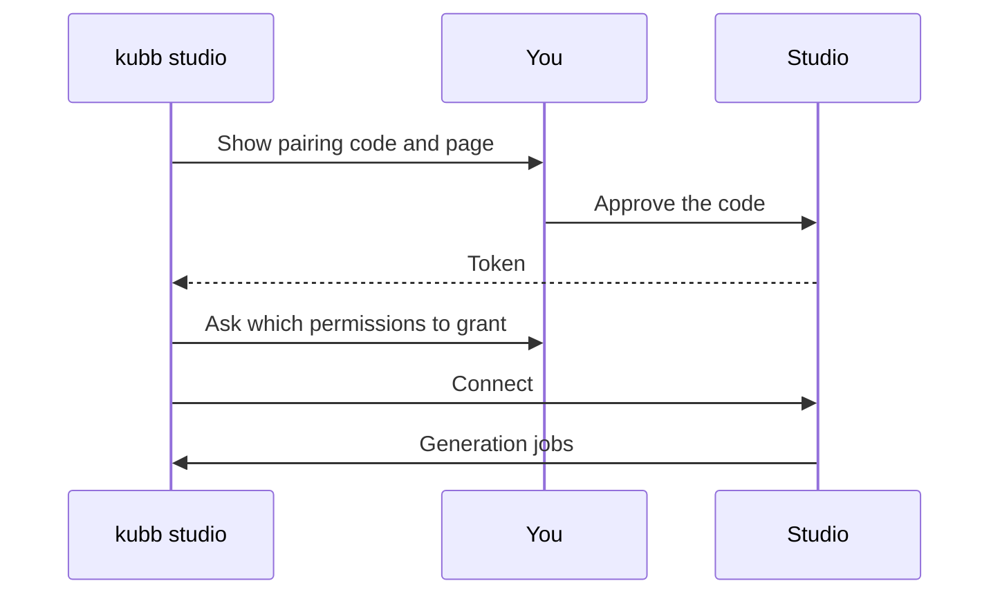
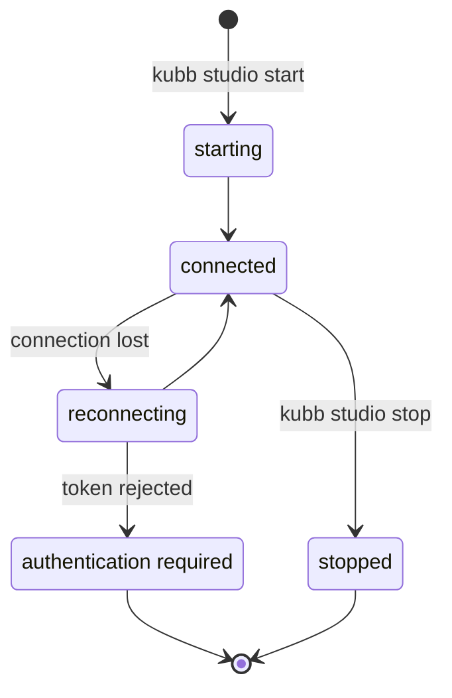

# kubb studio

`kubb studio` connects your project to [Kubb Studio](https://kubb.studio). The CLI generates on your machine and sends progress and file paths to Studio. To share more, grant [permissions](#permissions), such as `--allow-read` for file contents.

```shell [Terminal]
kubb studio
```

## Pair the machine

On the first run, the CLI pairs your machine:



- Approve the code before it expires. The CLI copies it to the clipboard when it can.
- The permission list starts unchecked. The CLI remembers your answers per project folder.
- Each job logs one line: time, command, requester, and result. Steps and diagnostics stay in Studio.
- Press `b` to move the session to the background worker, like `kubb studio start`.

## Pair with a code {#pair-with-a-code}

An agent that an MCP client starts pairs itself, with no person approving it. The `kubb_studio_connect` MCP tool hands out a one-time code and the command to run:

```shell [Terminal]
KUBB_STUDIO_PAIRING_CODE=kubb_pair_... npx kubb studio connect --allow-write --no-open --url https://kubb.studio
```

- When `KUBB_STUDIO_PAIRING_CODE` is set, `connect`, `start`, and `login` redeem the code instead of showing a pairing code. The CLI reads the code from the environment, so it never shows in the process list, and never logs it.
- A code works once and lasts 5 minutes. The CLI sends it once and never again, even when Studio refuses it.
- Only the flags grant permissions, and the CLI asks no questions. `--allow-write` alone is enough for a factory.
- No browser opens, with or without `--no-open`.
- The token lasts an hour. A connected CLI refreshes it at 70 to 85 percent of its lifetime, picked at random so many agents do not refresh at once.
- The same person, MCP client, and project folder pairing again gets the same agent and a new token.
- Once connected, the CLI prints the agent ID. The MCP client passes that ID to `kubb_studio_generate`.

When Studio refuses the code, the CLI prints why as [`KUBB_STUDIO_REFUSED`](/docs/5.x/reference/diagnostics#kubb-studio-refused) and exits with code `1`:

| Studio answers | Why | What to do |
| --- | --- | --- |
| `invalid_grant` | The code is unknown or used, or its connection was revoked | Ask the MCP client for a new code |
| `expired_token` | The code is older than 5 minutes | Ask the MCP client for a new code |
| `access_denied` | The plan reached its MCP agent limit | Remove an MCP agent in Studio, or upgrade the plan |

When Studio later rejects the token of an agent paired with a code, the CLI forgets the token and exits with `KUBB_STUDIO_REFUSED`. Ask the MCP client for a new code.

## Actions

The first argument picks the action, `connect` by default.

| Action | What it does |
| --- | --- |
| `connect` | Holds a foreground session open and generates on request |
| `start` | Resolves pairing and permissions, then connects in the background |
| `stop` | Stops the background worker and keeps its pairing |
| `login` | Pairs this machine again without a session. Saved permissions reset. |
| `logout` | Stops the worker and forgets this project's token |
| `status` | Shows pairing, worker state, permissions, and the log path, each with the command that changes it |
| `permissions` | Changes saved permissions without pairing again. Needs an interactive terminal. |
| `snapshot` | Generates, packs, and uploads a snapshot, then exits. See [Publish snapshots from CI](/docs/5.x/integrations/ci). |

## Background connection

Run `start`, `status`, and `stop` from the same project folder. `start` asks its questions, then returns while the worker connects. `status` reports its state:



- One worker owns a project. Stop it before a foreground `connect`.
- The worker survives a closed terminal and retries temporary failures. Start it again after a crash or reboot.
- When its token is rejected, run `kubb studio login`, then `kubb studio start`.
- To change the URL or config, stop the worker and start it with the new flags.

> [!WARNING]
> Flags only add permissions. To turn one off, run `kubb studio permissions`, then restart without that `--allow-*` flag. A running connection keeps the old permissions until it restarts.

### Credentials

Credentials, worker state, and the worker log live in [`KUBB_HOME`](/docs/5.x/reference/commands#environment-variables), `~/.kubb` by default. See [Studio credentials](#studio-credentials).

## Options

`connect`, `start`, and `login` take the connection and permission flags. `status` takes `--url` only, and `snapshot` has its own set.

### Connection

| Flag | Alias | Default | What it does |
| --- | --- | --- | --- |
| `--config <path>` | `-c` | | Config file path, such as `./kubb.staging.ts` |
| `--url <url>` | | The Studio the project paired with, else `https://kubb.studio` | Studio URL. Plain `http://` works only for `localhost`, `127.0.0.1`, or `[::1]`. |
| `--no-open` | | | Skips opening the approval page. A [pairing code](#pair-with-a-code) never opens one. |
| `--log-level <level>` | `-l` | `info` | `silent`, `info`, or `verbose` |

### Permissions {#permissions}

Each permission is off by default. The CLI asks once per project for each one you do not pass. Outside an interactive terminal, it skips the questions, so pass the flags the run needs.

| Flag | Lets Studio |
| --- | --- |
| `--allow-read` | Read generated file contents |
| `--allow-read-ast` | Read the parsed spec (the Kubb AST) |
| `--allow-write` | Write generated files to disk |
| `--allow-config-edit` | Change plugin options in `kubb.config.ts` |
| `--allow-install` | Install extensions with `kubb add`. Needs `--allow-config-edit`. |
| `--allow-update` | Update extensions with `kubb update`, leaving the config as is |
| `--allow-remove` | Remove extensions with `kubb remove`. Needs `--allow-config-edit`. |
| `--allow-save-input` | Save the spec it sends and point `input` at it. Needs `--allow-config-edit`. |
| `--allow-file-refs` | Let a `$ref` read a local file outside the project, or a URL on a host that is not public |
| `--allow-exec` | Run the formatter, the linter, and `output.postGenerate` |

See [Studio permissions](#studio-permissions) for what each one changes.

### Snapshot

`snapshot` takes `--config`, `--url`, `--log-level`, and these flags, but no `--allow-*` flag.

| Flag | Default | What it does |
| --- | --- | --- |
| `--token <key>` | `KUBB_TOKEN` | Organization CI API key |
| `--id <id>` | Detected | Stable CI agent identity |
| `--base-id <id>` | Detected | Another CI agent's `--id` to also compare with, such as the base branch's |
| `--name <name>` | From `package.json` | Tarball package name, from the nearest `package.json` with a name and version |
| `--package-version <version>` | From `package.json` | Tarball package version, from the same `package.json` |
| `--json` | `false` | Prints the result as one JSON object |

`snapshot` generates like `kubb generate`, then runs the formatter, the linter, and `output.postGenerate`. It refuses a tarball over 50 MB. In CI, the CLI refuses a browser pairing and needs stored credentials or a [pairing code](#pair-with-a-code), so use `snapshot` there.

> [!IMPORTANT]
> Install `tsdown` first: `npm i -D tsdown`. `snapshot` builds the package's `dist` files with it.

## Snapshot output

`--json` prints one object with the snapshot's id, version, URLs, and comparisons. See [CI snapshots](#studio-ci-snapshots) for its fields.

## CI agent identity

`snapshot` detects GitHub Actions, GitLab CI, Bitbucket Pipelines, and CircleCI. Other providers need a stable `--id`. See [CI snapshots](#studio-ci-snapshots).

## Plugins in Studio {#plugins-in-studio}

Studio builds its plugin list and option forms from [extension manifests](/docs/5.x/reference/kit/manifest). A third-party plugin works once it is installed and ships a manifest with `kind: "plugin"`, without a registry entry. Install it with your package manager or [`kubb add`](/docs/5.x/reference/commands/add), then reconnect.

> [!NOTE]
> The agent imports only `@kubb/plugin-*` packages and installed packages whose manifest has `kind: "plugin"`. It refuses any other package name before importing anything.

See [Studio agent](#studio-agent) for where the agent finds extensions.

## Exit codes

| Code | When |
| --- | --- |
| `0` | The action succeeds. |
| `1` | The action fails. |

## Less common cases {#less-common-cases}

### CI snapshots {#studio-ci-snapshots}

In CI, `kubb studio snapshot` identifies the CI agent and compares the new snapshot with earlier ones.

It uploads to the Studio's public API: `POST /v1/snapshots` on the `--url` host with `api.` in front, such as `https://api.kubb.studio` for `https://kubb.studio` and `https://api.dev.kubb.studio` for `https://dev.kubb.studio`. A Studio on `localhost` takes it on its own origin.

#### JSON output

`--json` prints one object with `id`, `name`, `version`, `integrity`, `url`, `snapshotIdUrl`, `expiresAt`, and `agentUrl`.

- It adds `number` and `webUrl` when Studio sends them, and the summary shows the number and a `View` link.
- It adds `changes` and `branchChanges` when a comparison exists.
- Installing a snapshot needs a separate `registry` API key.

| Field | Compared with |
| --- | --- |
| `changes` | The previous snapshot on the same pull request or branch. |
| `branchChanges` | The latest snapshot of the `--base-id` agent, or of the base branch of a GitHub pull request or GitLab merge request. `branch` names that agent. `baseFound` is `false` when that agent does not exist yet, and `true` when it has no snapshot of this package. |

#### CI agent identity details
| Option | Default | Description |
| --- | --- | --- |
| `--id <id>` | Detected | Stable CI agent identity. Detected on GitHub Actions, GitLab CI, Bitbucket Pipelines, and CircleCI. |
| `--base-id <id>` | Detected | The `--id` of another CI agent to also compare with, such as the base branch's. Detected on GitHub pull requests and GitLab merge requests. |

- Other providers need a stable `--id`. Use one on the base branch and pass it as `--base-id` on pull request runs.
- `--id` turns off base detection, so also pass `--base-id` to get `branchChanges`.

#### GitLab CI

| Pipeline | CI agent | Compared with |
| --- | --- | --- |
| Merge request | One agent per merge request | `branchChanges`: the target branch's latest snapshot. `changes`: the merge request's previous pipeline. |
| Branch | One agent per branch, the default branch included | `changes`: the branch's previous pipeline. |

A merge request snapshot records the head commit of the source branch. Pass `--id` to group runs your own way.

### Studio agent {#studio-agent}

When Studio lists a plugin as not installed, check where the agent looks. Studio builds its plugin list and option forms from [extension manifests](/docs/5.x/reference/kit/manifest).

On connect, the agent reports each extension with a valid `kubb-extension.json` from:

- The `dependencies` and `devDependencies` in `package.json`.
- The packages `kubb.config.ts` imports.
- The extensions bundled with `kubb`: `@kubb/adapter-oas`, `@kubb/parser-ts`, `@kubb/parser-md`, and `@kubb/plugin-barrel`.

#### Settings forms

- The config's adapter and parsers get a settings form from the `options` in their manifest.
- The agent sends a JSON copy of their options on connect. On generate, Studio's edits merge over the options in `kubb.config.ts`.
- A `null` value unsets an option for that run, so its default applies.
- An extension without a manifest, such as `parserTsx`, is listed without fields.

#### Plugins the agent runs

| Agent | Plugins it can run |
| --- | --- |
| `kubb studio` on your machine | `@kubb/plugin-*` packages, and installed packages whose manifest has `kind: "plugin"` |
| Docker agent and hosted sandbox | Only the packages in their image, with no runtime installs |

The agent calls the factory the manifest names in `export`. It refuses any other package name before importing anything, and config edits follow the same rule.

Studio also lists [extension registry](/extensions) plugins. A plugin the agent cannot run shows as not installed, with a `kubb add <id>` hint.

### Studio credentials {#studio-credentials}

When you pair a machine, the CLI stores the credentials, worker state, and worker log in [`KUBB_HOME`](/docs/5.x/reference/commands#environment-variables), `~/.kubb` by default. `status` prints the log path.

- Approve the pairing code before it expires. The CLI copies it with `pbcopy`, `clip.exe`, `xclip`, or `wl-copy` when one is available.
- A connected CLI renews its token daily, so it does not pair again. A token from a [pairing code](#pair-with-a-code) lasts an hour and renews before it expires.
- Pairing also creates a key that never leaves your machine. It goes in the system keychain (macOS Keychain, Windows Credential Manager, or Secret Service on Linux), or next to the token when no keychain allows access, such as in CI or a container.
- A project paired with an earlier release has no key and keeps working. `kubb studio login` adds one.
- `stop` waits for a running generation to clean up. An interrupted job does not run again.

### Studio permissions {#studio-permissions}

- `--allow-save-input` saves the spec Studio sends and points `input` at it. Grant `--allow-config-edit` too. A pasted document goes to `openapi.yaml`, or `openapi.json` for JSON (`openapi-<entry>` for a later config entry). A URL or git file goes into `input` as is.
- Without `--allow-read`, a session still generates and reports file paths, but Studio cannot show their contents.
- With `--allow-read`, Studio loads the files already in `output.path` on connect, so you can browse them before you select **Generate**.
- The agent keeps recent generations up to the [`KUBB_AGENT_MAX_GENERATIONS`](/docs/5.x/reference/commands#environment-variables) caps, with a separate budget for the initial output. Unchanged output keeps its ID across reconnects.

> [!WARNING]
> Flags only add permissions, and `login` resets the saved ones. To turn one off, run `kubb studio permissions`, then restart a running connection, since it keeps the old permissions. Restart with the same `--url` and `--config`, but without that permission's `--allow-*` flag, which would grant it again.
