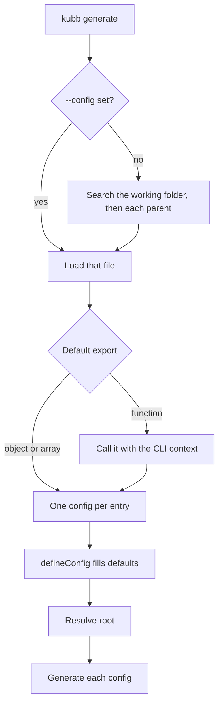

# Configuration

`kubb.config.ts` tells Kubb which spec to read, where to write, and which plugins to run. Its default export is a `defineConfig` call:

```typescript [kubb.config.ts]
import { defineConfig } from 'kubb/config'
import { pluginTs } from '@kubb/plugin-ts'

export default defineConfig({
  name: 'petStore',
  input: './petStore.yaml',
  output: { path: './src/gen' },
  plugins: [pluginTs()],
})
```

## How Kubb loads a config

Kubb loads the `--config` file. Without one, it loads the first `kubb.config.ts` or variant, such as `.kubbrc.ts`, in the working folder or a parent. See [Config loading](#config-loading).

## Config formats

`defineConfig` takes an object, a Promise of one, an array, or a function that returns any of these.

### Config function

Pass a function when the config depends on how Kubb runs, such as watch mode:

```typescript [kubb.config.ts]
import { defineConfig } from 'kubb/config'

export default defineConfig(({ watch }) => ({
  input: './petStore.yaml',
  output: { path: './src/gen', clean: !watch },
}))
```

The function gets the CLI context:

| Field | Type | Value |
| --- | --- | --- |
| `input` | `string \| undefined` | The [`kubb generate <input>`](/docs/5.x/reference/commands/generate#arguments) argument, which overrides [`config.input`](#input) |
| `watch` | `boolean \| undefined` | `true` in [watch mode](/docs/5.x/reference/commands/generate#watch-mode) |
| `logLevel` | `'silent' \| 'info' \| 'verbose' \| undefined` | The current [`--log-level`](/docs/5.x/reference/commands/generate#options) |
| `reporters` | `Array<ReporterName> \| undefined` | The [`--reporter`](/docs/5.x/reference/commands/generate#reporters) names, such as `['json']` |
| `config` | `string \| undefined` | The [`--config`](/docs/5.x/reference/commands/generate#options) value, or `undefined` |

### Multiple configurations (array)

Pass an array to generate from several specs in one run. A config function can return an array too.

```typescript [kubb.config.ts]
import { defineConfig } from 'kubb/config'
import { pluginTs } from '@kubb/plugin-ts'

export default defineConfig([
  { name: 'petStore', input: './petStore.yaml', output: { path: './src/gen/petStore' }, plugins: [pluginTs()] },
  { name: 'stripe', input: './stripe.yaml', output: { path: './src/gen/stripe' }, plugins: [pluginTs()] },
])
```

## Defaults {#defaults}

`defineConfig` from `kubb/config` and `createKubb` from `kubb` fill in these defaults for every option you leave out.

| Option | Default |
| --- | --- |
| `input` | None. Required with an adapter. |
| `output.path` | None. Required. |
| `output.clean` | `false` |
| `output.format` | `false` |
| `output.lint` | `false` |
| `output.barrel` | `false`, so no root `index.ts` |
| `output.defaultBanner` | `'simple'` |
| `plugins` | `pluginBarrel()`, appended when missing |
| `adapter` | `adapterOas()`, the bundled [OpenAPI adapter](/extensions/kubb-labs/adapter-oas) |
| `parsers` | `[parserTs(), parserTsx(), parserMd()]` |
| `storage` | `fsStorage()` |
| `root` | The config file's folder, or the folder above `.config/` or `configs/` |
| `reporters` | `[cli, json, file, html]` |

When you call `createKubb` yourself, `root` defaults to `process.cwd()`. `createKubb` from `@kubb/core` applies fewer defaults. The build tool integrations run fewer reporters. See [Config loading](#config-loading).

## Top-level options

::field-group

### `name`

:::field{type="string"}
The run heading the CLI prints before the input, such as `petStore ./petStore.yaml`. Unnamed configs show as `kubb`.
:::

### `input`

:::field{type="string | Record<string, unknown>"}
Where Kubb reads your spec. Required when an adapter is set, as `defineConfig` does by default. Kubb detects the kind:

| Value | Read as |
| --- | --- |
| An object | A parsed spec |
| A string starting with `{` or `[`, spanning lines, or opening with `openapi:` or `swagger:` | Inline JSON or YAML |
| A string starting with `git+` | A file in a git repository |
| A URL string | A remote spec |
| Any other string | A file path, relative to [`root`](#root) |

A git input is `git+<repo>#<ref>:<path>` and needs `git` on the `PATH`.

::::code-group

```typescript [File path]
import { defineConfig } from 'kubb/config'

export default defineConfig({
  input: './petStore.yaml',
  output: { path: './src/gen' },
})
```

```typescript [URL]
import { defineConfig } from 'kubb/config'

export default defineConfig({
  input: 'https://petstore3.swagger.io/api/v3/openapi.json',
  output: { path: './src/gen' },
})
```

```typescript [Git]
import { defineConfig } from 'kubb/config'

export default defineConfig({
  input: 'git+https://github.com/org/api.git#v2:specs/openapi.yaml',
  output: { path: './src/gen' },
})
```

```typescript [Inline YAML]
import { defineConfig } from 'kubb/config'

export default defineConfig({
  input: `
openapi: 3.1.0
info:
  title: Pet Store
  version: 1.0.0
paths: {}
`,
  output: { path: './src/gen' },
})
```

```typescript [Object]
import { defineConfig } from 'kubb/config'
import spec from './petStore.json' with { type: 'json' }

export default defineConfig({
  input: spec,
  output: { path: './src/gen' },
})
```

::::

See [Git input](#git-input) for refs and credentials, and [External `$ref` files](#external-refs).
:::

### `output`

Where and how Kubb writes files. `output.mode`, `output.banner`, and `output.footer` are [plugin options](/docs/5.x/reference/plugin-options#output) only.

#### `output.path`

:::field{type="string" required}
The folder for generated files, absolute or relative to `root`. Plugin output paths resolve inside it.
:::

#### `output.clean`

:::field{type="boolean"}
Remove every file in `output.path` before generating. Default: `false`.

> [!WARNING]
> Use `clean: true` only on a generated-code folder. Kubb stops with [`KUBB_CLEAN_ROOT`](/docs/5.x/reference/diagnostics#kubb-clean-root) when `output.path` is the project root or a parent of it.
:::

#### `output.format`

:::field{type="'auto' | 'prettier' | 'biome' | 'oxfmt' | false"}
The formatter for the generated files. Default: `false`.

`'auto'` runs the first installed of oxfmt, Biome, and Prettier. A tool name forces that tool, which reads its own config.
:::

#### `output.lint`

:::field{type="'auto' | 'eslint' | 'biome' | 'oxlint' | false"}
The linter for the generated files. Default: `false`.

`'auto'` runs the first installed of oxlint, Biome, and ESLint. A tool name forces that tool.
:::

#### `output.postGenerate`

:::field{type="Array<string | { name?: string; command: string }>"}
Commands to run in order from `root` after formatting and linting, such as a type check. `{ name, command }` labels a step in the CLI output.

```typescript [kubb.config.ts]
import { defineConfig } from 'kubb/config'

export default defineConfig({
  input: './petStore.yaml',
  output: {
    path: './src/gen',
    postGenerate: [{ name: 'types', command: 'npm run typecheck' }, 'biome check --write ./src/gen'],
  },
})
```

Format, lint, and `postGenerate` run only after a build without errors. A failing step reports [`KUBB_FORMAT_FAILED`](/docs/5.x/reference/diagnostics#kubb-format-failed), [`KUBB_LINT_FAILED`](/docs/5.x/reference/diagnostics#kubb-lint-failed), or [`KUBB_POST_GENERATE_FAILED`](/docs/5.x/reference/diagnostics#kubb-post-generate-failed).
:::

#### `output.barrel`

:::field{type="{ type: 'all' | 'named' } | false"}
The root `index.ts` at `output.path`: `{ type: 'named' }` or `{ type: 'all' }`, as on the plugin-level [`output.barrel`](/docs/5.x/reference/plugin-options#output-barrel). Default: `false`. A plugin without its own `output.barrel` inherits it. See [Add barrel files](/docs/5.x/how-to/recipes#barrel-files).
:::

#### `output.defaultBanner`

:::field{type="'simple' | 'full' | false"}
The notice Kubb writes at the top of each generated file. Default: `'simple'`. A plugin's [`output.banner`](/docs/5.x/reference/plugin-options#output-banner) replaces it.

::::code-group

```typescript [simple]
/**
 * Generated by Kubb (https://kubb.dev/).
 * Do not edit manually.
 */
```

```typescript [full]
/**
 * Generated by Kubb (https://kubb.dev/).
 * Do not edit manually.
 * Source: petStore.yaml
 * Title: Pet Store
 * OpenAPI spec version: 1.0.0
 */
```

```typescript [false]
// no banner
```

::::
:::

### `plugins`

:::field{type="Array<Plugin>"}
The plugins to run, in dependency order. Default: `[]`, with `pluginBarrel()` appended when missing. A missing required dependency fails with [`KUBB_MISSING_DEPENDENCY`](/docs/5.x/reference/diagnostics#kubb-missing-dependency). See [Shared plugin options](/docs/5.x/reference/plugin-options).
:::

### `adapter`

:::field{type="Adapter"}
Turns your input into Kubb's AST. Default: `adapterOas()`, bundled with `kubb`.

To pass options, such as `adapterOas({ validate: false })`, install and import `@kubb/adapter-oas`. `kubb` does not re-export it. See the [adapter options](/extensions/kubb-labs/adapter-oas/options).
:::

### `parsers`

:::field{type="Array<Parser>"}
Turn file nodes into source text, each for the extensions in its `extNames`. Default: `[parserTs(), parserTsx(), parserMd()]`, bundled with `kubb`. A list you pass replaces the default. See [`@kubb/parser-ts`](/extensions/kubb-labs/parser-ts).

```typescript [kubb.config.ts]
import { defineConfig } from 'kubb/config'
import { parserTs, parserTsx } from '@kubb/parser-ts'

export default defineConfig({
  input: './petStore.yaml',
  output: { path: './src/gen' },
  parsers: [parserTs(), parserTsx()],
})
```
:::

### `storage`

:::field{type="Storage"}
Where generated files go. Default: `fsStorage()`, which writes to disk. `memoryStorage()` from `kubb/kit` keeps them in memory. See [Storage](/docs/5.x/architecture#storage) for a custom backend.
:::

### `root`

:::field{type="string"}
The project root that `input` and `output.path` resolve against. Default: the config file's folder, or the folder above `.config/` or `configs/`. A relative `root` resolves from that folder. See [Config loading](#config-loading) for `createKubb`.
:::

### `reporters`

:::field{type="Array<Reporter>"}
The reporters a run can use. Default: the built-in `cli`, `json`, `file`, and `html` reporters. The [`--reporter`](/docs/5.x/reference/commands/generate#reporters) flag picks which ones run and defaults to `cli`.
:::

::

::studio-cta{source="configuration-reference"}
::

## Less common cases {#less-common-cases}

### Config loading {#config-loading}

Without `--config`, `kubb generate` searches for a config file and turns its default export into one config per entry.



- In each folder, `.kubbrc.*` comes before `kubb.config.*`, and the folder before its `.config/` and `configs/` subfolders.
- Extensions are tried in the order `.ts`, `.mts`, `.cts`, `.js`, `.mjs`, `.cjs`.
- When nothing matches, the CLI stops and suggests `kubb init`.

#### Root folder

Without [`root`](#root), the root is the config file's folder, or its parent for a config in `.config/` or `configs/`.

- A relative `root` resolves from that folder.
- `createKubb` without a config file uses `process.cwd()`.

#### Defaults outside the CLI

Without `kubb generate`, fewer [defaults](#defaults) apply:

- `createKubb` from `@kubb/core` applies only the `root`, `storage`, `output.format`, `output.lint`, and `output.defaultBanner` defaults.
- [Build tool integrations](/docs/5.x/integrations/build-tools) apply the `defineConfig` defaults, but run only the summary reporter.

#### Extension commands

`kubb add`, `kubb update`, `kubb list`, and `kubb remove` read `--config`, or search for a config as `kubb generate` does. With several config entries, `add` and `remove` edit the first one. See [Project files](/docs/5.x/reference/commands#project-files).

#### kubb validate

The adapter `kubb validate` runs depends on the config it finds. See [Which adapter runs](/docs/5.x/reference/commands/validate#which-adapter-runs).

| Situation | Adapter |
| --- | --- |
| A config is found or passed | Each entry's adapter. A local path resolves from the entry's `root`, or the current folder. |
| A config entry has no adapter | None. The command fails. |
| No config, or a found config that fails to load | `@kubb/adapter-oas`. A `--config` file that fails to load fails the command. |

- An array config that repeats one adapter and input validates that pair once.
- A URL or git input is passed unchanged. A git input is fetched into a temporary folder, validated, and deleted.

### External `$ref` files {#external-refs}

When your spec points at another file with a relative `$ref`, Kubb resolves it from the input file's folder. An object or inline input has no file, so its refs resolve from `root`. An OpenAPI 3.2 `$self` changes the base.

Some runs refuse local files:

| Run | Local `$ref` files it reads |
| --- | --- |
| A URL input | None, so a fetched spec cannot read your files |
| A Kubb Studio agent | Only files inside the project or the input's folder |
| A sandbox agent | None |
| A managed agent | Only files in the repository of a git input |

To fix a refused file, move it into the project, start your agent with [`--allow-file-refs`](/docs/5.x/reference/commands/studio#permissions), or inline the schema.

### Git input {#git-input}

For a spec in a git repository, write `input` as `git+<repo>#<ref>:<path>`.

- `<ref>` is a branch, a tag, or a full commit SHA on hosts that fetch by SHA, such as GitHub and GitLab.
- Leave out `<ref>:` to use the default branch.
- Kubb runs a shallow `git fetch` into a temporary folder. It needs `git` on the `PATH`. For a private repository, it uses your git credentials.

See [Read the spec from a git repository](/docs/5.x/how-to/recipes#read-the-spec-from-a-git-repository) for a config.
