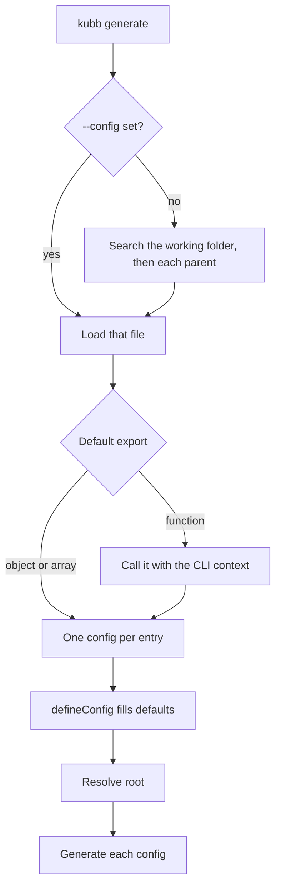

# Configuration

`kubb.config.ts` default-exports a `defineConfig` call that tells Kubb what to read, where to write, and which plugins to run.

```typescript [kubb.config.ts]
import { defineConfig } from 'kubb/config'
import { pluginTs } from '@kubb/plugin-ts'

export default defineConfig({
  name: 'petStore',
  input: './petStore.yaml',
  output: { path: './src/gen' },
  plugins: [pluginTs()],
})
```

## How Kubb loads a config



In each folder Kubb checks `.kubbrc.*` before `kubb.config.*`, and the folder itself before its `.config/` and `configs/` subfolders. It tries `.ts`, `.mts`, `.cts`, `.js`, `.mjs`, and `.cjs` in that order. When nothing matches, the CLI stops and suggests `kubb init`.

## Config formats

`defineConfig` accepts an object as in the example above, a Promise of one, an array, or a function that returns any of these.

### Config function

Pass a function when the config depends on how Kubb runs, such as watch mode:

```typescript [kubb.config.ts]
import { defineConfig } from 'kubb/config'

export default defineConfig(({ watch }) => ({
  input: './petStore.yaml',
  output: { path: './src/gen', clean: !watch },
}))
```

The function receives the CLI context:

| Field | Type | Value |
| --- | --- | --- |
| `input` | `string \| undefined` | The positional input of `kubb generate <input>`. It overrides `config.input` when set. |
| `watch` | `boolean \| undefined` | `true` in watch mode. |
| `logLevel` | `'silent' \| 'info' \| 'verbose' \| undefined` | The current log level. |
| `reporters` | `Array<ReporterName> \| undefined` | The names passed to `--reporter`, such as `['json']`. |
| `config` | `string \| undefined` | The `--config` value. `undefined` when the CLI found the file itself. |

### Multiple configurations (array)

Pass an array to generate from several specs in one run. A config function can return an array too.

```typescript [kubb.config.ts]
import { defineConfig } from 'kubb/config'
import { pluginTs } from '@kubb/plugin-ts'

export default defineConfig([
  { name: 'petStore', input: './petStore.yaml', output: { path: './src/gen/petStore' }, plugins: [pluginTs()] },
  { name: 'stripe', input: './stripe.yaml', output: { path: './src/gen/stripe' }, plugins: [pluginTs()] },
])
```

## Defaults {#defaults}

`defineConfig` from `kubb/config` and `createKubb` from `kubb` fill in the defaults below for every option you leave out.

| Option | Default |
| --- | --- |
| [`name`](#name) | None |
| [`input`](#input) | None. Required with an adapter. |
| [`output.path`](#outputpath) | None. Required. |
| [`output.clean`](#outputclean) | `false` |
| [`output.format`](#outputformat) | `false` |
| [`output.lint`](#outputlint) | `false` |
| [`output.postGenerate`](#outputpostgenerate) | None |
| [`output.barrel`](#outputbarrel) | `false`, so Kubb writes no root `index.ts`. Plugins keep their own default barrel. |
| [`output.defaultBanner`](#outputdefaultbanner) | `'simple'` |
| [`plugins`](#plugins) | `pluginBarrel()`, appended when the array does not include it |
| [`adapter`](#adapter) | `adapterOas()` from the bundled [OpenAPI adapter](/extensions/kubb-labs/adapter-oas) |
| [`parsers`](#parsers) | `[parserTs(), parserTsx(), parserMd()]` |
| [`storage`](#storage) | `fsStorage()` |
| [`root`](#root) | The config file's folder. `process.cwd()` when you call `createKubb` yourself. |
| [`reporters`](#reporters) | `[cli, json, file, html]` |

`createKubb` from `@kubb/core` applies only the `root`, `storage`, `output.format`, `output.lint`, and `output.defaultBanner` defaults. [Build tool integrations](/docs/5.x/integrations/overview#build-tools) apply the same defaults as `defineConfig`, but run only the summary reporter, not `json`, `file`, or `html`.

`output.mode`, `output.banner`, and `output.footer` exist only on a plugin's `output`. [Shared plugin options](/docs/5.x/reference/plugin-options#output) documents them.

## Top-level options

::field-group

### `name`

:::field{type="string"}
A label for this config. The CLI prints it as the run heading, followed by the input, such as `petStore ./petStore.yaml`. An unnamed config shows as `kubb`.
:::

### `input`

:::field{type="string | Record<string, unknown>"}
Where Kubb reads your spec. Kubb detects the kind from the value:

| Value | Read as |
| --- | --- |
| An object | An already-parsed spec |
| A string that starts with `{` or `[`, spans lines, or opens with `openapi:` or `swagger:` | Inline JSON or YAML |
| A string that starts with `git+` | A file in a git repository |
| A string that parses as a URL | A remote spec |
| Any other string | A file path, relative to [`root`](#root) |

Relative `$ref` files in an object or inline content also resolve against `root`. A URL input reads no local files through its `$ref`s, so a fetched spec cannot point at files on your machine.

A git input is `git+<repo>#<ref>:<path>`. `<ref>` is a branch, a tag, or a full commit SHA where the host allows fetching by SHA (GitHub and GitLab do). Leave out `<ref>:` to use the default branch. Kubb runs a shallow `git fetch` into a temporary folder, so it needs `git` on the `PATH` and uses your own git credentials for a private repository.

```typescript [kubb.config.ts]
import { defineConfig } from 'kubb/config'

export default defineConfig({
  input: 'git+https://github.com/org/api.git#v2:specs/openapi.yaml',
  output: { path: './src/gen' },
})
```

`input` is required whenever an adapter is set, and `defineConfig` always sets one, so a config without `input` stops with [`KUBB_INPUT_REQUIRED`](/docs/5.x/reference/diagnostics#kubb-input-required). Only `createKubb` from `@kubb/core` runs without an adapter, in plugin-only mode.
:::

### `output`

Where and how Kubb writes files.

#### `output.path`

:::field{type="string" required}
The folder for generated files, absolute or relative to `root`. Plugin output paths resolve inside it.
:::

#### `output.clean`

:::field{type="boolean"}
Remove every file in `output.path` before generating. Default: `false`.

> [!WARNING]
> Use `clean: true` only with a folder that holds generated code alone. Kubb stops with [`KUBB_CLEAN_ROOT`](/docs/5.x/reference/diagnostics#kubb-clean-root) when `output.path` is the project root or a parent of it.
:::

#### `output.format`

:::field{type="'auto' | 'prettier' | 'biome' | 'oxfmt' | false"}
The formatter to run over the generated files. Default: `false`.

`'auto'` runs the first one installed, in the order [oxfmt](https://oxc.rs), [Biome](https://biomejs.dev), [Prettier](https://prettier.io). A tool name forces that tool, which reads its own config file such as `.prettierrc` or `biome.json`.
:::

#### `output.lint`

:::field{type="'auto' | 'eslint' | 'biome' | 'oxlint' | false"}
The linter to run over the generated files. Default: `false`.

`'auto'` runs the first one installed, in the order [oxlint](https://oxc.rs), [Biome](https://biomejs.dev), [ESLint](https://eslint.org). A tool name forces that tool.
:::

#### `output.postGenerate`

:::field{type="Array<string | { name?: string; command: string }>"}
Commands to run after formatting and linting, such as a type check. They run in order from `root`. Use `{ name, command }` to label a step in the CLI output.

```typescript [kubb.config.ts]
import { defineConfig } from 'kubb/config'

export default defineConfig({
  input: './petStore.yaml',
  output: {
    path: './src/gen',
    postGenerate: [{ name: 'types', command: 'npm run typecheck' }, 'biome check --write ./src/gen'],
  },
})
```

Format, lint, and `postGenerate` run only after a build without errors. A failing step reports [`KUBB_FORMAT_FAILED`](/docs/5.x/reference/diagnostics#kubb-format-failed), [`KUBB_LINT_FAILED`](/docs/5.x/reference/diagnostics#kubb-lint-failed), or [`KUBB_POST_GENERATE_FAILED`](/docs/5.x/reference/diagnostics#kubb-post-generate-failed).
:::

#### `output.barrel`

:::field{type="{ type: 'all' | 'named' } | false"}
The root `index.ts` at `output.path`. Default: `false`.

`{ type: 'named' }` re-exports each symbol by name, and `{ type: 'all' }` writes `export *`. A plugin without its own `output.barrel` inherits this value. The root barrel has no `nested` or `namespace` field. See [`output.barrel`](/docs/5.x/reference/plugin-options#output-barrel) for the plugin level and [Barrel files](/docs/5.x/how-to/recipes#barrel-files) for the setup.
:::

#### `output.defaultBanner`

:::field{type="'simple' | 'full' | false"}
The notice Kubb writes at the top of each generated file. Default: `'simple'`. A plugin's [`output.banner`](/docs/5.x/reference/plugin-options#output-banner) replaces it.

::::code-group

```typescript [simple]
/**
 * Generated by Kubb (https://kubb.dev/).
 * Do not edit manually.
 */
```

```typescript [full]
/**
 * Generated by Kubb (https://kubb.dev/).
 * Do not edit manually.
 * Source: petStore.yaml
 * Title: Pet Store
 * OpenAPI spec version: 1.0.0
 */
```

```typescript [false]
// no banner
```

::::
:::

#### `output.mode`

:::field{type="'file' | 'directory'"}
Plugin-level only. See [`output.mode`](/docs/5.x/reference/plugin-options#output-mode).
:::

#### `output.banner`

:::field{type="string | ((meta: BannerMeta) => string)"}
Plugin-level only. See [`output.banner`](/docs/5.x/reference/plugin-options#output-banner).
:::

#### `output.footer`

:::field{type="string | ((meta: BannerMeta) => string)"}
Plugin-level only. See [`output.footer`](/docs/5.x/reference/plugin-options#output-footer).
:::

### `plugins`

:::field{type="Array<Plugin>"}
The plugins to run. Kubb orders them by their dependencies. A plugin whose required dependency is missing fails the run with [`KUBB_MISSING_DEPENDENCY`](/docs/5.x/reference/diagnostics#kubb-missing-dependency). See [Shared plugin options](/docs/5.x/reference/plugin-options) for the options every generator plugin takes.
:::

### `adapter`

:::field{type="Adapter"}
Converts your input into Kubb's AST. Default: `adapterOas()`, bundled with `kubb`. Set it yourself to pass options, such as `adapter: adapterOas({ validate: false })`. Install `@kubb/adapter-oas` for that import: `kubb` depends on it but does not re-export it. See [Adapters](/docs/5.x/explanation/architecture#adapters) and the [adapter options](/extensions/kubb-labs/adapter-oas/options).
:::

### `parsers`

:::field{type="Array<Parser>"}
Turn generated file nodes into source text. Each parser handles the file extensions in its `extNames`. Default: `[parserTs(), parserTsx(), parserMd()]`, bundled with `kubb`. A list you pass replaces the default. See [Parsers](/docs/5.x/explanation/architecture#parsers) and [`@kubb/parser-ts`](/extensions/kubb-labs/parser-ts).

```typescript [kubb.config.ts]
import { defineConfig } from 'kubb/config'
import { parserTs, parserTsx } from '@kubb/parser-ts'

export default defineConfig({
  input: './petStore.yaml',
  output: { path: './src/gen' },
  parsers: [parserTs(), parserTsx()],
})
```
:::

### `storage`

:::field{type="Storage"}
Where generated files go. Default: `fsStorage()`, which writes to disk. `storage: memoryStorage()`, imported from `kubb/kit`, keeps them in memory. See [Storage](/docs/5.x/explanation/architecture#storage) for a custom backend.
:::

### `root`

:::field{type="string"}
The project root that `input` and `output.path` resolve against.

Default: the config file's folder, or the folder above it for a config in `.config/` or `configs/`. A relative `root` resolves from that folder. `createKubb` without a config file uses `process.cwd()`.
:::

### `reporters`

:::field{type="Array<Reporter>"}
The reporters a run can use. Default: the built-in `cli`, `json`, `file`, and `html` reporters. The [`--reporter`](/docs/5.x/reference/commands/generate#reporters) flag picks which ones run and defaults to `cli`.
:::

::

::studio-cta{source="configuration-reference"}
::
