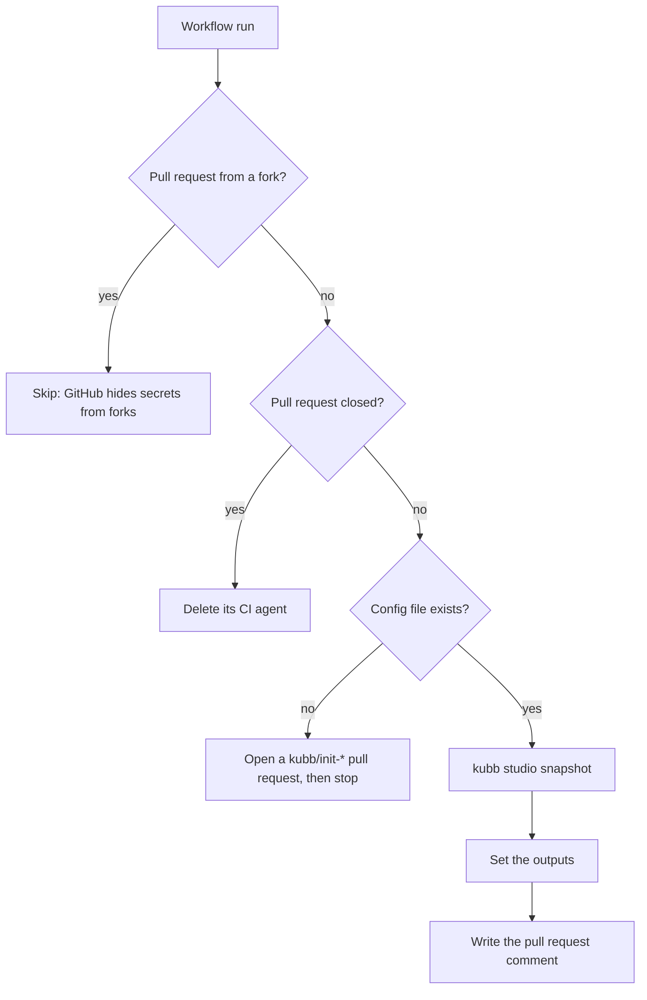

# GitHub Actions

`kubb-labs/action@v0` runs `kubb studio snapshot` to publish a Studio snapshot, then writes the result on the pull request. [CI snapshots](/docs/5.x/integrations/github-actions) has the workflow and the permissions it needs.

## Run flow

- Each pull request reuses one CI agent and one comment. Each branch push reuses one CI agent and writes no comment.
- When the snapshot fails, the comment shows the error and links the workflow run, and the step fails.

See [GitHub Action edge cases](/docs/5.x/topics/studio-and-ci#github-action-runs).

## Inputs

| Input | Default | What it does |
| --- | --- | --- |
| `token` | | Required. The organization CI API key. The action masks it in logs and passes it to the CLI as `KUBB_TOKEN`. |
| `github-token` | <code v-pre>${{ github.token }}</code> | Token that opens the init pull request and writes the comment. |
| `working-directory` | `.` | Folder that holds the Kubb config and `package.json`. |
| `config` | `kubb.config.ts` | Config file path, relative to `working-directory`. |
| `package-name` | `name` in `package.json` | Package name of the snapshot. |
| `package-version` | `version` in `package.json` | Package version of the snapshot, such as <code v-pre>0.0.0-pr.${{ github.event.pull_request.number }}</code>. |

## Outputs

| Output | Value |
| --- | --- |
| `snapshot-id` | The id Studio stores the snapshot under |
| `package-name` | The package name |
| `package-version` | The package version |
| `tarball-url` | The URL of the package tarball |
| `integrity` | The SHA-512 integrity of the tarball |
| `agent-url` | The Studio URL of the CI agent that holds the snapshot |
| `editor-url` | The read-only Studio editor for the output |
| `files-added`, `files-changed`, `files-removed` | Generated files added, changed, and removed since the previous snapshot on the pull request. `0` when there is none. |

## Kubb version

The action runs `node_modules/.bin/kubb` from `working-directory`, so the snapshot uses the Kubb version your config and plugins are built against. That install must be Kubb 5.6.2 or later. Without one, the action runs `npx` with `@kubb/cli@^5.16.0`, `@kubb/studio@^5.16.0`, and `tsdown@^0.23.1`.

## Pull request comment

The comment shows the package name and version, an `npm i <tarball-url>` command, and the generated file changes against the base branch and since the previous snapshot.

> [!TIP]
> The base branch comparison needs a snapshot of the base branch. Run the workflow on pushes to that branch too.

See [Read the snapshot comment](/docs/5.x/topics/studio-and-ci#github-action-runs).

## Environment variables

| Variable | Default | What it does |
| --- | --- | --- |
| `KUBB_STUDIO_URL` | `https://kubb.studio` | Studio URL for a self-hosted deployment |
