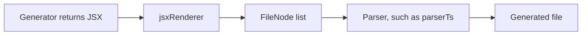

# JSX renderer

`kubb/jsx` lets you write a generator's files as JSX instead of [`ast.factory`](/docs/5.x/reference/kit/ast#factory-functions) node builders.

## Renderers {#renderers}

A renderer turns what a generator returns into `FileNode`s. Set `renderer: jsxRenderer` on the generator. Leave `renderer` unset or `null` when it returns `FileNode`s from `ast.factory`.



> [!NOTE]
> `jsxRenderer` does not use React. Components run once as plain functions, so hooks, suspense, and class components do not work.

For another template format, pass `createRenderer` from `kubb/kit` a factory that returns `{ render, files, [Symbol.dispose] }`.

## Setup

Point `tsconfig.json` at the `kubb/jsx` runtime instead of React:

```json [tsconfig.json]
{
  "compilerOptions": {
    "jsx": "react-jsx",
    "jsxImportSource": "kubb/jsx"
  }
}
```

## `jsxRenderer()`

`jsxRenderer()` returns a renderer. Call `render` with a JSX element, then read `files`.

```tsx [render.tsx]
import { File, Function, Type, jsxRenderer } from 'kubb/jsx'

const renderer = jsxRenderer()

await renderer.render(
  <File baseName="petStore.ts" path="src/gen/petStore.ts">
    <File.Source>
      <Type name="Pet">{'{ id: number; name: string }'}</Type>
      <Function name="getPet" async>
        {"return fetch('/pets')"}
      </Function>
    </File.Source>
  </File>,
)

const files = renderer.files
```

## Built-in components

| Group | Components |
| --- | --- |
| [Core](#core) | [`File`](#file), [`File.Source`](#file-source), [`File.Import`](#file-import), [`File.Export`](#file-export) |
| [JavaScript](#javascript) | [`Const`](#const), [`Function`](#function), [`Function.Arrow`](#function-arrow), [`Type`](#type) |
| [Markdown](#markdown) | [`Callout`](#callout), [`Frontmatter`](#frontmatter), [`Heading`](#heading), [`List`](#list), [`Paragraph`](#paragraph) |
| [JSX](#jsx) | [`Jsx`](#jsx-component) |

Inside a code component or `File.Source`, `<br />` adds a line break.

### Core

#### `File` {#file}

With `baseName` and `path`, `File` declares a generated file. Without them, it renders its children inline. Text directly in a `File`, outside `File.Source`, throws.

| Prop | Type | Description |
| --- | --- | --- |
| `baseName` | `` `${string}.${string}` `` | The file name, such as `petStore.ts` |
| `path` | `string` | The full output path |
| `meta?` | `object \| null` | Metadata for plugins to read |
| `banner?` | `string \| null` | Text before the source blocks |
| `footer?` | `string \| null` | Text after the source blocks |
| `copy?` | `string \| null` | An absolute path of a file to copy into the output |
| `children?` | `KubbReactNode` | The file's sources, imports, and exports |

```tsx
<File baseName="petStore.ts" path="src/models/petStore.ts">
  <File.Source name="Pet" isExportable isIndexable>
    {`export type Pet = { id: number; name: string }`}
  </File.Source>
</File>
```

#### `File.Source` {#file-source}

A block of source text in the enclosing `File`.

| Prop | Type | Description |
| --- | --- | --- |
| `name?` | `string \| null` | Names the source for deduplication and barrels |
| `isExportable?` | `boolean \| null` | Marks an exported declaration. The text still needs its own `export`. |
| `isIndexable?` | `boolean \| null` | Includes the source in barrels |
| `isTypeOnly?` | `boolean \| null` | Marks a type-only export |
| `inline?` | `{ expression: string } \| null` | Lets importing files use `expression` in place of the name |
| `pointer?` | `string` | The input location, such as `#/components/schemas/Pet` |
| `children?` | `KubbReactNode` | The source text |

See [Inline sources](#inline-sources) for `copy` and `inline`.

#### `File.Import` {#file-import}

An import at the top of the enclosing `File`.

| Prop | Type | Description |
| --- | --- | --- |
| `name` | `string \| Array<string \| { propertyName: string; name?: string }>` | A string for a default or namespace import, or an array of named imports |
| `path` | `string` | The module to import from |
| `root?` | `string \| null` | The file path the import is relative to |
| `isTypeOnly?` | `boolean \| null` | Emits `import type` |
| `isNameSpace?` | `boolean \| null` | Emits `import * as name` |

```tsx
<File.Import name={['useState']} path="react" />
// import { useState } from 'react'

<File.Import name="z" path="zod" isNameSpace />
// import * as z from 'zod'
```

#### `File.Export` {#file-export}

An export at the top of the enclosing `File`.

| Prop | Type | Description |
| --- | --- | --- |
| `name?` | `string \| Array<string> \| null` | The names to export, or none for a wildcard export |
| `path` | `string` | The module to export from |
| `isTypeOnly?` | `boolean \| null` | Emits `export type` |
| `asAlias?` | `boolean \| null` | Emits `export * as name` |

```tsx
<File.Export name={['Pet']} path="./models/petStore" />
// export { Pet } from './models/petStore'

<File.Export path="./models/petStore" isTypeOnly />
// export type * from './models/petStore'
```

### JavaScript

The JavaScript components emit TypeScript inside a `File.Source`. Each takes `export?: boolean | null` to add `export`, and `JSDoc?: { comments?: Array<string | undefined> } | null` for a JSDoc block.

#### `Const` {#const}

A `const` declaration, with the children as the initializer.

| Prop | Type | Description |
| --- | --- | --- |
| `name` | `string` | The name |
| `type?` | `string \| null` | The annotation after `const name:` |
| `asConst?` | `boolean \| null` | Adds `as const` after the initializer |

```tsx
<Const export name="petSchema" type="z.ZodType<Pet>">
  {`z.object({ id: z.number() })`}
</Const>
// export const petSchema: z.ZodType<Pet> = z.object({ id: z.number() })
```

#### `Function` {#function}

A function declaration, with the children as the body.

| Prop | Type | Description |
| --- | --- | --- |
| `name` | `string` | The name |
| `default?` | `boolean \| null` | Adds `default` after `export` |
| `async?` | `boolean \| null` | Adds `async` and wraps `returnType` in `Promise<…>` |
| `params?` | `string \| null` | The parameter list |
| `generics?` | `string \| Array<string> \| null` | The type parameters. An array joins with commas. |
| `returnType?` | `string \| null` | The return type after `:` |

```tsx
<Function export async name="getPet" generics={['TData = Pet']} params="petId: string" returnType="TData">
  {'return client.get("/pets/" + petId)'}
</Function>
// export async function getPet<TData = Pet>(petId: string): Promise<TData> { … }
```

#### `Function.Arrow` {#function-arrow}

An arrow function in a `const`. It takes every `Function` prop, plus `singleLine?: boolean | null` for an expression body without braces.

```tsx
<Function.Arrow export name="double" params="n: number" returnType="number" singleLine>
  {`n * 2`}
</Function.Arrow>
// export const double = (n: number): number => n * 2
```

#### `Type` {#type}

A type alias, with the children as the type. `name` must start with an uppercase letter, or `Type` throws.

| Prop | Type | Description |
| --- | --- | --- |
| `name` | `string` | The alias name |

```tsx
<Type export name="PetId">
  {`string | number`}
</Type>
// export type PetId = string | number
```

### Markdown

Each Markdown component emits its own source block, so put it directly in a `File`, not a `File.Source`. Name the file `.md` so `parserMd` prints it.

```tsx [docs.tsx]
import { Callout, File, Frontmatter, Heading, List, Paragraph, jsxRenderer } from 'kubb/jsx'

const renderer = jsxRenderer()

await renderer.render(
  <File baseName="pets.md" path="src/docs/pets.md">
    <Frontmatter data={{ title: 'Pets', layout: 'doc' }} />
    <Heading level={2}>Pets</Heading>
    <Paragraph>{'A pet object with an id and a name.'}</Paragraph>
    <List items={['id: number', 'name: string']} />
    <Callout type="tip">Keep the generator hot with kubb generate --watch.</Callout>
  </File>,
)
```

#### `Callout` {#callout}

A GitHub alert in `> [!TYPE]` syntax.

| Prop | Type | Description |
| --- | --- | --- |
| `type` | `'tip' \| 'note' \| 'important' \| 'warning' \| 'caution'` | The alert kind, printed in uppercase |
| `title?` | `string \| null` | Text on the marker line |
| `children` | `string` | The body. Each line gets a `> ` prefix. |

```tsx
<Callout type="warning" title="Heads up">Breaking change in v6.</Callout>
// > [!WARNING] Heads up
// > Breaking change in v6.
```

#### `Frontmatter` {#frontmatter}

YAML frontmatter between `---` fences, as the first child of the `File`. An empty `data` prints nothing.

| Prop | Type | Description |
| --- | --- | --- |
| `data` | `Record<string, unknown>` | The object to write as YAML |

#### `Heading` {#heading}

An ATX heading, such as `## Installation` for `level={2}`.

| Prop | Type | Description |
| --- | --- | --- |
| `level` | `1 \| 2 \| 3 \| 4 \| 5 \| 6` | The number of `#` characters |
| `children` | `string` | The heading text |

#### `List` {#list}

A list with one item per line.

| Prop | Type | Description |
| --- | --- | --- |
| `items` | `ReadonlyArray<string>` | The items |
| `ordered?` | `boolean \| null` | Numbers the items `1.`, `2.`, and so on. Default: a `-` list. |

#### `Paragraph` {#paragraph}

A paragraph. Inline Markdown passes through as written.

| Prop | Type | Description |
| --- | --- | --- |
| `children` | `string` | The paragraph text |

### JSX

#### `Jsx` {#jsx-component}

Embeds a raw JSX string, fragments included, such as a component body in a `Function`. The children must be one plain string.

| Prop | Type | Description |
| --- | --- | --- |
| `children?` | `string` | The JSX source, written as is |

```tsx
<Function name="MyComponent" export>
  <Jsx>{'return (\n  <>\n    <div>Hello</div>\n  </>\n)'}</Jsx>
</Function>
```

## Less common cases {#less-common-cases}

### Inline sources {#inline-sources}

When a plugin writes a `File` with `copy` or a `File.Source` with `inline`, Kubb copies or absorbs it instead of printing it.

- `copy` on `File` is an absolute path to copy into the output, through the parser's `copy` hook if it has one. Its sources count for barrels but are not printed.
- `inline.expression` on `File.Source` is the right-hand side of the declaration.
- Kubb does not write a file whose sources are all inline. Files that import it get the expression and its imports.

```tsx
<File.Source name="AddPetStatus200" isTypeOnly isExportable inline={{ expression: 'Pet' }}>
  {`export type AddPetStatus200 = Pet`}
</File.Source>
```

The parser's `inline` member (`InlineLanguage`) runs before barrels. It finds names (`replaceIdentifiers`) and makes a definition safe to put where a name was (`wrap`). Only files of a parser with `inline`, such as `parserTs`, absorb inline sources.

With the `kubb/jsx` [setup](#setup), `.tsx` files load `jsx-runtime` and `jsx-dev-runtime` from `kubb/jsx`.
