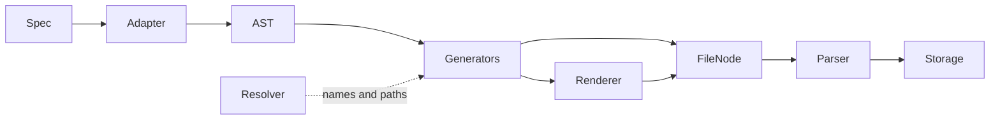

# Kit API

`kubb/kit` holds the APIs for writing plugins, adapters, parsers, and storage backends. It ships with the `kubb` package.

## Parts of the kit

An adapter reads the spec into the AST. Each plugin's generators walk the AST and return files, a resolver names them, and a renderer turns JSX into files. Parsers print the files, and storage writes them. The engine runs it all and fires hooks along the way.



| Part                 | Entry points                                                | Page                                                               |
| -------------------- | ----------------------------------------------------------- | ------------------------------------------------------------------ |
| Plugins              | `defineExtension({ kind: 'plugin' })`, `addGenerator`, `setResolver` | [Extensions: plugins](/docs/5.x/reference/kit/plugins)  |
| Adapters             | `defineExtension({ kind: 'adapter' })`                      | [Extensions: adapters](/docs/5.x/reference/kit/adapters) |
| Parsers              | `defineExtension({ kind: 'parser' })`                       | [Extensions: parsers](/docs/5.x/reference/kit/parsers)  |
| Generators           | `defineGenerator`                                           | [Generators](/docs/5.x/reference/kit/generators)                   |
| Resolvers            | `createResolver`, `Resolver`                                | [Resolvers](/docs/5.x/reference/kit/resolvers)                     |
| AST                  | `ast`, `createPrinter`, `defineMacro`                       | [AST and node builders](/docs/5.x/reference/kit/ast)               |
| JSX renderer         | `jsxRenderer`, `createRenderer`                             | [JSX renderer](/docs/5.x/reference/jsx)                            |
| Storage              | `createStorage`, `fsStorage`, `memoryStorage`               | [Storage](/docs/5.x/reference/kit/storage)                         |
| Engine               | `createKubb`, `Diagnostics`                                 | [Engine](/docs/5.x/reference/kit/engine)                           |
| Lifecycle hooks      | `KubbHooks`, `Hookable`                                     | [Lifecycle hooks](/docs/5.x/reference/kit/hooks)                   |
| Extension manifest   | `kubb-extension.json`, `isExtensionManifest`                | [Extension manifest](/docs/5.x/reference/kit/manifest)             |
| Extension docs       | `docs/` folder                                              | [Extension docs](/docs/5.x/reference/kit/extension-docs)           |

`createKubb` comes from `kubb`, `jsxRenderer` from `kubb/jsx`, and everything else from `kubb/kit`.

## Casing {#casing}

`casing` turns names from a spec into identifiers and file names. Every helper except `capitalize` takes a second argument, `{ prefix, suffix }`, that it adds before casing.

| Helper                  | Example                                    |
| ----------------------- | ------------------------------------------ |
| `casing.camel`          | `'get pet-by id'` gives `'getPetById'`.    |
| `casing.pascal`         | `'get pet-by id'` gives `'GetPetById'`.    |
| `casing.snake`          | `'helloWorld'` gives `'hello_world'`.      |
| `casing.screamingSnake` | `'helloWorld'` gives `'HELLO_WORLD'`.      |
| `casing.capitalize`     | `'getPetById'` gives `'GetPetById'`.       |

```typescript [casing.ts]
import { casing } from 'kubb/kit'

casing.camel('tag', { prefix: 'create' }) // 'createTag'
```

`camelCase` and `pascalCase` from `kubb/kit` are deprecated. Use `casing.camel` and `casing.pascal`.

## Text {#text}

`text` holds helpers that work for any output language, so a quote or line break in a spec name cannot break the output.

| Helper                       | Returns                                                                                   |
| ---------------------------- | ----------------------------------------------------------------------------------------- |
| `text.quote(value)`          | A single-quoted string literal with quotes, backslashes, and line breaks escaped. `''` for `null` or `undefined`. |
| `text.indent({ text, unit })` | `text` with every non-empty line indented by `unit`, two spaces by default. Blank lines stay empty. |
| `text.dedent(text)`          | `text` without its common leading whitespace and the blank lines around it.               |
| `text.unquote(text)`         | `text` without one matching pair of `"`, `'`, or `` ` `` around it.                       |

```typescript [text.ts]
import { text } from 'kubb/kit'

const line = `method: ${text.quote("o'clock")}` // method: 'o\'clock'
```
