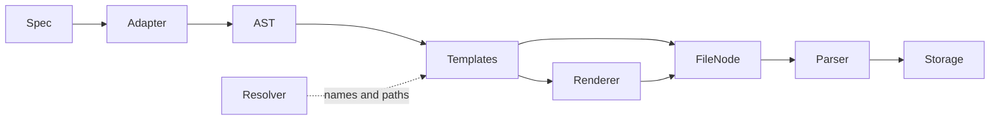

# Kit API

`kubb/kit` gives you the APIs to write plugins, adapters, parsers, and storage backends. It ships with `kubb`.

## Parts of the kit

An adapter reads the spec into the AST. Templates turn the AST into files, and a resolver names them. Parsers print the files, and storage writes them.



| Part                 | Entry points                                                | Page                                                               |
| -------------------- | ----------------------------------------------------------- | ------------------------------------------------------------------ |
| Plugins              | `defineExtension({ kind: 'plugin' })`, `addTemplate`, `setResolver` | [Plugins](/docs/5.x/reference/kit/plugins)                 |
| Adapters             | `defineExtension({ kind: 'adapter' })`                      | [Adapters](/docs/5.x/reference/kit/adapters)                       |
| Parsers              | `defineExtension({ kind: 'parser' })`                       | [Parsers](/docs/5.x/reference/kit/parsers)                         |
| Templates            | `defineTemplate`                                            | [Templates](/docs/5.x/reference/kit/templates)                     |
| Resolvers            | `createResolver`, `Resolver`                                | [Resolvers](/docs/5.x/reference/kit/resolvers)                     |
| AST                  | `ast`, `createPrinter`, `defineMacro`                       | [AST and node builders](/docs/5.x/reference/kit/ast)               |
| JSX renderer         | `jsxRenderer`, `createRenderer`                             | [JSX renderer](/docs/5.x/reference/jsx)                            |
| Storage              | `createStorage`, `fsStorage`, `memoryStorage`               | [Storage](/docs/5.x/reference/kit/storage)                         |
| Engine               | `createKubb`, `Diagnostics`                                 | [Engine](/docs/5.x/reference/kit/engine)                           |
| Lifecycle hooks      | `KubbHooks`, `Hookable`                                     | [Lifecycle hooks](/docs/5.x/reference/kit/hooks)                   |
| Context              | `withContext`, `useKubb`, composables                       | [Context](/docs/5.x/reference/kit/context)                         |
| Extension manifest   | `kubb-extension.json`, `isExtensionManifest`                | [Extension manifest](/docs/5.x/reference/kit/manifest)             |
| Extension docs       | `docs/` folder                                              | [Extension docs](/docs/5.x/reference/kit/extension-docs)           |

Import `createKubb` from `kubb`, `jsxRenderer` from `kubb/jsx`, and everything else from `kubb/kit`.

## Casing {#casing}

`casing` turns spec names into identifiers and file names. Every helper except `capitalize` takes `{ prefix, suffix }` as a second argument and adds them before casing.

| Helper                  | Input             | Output          |
| ----------------------- | ----------------- | --------------- |
| `casing.camel`          | `'get pet-by id'` | `'getPetById'`  |
| `casing.pascal`         | `'get pet-by id'` | `'GetPetById'`  |
| `casing.snake`          | `'helloWorld'`    | `'hello_world'` |
| `casing.screamingSnake` | `'helloWorld'`    | `'HELLO_WORLD'` |
| `casing.capitalize`     | `'getPetById'`    | `'GetPetById'`  |

```typescript [casing.ts]
import { casing } from 'kubb/kit'

casing.camel('tag', { prefix: 'create' }) // 'createTag'
```

## Text {#text}

`text` escapes and formats strings for any output language, so a quote or line break in a spec name cannot break the output.

| Helper                        | Returns                                                                       |
| ----------------------------- | ----------------------------------------------------------------------------- |
| `text.quote(value)`           | A single-quoted, escaped string literal. `''` for `null` or `undefined`.      |
| `text.indent({ text, unit })` | `text` with each non-empty line indented by `unit`, two spaces by default.    |
| `text.dedent(text)`           | `text` without its common leading whitespace and surrounding blank lines.     |
| `text.unquote(text)`          | `text` without one matching pair of `"`, `'`, or `` ` `` around it.           |

```typescript [text.ts]
import { text } from 'kubb/kit'

const line = `method: ${text.quote("o'clock")}` // method: 'o\'clock'
```

## Unique names {#renamer}

`createRenamer()` hands out names that do not clash. When a name is taken, it adds 2, 3 and so on, as in `Options2`. Use it when one file or scope declares names from several sources, such as one name per content type.

| Method                              | What it does                                                                                     |
| ----------------------------------- | ------------------------------------------------------------------------------------------------ |
| `reserve({ name })`                 | Keeps `name` from being assigned, such as a global the code uses.                                |
| `bind({ name, owner })`             | Gives `name` to `owner` as it is, such as a name the file already imports.                       |
| `assign({ name, owner?, emits? })`  | Returns the first free name from `name`. The same `owner` may take a name it already holds.      |

`emits` returns the names one candidate claims, for a declaration that writes more than one, such as an enum value and its type. All of them must be free.

```typescript [renamer.ts]
import { createRenamer } from 'kubb/kit'

const renamer = createRenamer()
renamer.reserve({ name: 'Response' })
renamer.assign({ name: 'Response' }) // 'Response2'
renamer.assign({ name: 'Status', emits: (name) => [name, `${name}Key`] }) // claims 'Status' and 'StatusKey'
```
