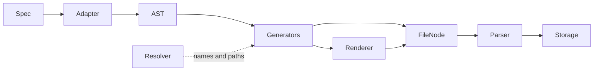

# Kit API

`kubb/kit` gives you the APIs to write plugins, adapters, parsers, and storage backends. It ships with `kubb`.

## Parts of the kit

An adapter reads the spec into the AST. Generators turn the AST into files, and a resolver names them. Parsers print the files, and storage writes them.



| Part                 | Entry points                                                | Page                                                               |
| -------------------- | ----------------------------------------------------------- | ------------------------------------------------------------------ |
| Plugins              | `defineExtension({ kind: 'plugin' })`, `addGenerator`, `setResolver` | [Plugins](/docs/5.x/reference/kit/plugins)                |
| Adapters             | `defineExtension({ kind: 'adapter' })`                      | [Adapters](/docs/5.x/reference/kit/adapters)                       |
| Parsers              | `defineExtension({ kind: 'parser' })`                       | [Parsers](/docs/5.x/reference/kit/parsers)                         |
| Generators           | `defineGenerator`                                           | [Generators](/docs/5.x/reference/kit/generators)                   |
| Resolvers            | `createResolver`, `Resolver`                                | [Resolvers](/docs/5.x/reference/kit/resolvers)                     |
| AST                  | `ast`, `createPrinter`, `defineMacro`                       | [AST and node builders](/docs/5.x/reference/kit/ast)               |
| JSX renderer         | `jsxRenderer`, `createRenderer`                             | [JSX renderer](/docs/5.x/reference/jsx)                            |
| Storage              | `createStorage`, `fsStorage`, `memoryStorage`               | [Storage](/docs/5.x/reference/kit/storage)                         |
| Engine               | `createKubb`, `Diagnostics`                                 | [Engine](/docs/5.x/reference/kit/engine)                           |
| Lifecycle hooks      | `KubbHooks`, `Hookable`                                     | [Lifecycle hooks](/docs/5.x/reference/kit/hooks)                   |
| Extension manifest   | `kubb-extension.json`, `isExtensionManifest`                | [Extension manifest](/docs/5.x/reference/kit/manifest)             |
| Extension docs       | `docs/` folder                                              | [Extension docs](/docs/5.x/reference/kit/extension-docs)           |

Import `createKubb` from `kubb`, `jsxRenderer` from `kubb/jsx`, and everything else from `kubb/kit`.

## Casing {#casing}

`casing` turns spec names into identifiers and file names. Every helper except `capitalize` takes `{ prefix, suffix }` as a second argument and adds them before casing.

| Helper                  | Input             | Output          |
| ----------------------- | ----------------- | --------------- |
| `casing.camel`          | `'get pet-by id'` | `'getPetById'`  |
| `casing.pascal`         | `'get pet-by id'` | `'GetPetById'`  |
| `casing.snake`          | `'helloWorld'`    | `'hello_world'` |
| `casing.screamingSnake` | `'helloWorld'`    | `'HELLO_WORLD'` |
| `casing.capitalize`     | `'getPetById'`    | `'GetPetById'`  |

```typescript [casing.ts]
import { casing } from 'kubb/kit'

casing.camel('tag', { prefix: 'create' }) // 'createTag'
```

> [!WARNING]
> `camelCase` and `pascalCase` from `kubb/kit` are deprecated. Use `casing.camel` and `casing.pascal`.

## Text {#text}

`text` escapes and formats strings for any output language, so a quote or line break in a spec name cannot break the output.

| Helper                        | Returns                                                                       |
| ----------------------------- | ----------------------------------------------------------------------------- |
| `text.quote(value)`           | A single-quoted, escaped string literal. `''` for `null` or `undefined`.      |
| `text.indent({ text, unit })` | `text` with each non-empty line indented by `unit`, two spaces by default.    |
| `text.dedent(text)`           | `text` without its common leading whitespace and surrounding blank lines.     |
| `text.unquote(text)`          | `text` without one matching pair of `"`, `'`, or `` ` `` around it.           |

```typescript [text.ts]
import { text } from 'kubb/kit'

const line = `method: ${text.quote("o'clock")}` // method: 'o\'clock'
```
