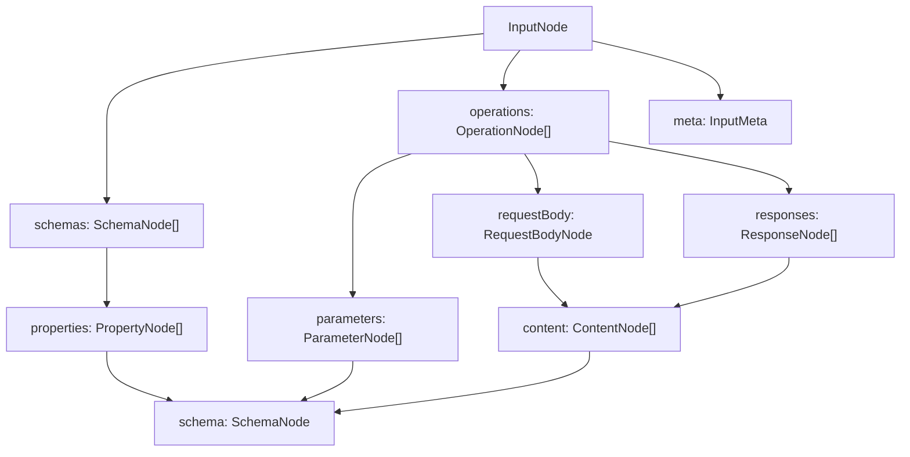
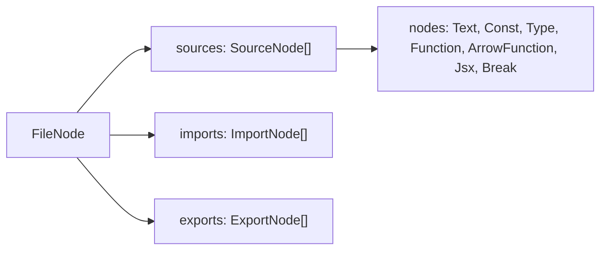

# AST and node builders

## `ast`

`ast` from `kubb/kit` gives you the whole AST API in one namespace, like `ts.factory` for TypeScript. `ast.factory` builds nodes, and `ast.node` walks them. Each other group reads one subject, such as refs.

```typescript [ast-namespace.ts]
import { ast } from 'kubb/kit'

const root = ast.factory.createInput({
  schemas: [ast.factory.createSchema({ name: 'Pet', type: 'object', properties: [] })],
  operations: [],
})
```

## Node tree {#node-tree}

An adapter returns one `InputNode`. Every node has a `kind`, such as `'Schema'`. A schema also has a `type`. A `ref` schema points at a schema in `schemas` instead of copying it.



A template returns `FileNode`s, a second tree:



## Schema node types

You narrow a `SchemaNode` by its `type`. `ast.schema.types` lists every value.

| Family     | Types                                                                                         | Notes                         |
| ---------- | --------------------------------------------------------------------------------------------- | ----------------------------- |
| Structural | `object`, `array`, `tuple`, `union`, `intersection`, `enum`, `not`                            |                               |
| Scalar     | `string`, `number`, `integer`, `bigint`, `boolean`, `null`, `any`, `unknown`, `void`, `never` | `integer` prints as `number`. |
| Special    | `ref`, `date`, `datetime`, `time`, `uuid`, `email`, `url`, `ipv4`, `ipv6`, `blob`             | `blob` is binary data         |

Schema, parameter, request body, response and content nodes keep the source object's vendor extensions (`x-*` keys) in `extensions`, as input and operation nodes do. A `blob` node keeps `contentMediaType` and `contentEncoding` in `content`.

## `ast.factory` {#factory-functions}

`ast.factory` builds typed nodes with the defaults filled in. Use it instead of object literals.

| Tree       | Factories                                                                                                                                     |
| ---------- | --------------------------------------------------------------------------------------------------------------------------------------------- |
| Input      | `createInput`, `createSchema`, `createOperation`, `createOperations`, `createParameter`, `createProperty`, `createResponse`, `createRequestBody`, `createContent` |
| File       | `createFile`, `createSource`, `createImport`, `createExport`                                                                                  |
| Code nodes | `createText`, `createConst`, `createType`, `createFunction`, `createArrowFunction`, `createJsx`, `createBreak`                                |

```typescript [factory.ts]
import { ast } from 'kubb/kit'

ast.factory.createSchema({ type: 'string', format: 'email' })
// { kind: 'Schema', type: 'string', primitive: 'string', format: 'email' }

ast.factory.createText('export const a = 1')
// { kind: 'Text', value: 'export const a = 1' }
```

## `ast.node` {#visitors}

`ast.node` walks a tree with a visitor, which has a callback per kind: `input`, `operation`, `schema`, `property`, `parameter`, and `response`. In a plugin, use a [macro](#macros) instead of `transform`.

| Helper               | Returns                                     |
| -------------------- | ------------------------------------------- |
| `ast.node.transform` | A new tree with the visitor's replacements  |
| `ast.node.collect`   | The visitor's non-null results, depth-first |
| `ast.node.kinds`     | Every node `kind`, such as `'Schema'`       |
| `ast.node.getText`   | Code node text, joined by newlines          |

Pass `depth: 'shallow'` to `transform` or `collect` to skip nested schemas.

```typescript [node.ts]
import { ast } from 'kubb/kit'

const root = ast.factory.createInput({ schemas: [], operations: [] })

const strict = ast.node.transform(root, {
  schema(node) {
    return node.type === 'object' && node.additionalProperties === undefined ? { ...node, additionalProperties: false } : node
  },
})

const mutations = ast.node.collect<ast.OperationNode>(root, {
  operation(node) {
    return node.method === 'POST' ? node : undefined
  },
})
// Array<OperationNode>

ast.node.kinds.schema // 'Schema'
ast.node.getText([ast.factory.createText('const a = 1'), ast.factory.createText('const b = 2')]) // 'const a = 1\nconst b = 2'
```

## `ast.file` {#ast-file}

| Helper            | Returns                                                                |
| ----------------- | ---------------------------------------------------------------------- |
| `ast.file.inline` | `{ files, virtualPaths, problems }`, with virtual-file imports inlined |

```typescript [file.ts]
import { ast } from 'kubb/kit'

// Array<FileNode>, Array<string>, Array<{ path: string, message: string }>
const {
  files: inlined,
  virtualPaths,
  problems,
} = ast.file.inline(files, {
  language: (file) => parsers.get(file.extname)?.inline,
})
```

## `ast.macro` {#macros}

A macro is a named transform that rewrites nodes before printing. Define one with `defineMacro`, as [Macros](/docs/5.x/how-to/customize#macros) shows.

| Helper                   | Returns                                              |
| ------------------------ | ---------------------------------------------------- |
| `ast.macro.apply`        | The tree after running the macros                    |
| `ast.macro.compareOrder` | Sorts `enforce` values: `'pre'` first, `'post'` last |

```typescript [macro.ts]
import { ast, defineMacro } from 'kubb/kit'

const macroUntagged = defineMacro({
  name: 'untagged',
  operation: (node) => (node.tags?.length ? undefined : { ...node, tags: ['untagged'] }),
})

ast.macro.apply(operation, [macroUntagged]).tags // ['untagged']
ast.macro.compareOrder('pre', 'post') // -2
ast.macro.compareOrder(undefined, 'post') // -1
```

`kubb/kit` also exports built-in macros. Call `macroDiscriminatorEnum` and `macroEnumName` with options to get the macro.

| Macro                    | Purpose                                                   |
| ------------------------ | --------------------------------------------------------- |
| `macroDedupeUnion`       | Drops repeated union members, ignoring the source pointer |
| `macroDiscriminatorEnum` | Turns a discriminator property into an enum of its values |
| `macroEnumName`          | Names an inline enum from its parent and property         |

### Macro options and callbacks

A macro has the callbacks of an [`ast.node`](#visitors) visitor, a `name`, and optional `enforce` and `match`. Each callback gets the visitor context, with the node's `parent`, as `this` and as its second argument. It returns a replacement node, or `undefined` or `null` to keep the original.

```typescript [Type definition]
type Macro = {
  name: string
  enforce?: 'pre' | 'post'
  match?: (node: Node) => boolean
  schema?(node: SchemaNode, context): SchemaNode | null | undefined
  operation?(node: OperationNode, context): OperationNode | null | undefined
  // input, property, parameter, response
}
```

## `ast.json` {#ast-json}

Use `ast.json` to cache a parsed spec or to send one to another thread or process. A plain `JSON.stringify(root)` writes the whole target schema again at every ref. `ast.json.stringify` writes each target once.

| Helper               | Returns                                                                    |
| -------------------- | -------------------------------------------------------------------------- |
| `ast.json.stringify` | JSON text for an `InputNode`, with every ref target written once           |
| `ast.json.parse`     | The `InputNode` from that text. Refs to one schema share one object again. |

```typescript [json.ts]
import { ast } from 'kubb/kit'

const text = ast.json.stringify(root)

ast.json.parse(text) // InputNode, equal to root
```

A `FileNode` holds no refs, so plain `JSON.stringify(file)` and `JSON.parse` are enough for files.

## `ast.ref` {#ast-ref}

| Helper                | Returns                                                                  |
| --------------------- | ------------------------------------------------------------------------ |
| `ast.ref.getName`     | The target name, `targetName` first. Pass the node, not `node.ref`.      |
| `ast.ref.getSchema`   | The schema a ref points at, or the node itself                           |
| `ast.ref.isAlias`     | Whether a ref adds nothing and prints as its target name                 |
| `ast.ref.mergeSchema` | The ref merged with its schema, ref fields such as `description` winning |

`kubb/kit` also exports the name builders `childName` and `enumPropName`.

```typescript [ref.ts]
import { ast } from 'kubb/kit'

ast.ref.getName('#/components/schemas/Pet') // 'Pet'
ast.ref.getSchema(petRef).type // 'object'
ast.ref.isAlias(petRef) // true
ast.ref.mergeSchema(petRef).description // 'The owner pet', from the ref
```

## `ast.graph` {#ast-graph}

Use `ast.graph` to drop unused schemas or to wrap circular ones in a lazy getter.

| Helper                       | Returns                                                                         |
| ---------------------------- | ------------------------------------------------------------------------------- |
| `ast.graph.getRefNames`      | Every schema name a node refers to, at any depth                                |
| `ast.graph.getImportedNames` | The ref names a printed schema imports. `{ checks: true }` adds refs in checks. |
| `ast.graph.getUsedNames`     | The schema names operations reach, also through other schemas                   |
| `ast.graph.getCircularNames` | The schemas in a circular chain                                                 |

```typescript [graph.ts]
import { ast } from 'kubb/kit'

ast.graph.getRefNames(ownerSchema) // Set { 'Pet' }
ast.graph.getImportedNames(petListSchema) // ['Pet']
ast.graph.getUsedNames(root.operations, root.schemas) // Set { 'Pet' }
ast.graph.getCircularNames([nodeSchema, tagSchema]) // Set { 'Node' }
```

## `ast.schema` {#ast-schema}

| Helper                          | Returns                                                                                     |
| ------------------------------- | ------------------------------------------------------------------------------------------- |
| `ast.schema.types`              | Every schema `type`, such as `'string'`                                                     |
| `ast.schema.narrow`             | The schema typed as a given `type`, or `null`                                               |
| `ast.schema.find`               | The first matching schema. `follow: ['ref']` also searches resolved refs.                   |
| `ast.schema.applyOptionality`   | Marks the schema `optional` if not required, `nullish` if also nullable                     |
| `ast.schema.findProperties`     | The named properties on an object, resolved ref, or intersection, not a union               |
| `ast.schema.getLiterals`        | The literals an enum, resolved ref, or literal union allows                                 |
| `ast.schema.inferDiscriminator` | The property each member pins to its own literal                                            |
| `ast.schema.getEmbeddedJson`    | The schema of JSON inside a string (`contentMediaType` with `contentSchema`)                |
| `ast.schema.is`                 | Whether a schema is `binary`, `string`, `text`, `scalar`, `const`, `enumLike`, or `untyped` |

```typescript twoslash [schema.ts]
import { ast } from 'kubb/kit'

const root = ast.factory.createInput({ schemas: [], operations: [] })

const dateSchema = ast.schema.find(root, {
  follow: ['ref'],
  predicate: (schema) => schema.type === 'date',
})
```

```typescript [schema-values.ts]
ast.schema.types.string // 'string'
ast.schema.narrow(node, 'object')?.properties.length // number | undefined
ast.schema.applyOptionality(nullableName, false).nullish // true
ast.schema.findProperties({ node: petSchema, propertyName: 'id' }).map((property) => property.schema.type) // ['integer']
ast.schema.getLiterals(petKind) // ['cat', 'dog']
ast.schema.inferDiscriminator([catSchema, dogSchema]) // 'kind'
ast.schema.getEmbeddedJson(jsonStringSchema)?.name // 'Pet'
ast.schema.is(ast.factory.createSchema({ type: 'uuid' }), 'string') // true
ast.schema.is(uploadSchema, 'binary', { follow: ['ref', 'array'] }) // true for Blob or Blob[] behind refs
```

To reuse `find` results, see [Schema search cache](#schema-search-cache).

## `ast.mediaType` {#ast-media-type}

Each helper takes a media type string or a content entry.

| Helper                  | Returns                                                   |
| ----------------------- | --------------------------------------------------------- |
| `ast.mediaType.getBase` | The lowercase media type without parameters               |
| `ast.mediaType.isJson`  | Whether it is `application/json`, `text/json`, or `+json` |

```typescript [media-type.ts]
ast.mediaType.getBase('Application/JSON; charset=utf-8') // 'application/json'
ast.mediaType.isJson('application/problem+json') // true
```

## `ast.http` {#ast-http}

| Helper                 | Returns                                                                |
| ---------------------- | ---------------------------------------------------------------------- |
| `ast.http.isOperation` | Whether an operation is HTTP, narrowing it to have `method` and `path` |

```typescript [http.ts]
import { ast } from 'kubb/kit'

if (ast.http.isOperation(node)) {
  node.method // 'GET'
}
```

## Printers {#printers}

| `kubb/kit` export | Returns                                       |
| ----------------- | --------------------------------------------- |
| `createPrinter`   | A factory from printer options to a `Printer` |
| `defineMacro`     | The same macro object, typed as a `Macro`     |

A printer's `overrides` map replaces the handlers of single schema types. The `printer.nodes` option of `@kubb/plugin-ts`, `@kubb/plugin-zod`, and `@kubb/plugin-faker` fills it, as [Printers](/docs/5.x/how-to/customize#printers) shows.

> [!WARNING]
> Pass overrides through `overrides`. If you spread them into `nodes`, `this.base` cannot find the original handler.

### Printer handlers and context

Key the map by schema `type`, such as `'string'`. A type without a handler keeps the built-in one.

```typescript [Type definition]
type PrinterNodes = Partial<{
  [K in SchemaType]: (this: Context, node: SchemaNodeByType[K], ctx?: Context) => Output | null
}>
```

A handler gets the context as `this` and as its second argument, so an arrow function can read it as `ctx`, such as `array: (node, ctx) => ctx!.transform(node.items[0])`. The second argument is typed as optional, and its `options` as `object`, so handler types written for `this` alone keep compiling. Read typed options from `this.options`. The root `print` override gets the root context the same way.

| `this` member                    | Does                                                                           |
| -------------------------------- | ------------------------------------------------------------------------------ |
| `this.transform(node, options?)` | Prints a nested schema with every handler, overrides included                  |
| `this.base(node, options?)`      | Runs the replaced built-in handler, to wrap its output                         |
| `this.options`                   | The resolved printer options, such as `arrayType` on `@kubb/plugin-ts`         |
| `this.parent`                    | The schema node whose handler called `this.transform`, `undefined` at the root |
| `this.import(node)`              | Declares an import, as an `ast.factory.createImport()` node                    |

The `options` you pass to `this.transform` or `this.base` are merged over `this.options` for that child and what it prints, and leave the caller's options unchanged:

```typescript
string(node) {
  const contentNode = ast.schema.getEmbeddedJson(node)
  return contentNode ? this.transform(contentNode, { direction: 'decode' }) : 'z.string()'
}
```

A handler that runs during a build, from a template that calls the printer, can call [`from()`](/docs/5.x/reference/kit/templates#from) for another plugin's names and their imports. So a printer needs no `resolver` in its options:

```typescript
ref(node) {
  const type = from('plugin-ts').resolver.name(ast.ref.getName(node) ?? '')
  if (type.import) this.import(type.import)
  return type.name
}
```

`from()` reports `KUBB_NO_CONTEXT` when the printer runs outside a build, such as in a test that calls it directly. Run that call inside `withContext` with a mocked context.

> [!IMPORTANT]
> The built-in templates collect those imports. In your own template, call `printer.drainImports()` after printing.

[Architecture](/docs/5.x/introduction/architecture#ast) explains why the AST exists.

## Less common cases {#less-common-cases}

### Schema search cache {#schema-search-cache}

When you call `ast.schema.find` across many schemas, reuse its answers with a `cache`. Keep one `cache` per predicate and `follow` value, so later calls skip what earlier ones searched.

```typescript [find-cache.ts]
import { ast } from 'kubb/kit'

const dateCache = new WeakMap<ast.SchemaNode, ast.SchemaNode | null>()
const hasDate = (schema: ast.SchemaNode) =>
  ast.schema.find(schema, { follow: ['ref'], cache: dateCache, predicate: (node) => node.type === 'date' }) !== undefined
```

### AST helper details {#ast-helper-details}

Helper names are a verb plus what they return (`getName`) or a question (`isJson`).

| Helper                                     | Detail                                                                                                                                                                             |
| ------------------------------------------ | ---------------------------------------------------------------------------------------------------------------------------------------------------------------------------------- |
| [`createPrinter`](#printers)               | [Import a custom codec](/extensions/kubb-labs/plugin-zod/guides/customization#import-a-custom-codec) shows an `overrides` map in practice.                                         |
| [`ast.schema.is`](#ast-schema)             | `follow` adds links on top of the node itself: `'ref'` jumps to a resolved ref's target, and `'array'` matches when some item matches. Following repeats and stops on a ref cycle. |
| [`ast.graph.getImportedNames`](#ast-graph) | Pass `{ checks: true }` to include refs inside `conditionals`, `contains`, and `content`.                                                                                          |
| [`ast.macro`](#macros)                     | A macro is a named transform that rewrites nodes before printing, with ordering through `enforce` and gating through `match`.                                                      |
