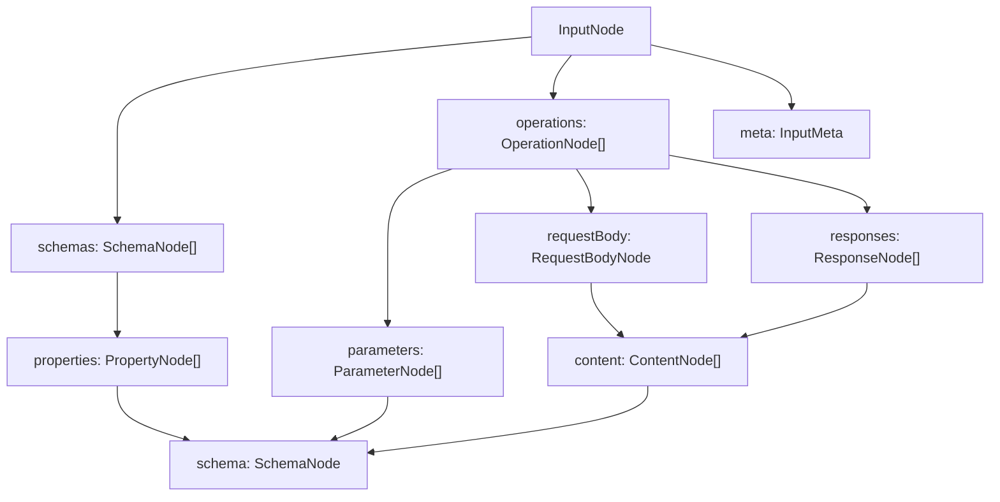
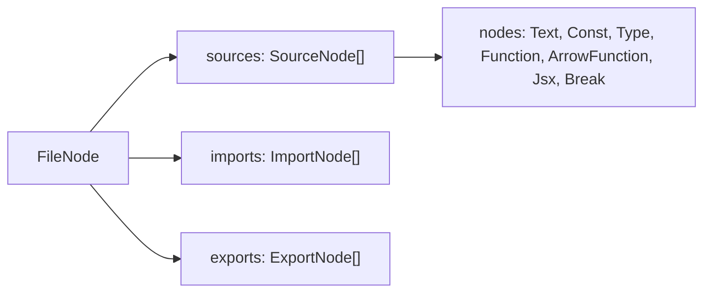

# AST and node builders

## `ast`

`ast` from `kubb/kit` gives you the whole AST API in one namespace, like `ts.factory` for TypeScript. `ast.factory` builds nodes, and `ast.node` walks them. Each other group reads one subject, such as refs.

```typescript [ast-namespace.ts]
import { ast } from 'kubb/kit'

const root = ast.factory.createInput({
  schemas: [ast.factory.createSchema({ name: 'Pet', type: 'object', properties: [] })],
  operations: [],
})
```

> [!WARNING]
> Old top-level names, such as `ast.narrowSchema` or `ast.transform`, are deprecated aliases until Kubb v6. Their JSDoc names the replacement.

## Node tree {#node-tree}

An adapter returns one `InputNode`. Every node has a `kind`, such as `'Schema'`. A schema also has a `type`. A `ref` schema points at a schema in `schemas` instead of copying it.



A generator returns `FileNode`s, a second tree:



## Schema node types

You narrow a `SchemaNode` by its `type`. `ast.schema.types` lists every value.

| Family     | Types                                                                                         | Notes                         |
| ---------- | --------------------------------------------------------------------------------------------- | ----------------------------- |
| Structural | `object`, `array`, `tuple`, `union`, `intersection`, `enum`, `not`                            |                               |
| Scalar     | `string`, `number`, `integer`, `bigint`, `boolean`, `null`, `any`, `unknown`, `void`, `never` | `integer` prints as `number`. |
| Special    | `ref`, `date`, `datetime`, `time`, `uuid`, `email`, `url`, `ipv4`, `ipv6`, `blob`             | `blob` is binary data         |

## `ast.factory` {#factory-functions}

`ast.factory` builds typed nodes with the defaults filled in. Use it instead of object literals.

| Tree       | Factories                                                                                                                                     |
| ---------- | --------------------------------------------------------------------------------------------------------------------------------------------- |
| Input      | `createInput`, `createSchema`, `createOperation`, `createParameter`, `createProperty`, `createResponse`, `createRequestBody`, `createContent` |
| File       | `createFile`, `createSource`, `createImport`, `createExport`                                                                                  |
| Code nodes | `createText`, `createConst`, `createType`, `createFunction`, `createArrowFunction`, `createJsx`, `createBreak`                                |

```typescript [factory.ts]
import { ast } from 'kubb/kit'

ast.factory.createSchema({ type: 'string', format: 'email' })
// { kind: 'Schema', type: 'string', primitive: 'string', format: 'email' }

ast.factory.createText('export const a = 1')
// { kind: 'Text', value: 'export const a = 1' }
```

## `ast.node` {#visitors}

`ast.node` walks a tree with a visitor, which has a callback per kind: `input`, `operation`, `schema`, `property`, `parameter`, and `response`. In a plugin, use a [macro](#macros) instead of `transform`.

| Helper               | Returns                                     |
| -------------------- | ------------------------------------------- |
| `ast.node.transform` | A new tree with the visitor's replacements  |
| `ast.node.collect`   | The visitor's non-null results, depth-first |
| `ast.node.kinds`     | Every node `kind`, such as `'Schema'`       |
| `ast.node.getText`   | Code node text, joined by newlines          |

Pass `depth: 'shallow'` to `transform` or `collect` to skip nested schemas.

```typescript [node.ts]
import { ast } from 'kubb/kit'

const root = ast.factory.createInput({ schemas: [], operations: [] })

const strict = ast.node.transform(root, {
  schema(node) {
    return node.type === 'object' && node.additionalProperties === undefined ? { ...node, additionalProperties: false } : node
  },
})

const mutations = ast.node.collect<ast.OperationNode>(root, {
  operation(node) {
    return node.method === 'POST' ? node : undefined
  },
})
// Array<OperationNode>

ast.node.kinds.schema // 'Schema'
ast.node.getText([ast.factory.createText('const a = 1'), ast.factory.createText('const b = 2')]) // 'const a = 1\nconst b = 2'
```

## `ast.file` {#ast-file}

| Helper            | Returns                                                                |
| ----------------- | ---------------------------------------------------------------------- |
| `ast.file.inline` | `{ files, virtualPaths, problems }`, with virtual-file imports inlined |

```typescript [file.ts]
import { ast } from 'kubb/kit'

// Array<FileNode>, Array<string>, Array<{ path: string, message: string }>
const {
  files: inlined,
  virtualPaths,
  problems,
} = ast.file.inline(files, {
  language: (file) => parsers.get(file.extname)?.inline,
})
```

## `ast.macro` {#macros}

A macro is a named transform that rewrites nodes before printing. Define one with `defineMacro`, as [Macros](/docs/5.x/how-to/customize#macros) shows.

| Helper                   | Returns                                              |
| ------------------------ | ---------------------------------------------------- |
| `ast.macro.apply`        | The tree after running the macros                    |
| `ast.macro.compareOrder` | Sorts `enforce` values: `'pre'` first, `'post'` last |

```typescript [macro.ts]
import { ast, defineMacro } from 'kubb/kit'

const macroUntagged = defineMacro({
  name: 'untagged',
  operation: (node) => (node.tags?.length ? undefined : { ...node, tags: ['untagged'] }),
})

ast.macro.apply(operation, [macroUntagged]).tags // ['untagged']
ast.macro.compareOrder('pre', 'post') // -2
ast.macro.compareOrder(undefined, 'post') // -1
```

`kubb/kit` also exports built-in macros. Call `macroDiscriminatorEnum` and `macroEnumName` with options to get the macro.

| Macro                    | Purpose                                                   |
| ------------------------ | --------------------------------------------------------- |
| `macroDedupeUnion`       | Drops repeated union members, ignoring the source pointer |
| `macroDiscriminatorEnum` | Turns a discriminator property into an enum of its values |
| `macroEnumName`          | Names an inline enum from its parent and property         |

`macroSimplifyUnion`, the pre-5.16 name of `macroDedupeUnion`, is deprecated.

### Macro options and callbacks

A macro has the callbacks of an [`ast.node`](#visitors) visitor, a `name`, and optional `enforce` and `match`. Each callback returns a replacement node, or `undefined` or `null` to keep the original.

```typescript [Type definition]
type Macro = {
  name: string
  enforce?: 'pre' | 'post'
  match?: (node: Node) => boolean
  schema?(node: SchemaNode, context): SchemaNode | null | undefined
  operation?(node: OperationNode, context): OperationNode | null | undefined
  // input, property, parameter, response
}
```

## `ast.json` {#ast-json}

Use `ast.json` to cache a parsed spec or to send one to another thread or process. A plain `JSON.stringify(root)` writes the whole target schema again at every ref. `ast.json.stringify` writes each target once.

| Helper               | Returns                                                                    |
| -------------------- | -------------------------------------------------------------------------- |
| `ast.json.stringify` | JSON text for an `InputNode`, with every ref target written once           |
| `ast.json.parse`     | The `InputNode` from that text. Refs to one schema share one object again. |

```typescript [json.ts]
import { ast } from 'kubb/kit'

const text = ast.json.stringify(root)

ast.json.parse(text) // InputNode, equal to root
```

A `FileNode` holds no refs, so plain `JSON.stringify(file)` and `JSON.parse` are enough for files.

## `ast.ref` {#ast-ref}

| Helper                | Returns                                                                  |
| --------------------- | ------------------------------------------------------------------------ |
| `ast.ref.getName`     | The target name, `targetName` first. Pass the node, not `node.ref`.      |
| `ast.ref.getSchema`   | The schema a ref points at, or the node itself                           |
| `ast.ref.isAlias`     | Whether a ref adds nothing and prints as its target name                 |
| `ast.ref.mergeSchema` | The ref merged with its schema, ref fields such as `description` winning |

`kubb/kit` also exports the name builders `childName` and `enumPropName`.

```typescript [ref.ts]
import { ast } from 'kubb/kit'

ast.ref.getName('#/components/schemas/Pet') // 'Pet'
ast.ref.getSchema(petRef).type // 'object'
ast.ref.isAlias(petRef) // true
ast.ref.mergeSchema(petRef).description // 'The owner pet', from the ref
```

## `ast.graph` {#ast-graph}

Use `ast.graph` to drop unused schemas or to wrap circular ones in a lazy getter.

| Helper                       | Returns                                                                         |
| ---------------------------- | ------------------------------------------------------------------------------- |
| `ast.graph.getRefNames`      | Every schema name a node refers to, at any depth                                |
| `ast.graph.getImportedNames` | The ref names a printed schema imports. `{ checks: true }` adds refs in checks. |
| `ast.graph.getUsedNames`     | The schema names operations reach, also through other schemas                   |
| `ast.graph.getCircularNames` | The schemas in a circular chain                                                 |
| `ast.graph.containsCircular` | Whether a schema reaches a circular one                                         |

```typescript [graph.ts]
import { ast } from 'kubb/kit'

ast.graph.getRefNames(ownerSchema) // Set { 'Pet' }
ast.graph.getImportedNames(petListSchema) // ['Pet']
ast.graph.getUsedNames(root.operations, root.schemas) // Set { 'Pet' }
ast.graph.getCircularNames([nodeSchema, tagSchema]) // Set { 'Node' }
ast.graph.containsCircular(ownerSchema, { circularSchemas: new Set(['Pet']) }) // true
```

## `ast.schema` {#ast-schema}

| Helper                          | Returns                                                                                                                          |
| ------------------------------- | -------------------------------------------------------------------------------------------------------------------------------- |
| `ast.schema.types`              | Every schema `type`, such as `'string'`                                                                                          |
| `ast.schema.narrow`             | The schema typed as a given `type`, or `null`                                                                                    |
| `ast.schema.find`               | The first matching schema. `follow: ['ref']` also searches resolved refs.                                                        |
| `ast.schema.applyOptionality`   | Marks the schema `optional` if not required, `nullish` if also nullable                                                          |
| `ast.schema.findProperties`     | The named properties on an object, resolved ref, or intersection, not a union                                                    |
| `ast.schema.getLiterals`        | The literals an enum, resolved ref, or literal union allows                                                                      |
| `ast.schema.inferDiscriminator` | The property each member pins to its own literal                                                                                 |
| `ast.schema.getEmbeddedJson`    | The schema of JSON inside a string (`contentMediaType` with `contentSchema`)                                                     |
| `ast.schema.is`                 | Whether a schema is `binary`, `string`, `text`, `scalar`, `const`, `enumLike`, or `untyped`                                      |
| `ast.schema.getObjectKind`      | How an object-like schema prints: `properties`, `record`, `composed`, `mixed`, or `null`                                         |
| `ast.schema.getChecks`          | The checks a schema runs on its raw input, named after JSON Schema keywords                                                      |
| `ast.schema.getNumberBounds`    | The tightest inclusive `{ min, max }`, exclusive bounds moved by one `step`, with a node's integer format range and `multipleOf` |

```typescript twoslash [schema.ts]
import { ast } from 'kubb/kit'

const root = ast.factory.createInput({ schemas: [], operations: [] })

const dateSchema = ast.schema.find(root, {
  follow: ['ref'],
  predicate: (schema) => schema.type === 'date',
})
```

```typescript [schema-values.ts]
ast.schema.types.string // 'string'
ast.schema.narrow(node, 'object')?.properties.length // number | undefined
ast.schema.applyOptionality(nullableName, false).nullish // true
ast.schema.findProperties({ node: petSchema, propertyName: 'id' }).map((property) => property.schema.type) // ['integer']
ast.schema.getLiterals(petKind) // ['cat', 'dog']
ast.schema.inferDiscriminator([catSchema, dogSchema]) // 'kind'
ast.schema.getNumberBounds({ min: 0.5, exclusive: { max: 10 }, integer: true }) // { min: 1, max: 9 }
ast.schema.getEmbeddedJson(jsonStringSchema)?.name // 'Pet'
ast.schema.is(ast.factory.createSchema({ type: 'uuid' }), 'string') // true
ast.schema.is(uploadSchema, 'binary', { follow: ['ref', 'array'] }) // true for Blob or Blob[] behind refs
ast.schema.getObjectKind(petSchema, { circularSchemas }) // 'properties'
ast.schema.getChecks(boundedRecord) // [{ kind: 'minProperties', value: 1 }]
ast.schema.getNumberBounds({ type: 'integer', format: 'int32', min: 0 }) // { min: 0, max: 2147483647 }
```

`ast.schema.isString` is deprecated. Use `ast.schema.is(node, 'string')`. `followRefs: true` on `find` is deprecated. Use `follow: ['ref']`. Both are removed in Kubb v6.

To reuse `find` results, see [Schema search cache](#schema-search-cache).

## `ast.mediaType` {#ast-media-type}

Each helper takes a media type string or a content entry.

| Helper                   | Returns                                                                                |
| ------------------------ | -------------------------------------------------------------------------------------- |
| `ast.mediaType.getBase`  | The lowercase media type without parameters                                            |
| `ast.mediaType.isJson`   | Whether it is `application/json`, `text/json`, or `+json`                              |
| `ast.mediaType.isStream` | Whether it is server-sent events, JSON Lines, or `+json-seq`                           |
| `ast.mediaType.getKind`  | `json`, `form`, `urlencoded`, `text`, `binary`, `eventStream`, `lineStream`, or `null` |

```typescript [media-type.ts]
ast.mediaType.getBase('Application/JSON; charset=utf-8') // 'application/json'
ast.mediaType.isJson('application/problem+json') // true
ast.mediaType.isStream('text/event-stream') // true
ast.mediaType.getKind('image/png') // 'binary'
```

## `ast.server` {#ast-server}

| Helper                   | Returns                                      |
| ------------------------ | -------------------------------------------- |
| `ast.server.get`         | The server at `index`, else the first one    |
| `ast.server.groupByName` | Servers by name. The first with a name wins. |

```typescript [server.ts]
const servers = [
  { name: 'prod', url: 'https://api.example.com' },
  { name: 'staging', url: 'https://staging.example.com' },
]

ast.server.get({ servers, index: 5 })?.url // 'https://api.example.com', the first server
ast.server.groupByName(servers).get('staging')?.url // 'https://staging.example.com'
```

## `ast.auth` {#ast-auth}

| Helper                     | Returns                                                        |
| -------------------------- | -------------------------------------------------------------- |
| `ast.auth.getRequirements` | `node.auth`'s declared, unique requirements with their schemes |

```typescript [auth.ts]
ast.auth.getRequirements({ auth: node.auth, schemes })
// [[{ name: 'oauth', credential: { type: 'oauth2' }, scopes: ['read:pets'] }]]
```

## `ast.http` {#ast-http}

`ast.http` works on HTTP operations only.

| Helper                           | Returns                                                                                  |
| -------------------------------- | ---------------------------------------------------------------------------------------- |
| `ast.http.isOperation`           | Whether an operation is HTTP, narrowing it to have `method` and `path`                   |
| `ast.http.groupParameters`       | The parameters by location (`path`, `query`, `header`, `cookie`)                         |
| `ast.http.getRequestGroups`      | Which groups a request carries, which hold a required member, and the body's media types |
| `ast.http.getBaseURL`            | A server's absolute URL without variables, else `undefined`                              |
| `ast.http.requestBody.getSchema` | The first request body entry's schema, or `undefined`                                    |

```typescript [http.ts]
import { ast } from 'kubb/kit'

if (ast.http.isOperation(node)) {
  node.method // 'GET'
  ast.http.groupParameters(node).query // Array<ParameterNode>
  ast.http.getRequestGroups(node).isOptional // true when no group holds a required member
}

ast.http.requestBody.getSchema(node)?.type // 'ref'

// string | undefined
const baseURL = ast.http.getBaseURL(ast.server.get({ servers: node.servers, index: 0 }))
```

### `ast.http.responses`

| Helper                                | Returns                                                                                   |
| ------------------------------------- | ----------------------------------------------------------------------------------------- |
| `ast.http.responses.filterSuccess`    | The `2xx` responses, ranges included                                                      |
| `ast.http.responses.findPrimary`      | The success response a client returns, preferring a body, then an exact code over a range |
| `ast.http.responses.filterError`      | The `4xx` and `5xx` responses, ranges included                                            |
| `ast.http.responses.getImportedNames` | The ref names the response bodies import                                                  |
| `ast.http.responses.getStream`        | How the success responses stream: item shape, text events, and stream variants, or `null` |
| `ast.http.responses.getUnion`         | A union of refs to the success responses with a body, named by your resolver, or `null`   |

```typescript [responses.ts]
// node.responses: 200 with a Pet body, 404, default
ast.http.responses.filterSuccess(node).map((response) => response.statusCode) // ['200']
ast.http.responses.findPrimary(node)?.statusCode // '200'
ast.http.responses.filterError(node).map((response) => response.statusCode) // ['404']
ast.http.responses.getImportedNames(node.responses) // ['Pet']
ast.http.responses.getStream(node) // null, since no response streams
```

### `ast.http.status`

Each helper takes a status code, a range, or a response.

| Helper                      | Returns                                                        |
| --------------------------- | -------------------------------------------------------------- |
| `ast.http.status.getClass`  | The class digit: `2` for `201` and `2xx`, `null` for `default` |
| `ast.http.status.isSuccess` | Whether the code is `2xx`                                      |
| `ast.http.status.isError`   | Whether the code is `4xx` or `5xx`                             |
| `ast.http.status.toCode`    | One concrete code: `200` for `2xx` and `default`               |

```typescript [status.ts]
ast.http.status.getClass(201) // 2
ast.http.status.getClass('default') // null
ast.http.status.isSuccess('204') // true
ast.http.status.isError('4xx') // true
ast.http.status.toCode('2xx') // 200
ast.http.status.toCode({ statusCode: '404' }) // 404
```

## Printers {#printers}

| `kubb/kit` export | Returns                                       |
| ----------------- | --------------------------------------------- |
| `createPrinter`   | A factory from printer options to a `Printer` |
| `defineMacro`     | The same macro object, typed as a `Macro`     |

A printer's `overrides` map replaces the handlers of single schema types. The `printer.nodes` option of `@kubb/plugin-ts`, `@kubb/plugin-zod`, and `@kubb/plugin-faker` fills it, as [Printers](/docs/5.x/how-to/customize#printers) shows.

> [!WARNING]
> Pass overrides through `overrides`. If you spread them into `nodes`, `this.base` cannot find the original handler.

### Printer handlers and context

Key the map by schema `type`, such as `'string'`. A type without a handler keeps the built-in one.

```typescript [Type definition]
type PrinterNodes = Partial<{
  [K in SchemaType]: (this: Context, node: SchemaNodeByType[K]) => Output | null
}>
```

Handlers use `this`, so write regular functions, not arrow functions:

| `this` member          | Does                                                                   |
| ---------------------- | ---------------------------------------------------------------------- |
| `this.transform(node)` | Prints a nested schema with every handler, overrides included          |
| `this.base(node)`      | Runs the replaced built-in handler, to wrap its output                 |
| `this.options`         | The resolved printer options, such as `arrayType` on `@kubb/plugin-ts` |
| `this.import(node)`    | Declares an import, as an `ast.factory.createImport()` node            |

> [!IMPORTANT]
> The built-in generators collect those imports. In your own generator, call `printer.drainImports()` after printing.

[Architecture](/docs/5.x/introduction/architecture#ast) explains why the AST exists.

## Less common cases {#less-common-cases}

### Schema search cache {#schema-search-cache}

When you call `ast.schema.find` across many schemas, reuse its answers with a `cache`. Keep one `cache` per predicate and `follow` value, so later calls skip what earlier ones searched.

```typescript [find-cache.ts]
import { ast } from 'kubb/kit'

const dateCache = new WeakMap<ast.SchemaNode, ast.SchemaNode | null>()
const hasDate = (schema: ast.SchemaNode) =>
  ast.schema.find(schema, { follow: ['ref'], cache: dateCache, predicate: (node) => node.type === 'date' }) !== undefined
```

### AST helper details {#ast-helper-details}

Helper names are a verb plus what they return (`getName`) or a question (`isJson`).

| Helper                                     | Detail                                                                                                                                                                             |
| ------------------------------------------ | ---------------------------------------------------------------------------------------------------------------------------------------------------------------------------------- |
| [`createPrinter`](#printers)               | [Import a custom codec](/extensions/kubb-labs/plugin-zod/guides/customization#import-a-custom-codec) shows an `overrides` map in practice.                                         |
| [`ast.schema.is`](#ast-schema)             | `follow` adds links on top of the node itself: `'ref'` jumps to a resolved ref's target, and `'array'` matches when some item matches. Following repeats and stops on a ref cycle. |
| [`ast.schema.getObjectKind`](#ast-schema)  | A nullable or optional node, a node with input checks, and a ref into `circularSchemas` give `null`. An unresolved ref counts as `properties`.                                     |
| [`ast.graph.getImportedNames`](#ast-graph) | Pass `{ checks: true }` to include refs inside `conditionals`, `contains`, and `content`.                                                                                          |
| [`ast.http.groupParameters`](#ast-http)    | The parameters by location (`path`, `query`, `header`, `cookie`), keeping the first of a repeated name.                                                                            |
| [`ast.macro`](#macros)                     | A macro is a named transform that rewrites nodes before printing, with ordering through `enforce` and gating through `match`.                                                      |
