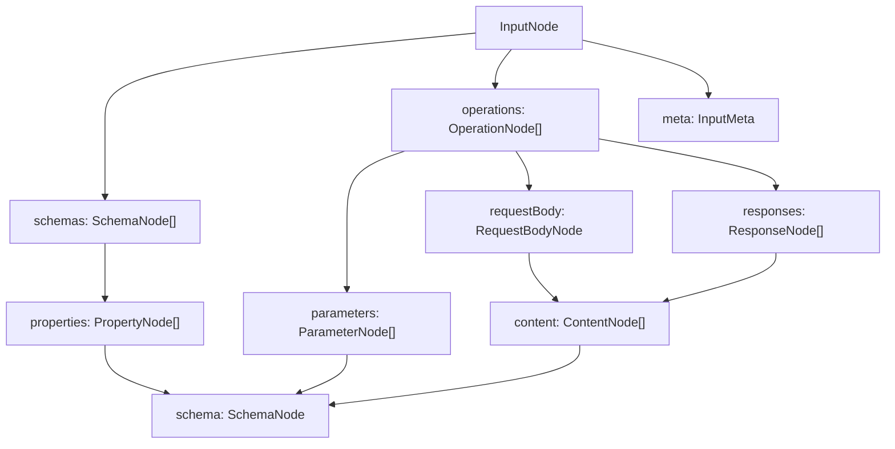
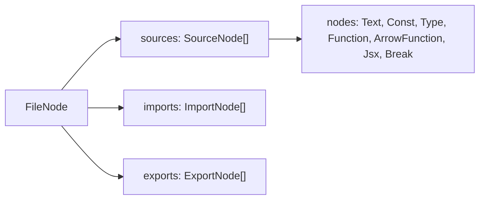

# AST and node builders

## `ast`

`ast` from `kubb/kit` holds the whole AST surface, the way `ts.factory` holds TypeScript's node builders. `ast.factory` builds nodes, `ast.node` walks them, and each other group reads one subject. Helper names are a verb plus what they return, such as `getName`, or a question, such as `isJson`.

```typescript [ast-namespace.ts]
import { ast } from 'kubb/kit'

const root = ast.factory.createInput({
  schemas: [ast.factory.createSchema({ name: 'Pet', type: 'object', properties: [] })],
  operations: [],
})
```

The old top-level names, such as `ast.narrowSchema` or `ast.transform`, still work as deprecated aliases until Kubb v6. Each one's JSDoc names its replacement. For why the AST exists, see [AST concepts](/docs/5.x/explanation/architecture#ast).

## Node tree {#node-tree}

An adapter returns one `InputNode`. Every node has a `kind`, such as `'Schema'`, and a schema also has a `type`. A `ref` schema points at a schema in `schemas` instead of copying it.



A generator returns `FileNode`s, a second tree:



## Schema node types

A `SchemaNode` is discriminated by its `type`. `ast.schema.types` lists every value.

| Family     | Types                                                                                    | Notes                                                                                                  |
| ---------- | ---------------------------------------------------------------------------------------- | ------------------------------------------------------------------------------------------------------ |
| Structural | `object`, `array`, `tuple`, `union`, `intersection`, `enum`, `not`                       | `object` holds `properties`, and can hold `propertyNames`, a schema for each key. `not` has no TypeScript equivalent. |
| Scalar     | `string`, `number`, `integer`, `bigint`, `boolean`, `null`, `any`, `unknown`, `void`, `never` | `integer` prints as `number`. `bigint` appears only when the adapter's `integerType` is `'bigint'`.     |
| Special    | `ref`, `date`, `datetime`, `time`, `uuid`, `email`, `url`, `ipv4`, `ipv6`, `blob`        | `ref` points at another schema, such as `Pet` from a `$ref`. `blob` is binary data.                    |

## `ast.factory` {#factory-functions}

Factories return defaulted, fully typed nodes. Build nodes with them, never as object literals.

| `kind`                                                    | Factory                                                                           |
| --------------------------------------------------------- | --------------------------------------------------------------------------------- |
| `Input`, `Schema`, `Operation`                            | `createInput`, `createSchema`, `createOperation`                                  |
| `Parameter`, `Property`                                   | `createParameter`, `createProperty`                                               |
| `Response`, `RequestBody`, `Content`                      | `createResponse`, `createRequestBody`, `createContent`                            |
| `File`, `Source`, `Import`, `Export`                      | `createFile`, `createSource`, `createImport`, `createExport`                      |
| `Text`, `Const`, `Type`, `Function`, `ArrowFunction`, `Jsx`, `Break` | `createText`, `createConst`, `createType`, `createFunction`, `createArrowFunction`, `createJsx`, `createBreak` |

```typescript [factory.ts]
import { ast } from 'kubb/kit'

ast.factory.createSchema({ type: 'string', format: 'email' })
// { kind: 'Schema', type: 'string', primitive: 'string', format: 'email' }

ast.factory.createText('export const a = 1')
// { kind: 'Text', value: 'export const a = 1' }
```

## `ast.node` {#visitors}

A visitor has a callback per kind: `input`, `operation`, `schema`, `property`, `parameter`, and `response`. Inside a plugin, rewrite nodes with a [macro](/docs/5.x/how-to/customize#macros) instead of `transform`.

| Helper               | Returns                                                                         |
| -------------------- | ------------------------------------------------------------------------------- |
| `ast.node.transform` | A copy of the tree with each visited node replaced by what the visitor returns. |
| `ast.node.collect`   | Every non-null value a visitor returns, depth-first, as an array.               |
| `ast.node.kinds`     | The `kind` value of every node, such as `'Schema'`.                             |
| `ast.node.getText`   | The text of code nodes, joined with new lines.                                  |

Pass `depth: 'shallow'` to `transform` or `collect` to skip nested schemas.

```typescript [node.ts]
import { ast } from 'kubb/kit'

const root = ast.factory.createInput({ schemas: [], operations: [] })

const strict = ast.node.transform(root, {
  schema(node) {
    return node.type === 'object' && node.additionalProperties === undefined ? { ...node, additionalProperties: false } : node
  },
})

const mutations = ast.node.collect<ast.OperationNode>(root, {
  operation(node) {
    return node.method === 'POST' ? node : undefined
  },
})
// Array<OperationNode>

ast.node.kinds.schema // 'Schema'
```

## `ast.file` {#ast-file}

| Helper            | Returns                                                                                                          |
| ----------------- | ---------------------------------------------------------------------------------------------------------------- |
| `ast.file.inline` | `{ files, virtualPaths, problems }`, with names imported from virtual files replaced by their inline expression. |

## `ast.macro` {#macros}

A macro is a named transform that rewrites nodes before printing, with ordering through `enforce` and gating through `match`. Define one with `defineMacro` from `kubb/kit`. [Customize](/docs/5.x/how-to/customize#macros) shows how.

| Helper                   | Returns                                                                                       |
| ------------------------ | --------------------------------------------------------------------------------------------- |
| `ast.macro.apply`        | The tree after running a list of macros over it.                                              |
| `ast.macro.compareOrder` | A sort result for two `enforce` values that puts `'pre'` first and `'post'` last.             |

```typescript [macro.ts]
import { ast, defineMacro } from 'kubb/kit'

const macroUntagged = defineMacro({
  name: 'untagged',
  operation: (node) => (node.tags?.length ? undefined : { ...node, tags: ['untagged'] }),
})

ast.macro.apply(operation, [macroUntagged]).tags // ['untagged']
```

`kubb/kit` also exports built-in macros. `macroDiscriminatorEnum` and `macroEnumName` take options, so call them to build the macro.

| Macro                    | Purpose                                                                       |
| ------------------------ | ----------------------------------------------------------------------------- |
| `macroDedupeUnion`       | Drops union members that repeat an earlier one, ignoring the source pointer.  |
| `macroDiscriminatorEnum` | Replaces a discriminator property's schema with an enum of its allowed values. |
| `macroEnumName`          | Names an inline enum schema from its parent and property name.                |

`macroSimplifyUnion`, the name `macroDedupeUnion` had before 5.16, is deprecated.

A plugin that imports another plugin's output computes names from the nodes it sees, so register a rename on every plugin that touches the schema, such as through one shared `macros` array.

### Macro options and callbacks

A macro has the per-kind callbacks of a [visitor](#visitors), plus a `name`, an optional `enforce`, and an optional `match` predicate. Each callback returns a replacement node, or `undefined` or `null` to leave the node as it is.

```typescript [Type definition]
type Macro = {
  name: string
  enforce?: 'pre' | 'post'
  match?: (node: Node) => boolean
  schema?(node: SchemaNode, context): SchemaNode | null | undefined
  operation?(node: OperationNode, context): OperationNode | null | undefined
  // input, property, parameter, response
}
```

## `ast.ref` {#ast-ref}

| Helper                | Returns                                                                                                                       |
| --------------------- | ----------------------------------------------------------------------------------------------------------------------------- |
| `ast.ref.getName`     | The name a ref points at. A ref node gives its `targetName` first, so pass the node, not `node.ref`. Other nodes give `null`. |
| `ast.ref.getSchema`   | The schema a ref node points at, or the node itself.                                                                          |
| `ast.ref.isAlias`     | Whether a ref adds nothing to its target, so it prints as just the target name.                                               |
| `ast.ref.mergeSchema` | The ref node with its resolved schema merged in. Fields set where the ref is used, such as `description`, win.                |

`childName` and `enumPropName` build names, so they are named exports of `kubb/kit`.

```typescript [ref.ts]
import { ast } from 'kubb/kit'

ast.ref.getName('#/components/schemas/Pet') // 'Pet'
ast.ref.getSchema(petRef).type // 'object'
ast.ref.isAlias(petRef) // true
```

## `ast.graph` {#ast-graph}

Use these to drop unused schemas or to wrap circular ones in a lazy getter.

| Helper                       | Returns                                                                                                                           |
| ---------------------------- | --------------------------------------------------------------------------------------------------------------------------------- |
| `ast.graph.getRefNames`      | Every schema name a node refers to, at any depth.                                                                                 |
| `ast.graph.getImportedNames` | The ref names a printed schema imports. Pass `{ checks: true }` to include refs inside `conditionals`, `contains`, and `content`. |
| `ast.graph.getUsedNames`     | The schema names a set of operations reaches, directly or through other schemas.                                                  |
| `ast.graph.getCircularNames` | The schemas that take part in a circular chain.                                                                                   |
| `ast.graph.containsCircular` | Whether a schema reaches one of the circular schemas.                                                                             |

```typescript [graph.ts]
import { ast } from 'kubb/kit'

ast.graph.getRefNames(ownerSchema) // Set { 'Pet' }
ast.graph.getCircularNames([nodeSchema, tagSchema]) // Set { 'Node' }
ast.graph.containsCircular(ownerSchema, { circularSchemas: new Set(['Pet']) }) // true
```

## `ast.schema` {#ast-schema}

| Helper                          | Returns                                                                                                     |
| ------------------------------- | ----------------------------------------------------------------------------------------------------------- |
| `ast.schema.types`              | The `type` value of every schema, such as `'string'`.                                                       |
| `ast.schema.narrow`             | The schema typed as the given `type`, or `null` when it is another type.                                    |
| `ast.schema.find`               | The first schema in a tree that matches. Set `followRefs: true` to look through resolved refs, and pass a `cache` to reuse earlier answers. |
| `ast.schema.applyOptionality`   | The schema marked `optional` when not required, or `nullish` when it is also nullable.                      |
| `ast.schema.findProperties`     | Every property with a given name on an object, a resolved ref, or an intersection. Unions are not searched. |
| `ast.schema.getLiterals`        | The literal values an enum, a resolved ref, or a union of literals allows.                                  |
| `ast.schema.inferDiscriminator` | The property every member pins to its own literal, which can act as an implicit discriminator.              |
| `ast.schema.getEmbeddedJson`    | The schema of the JSON document a string holds (`contentMediaType` with `contentSchema`).                   |
| `ast.schema.isString`           | Whether a schema prints as a plain `string`, including `date` and `time` with a string representation.      |
| `ast.schema.getNumberBounds`    | The tightest inclusive `{ min, max }`, with exclusive bounds moved to the next `step`.                      |

```typescript twoslash [schema.ts]
import { ast } from 'kubb/kit'

const root = ast.factory.createInput({ schemas: [], operations: [] })

const dateSchema = ast.schema.find(root, {
  followRefs: true,
  predicate: (schema) => schema.type === 'date',
})
```

For many schemas, keep one `cache` per predicate and `followRefs` value, so later calls skip what earlier ones searched.

```typescript [find-cache.ts]
const dateCache = new WeakMap<ast.SchemaNode, ast.SchemaNode | null>()
const hasDate = (schema: ast.SchemaNode) =>
  ast.schema.find(schema, { followRefs: true, cache: dateCache, predicate: (node) => node.type === 'date' }) !== undefined
```

```typescript [schema-values.ts]
ast.schema.narrow(node, 'object')?.properties.length // number | undefined
ast.schema.getLiterals(petKind) // ['cat', 'dog']
ast.schema.inferDiscriminator([catSchema, dogSchema]) // 'kind'
ast.schema.getNumberBounds({ min: 0.5, exclusive: { max: 10 }, integer: true }) // { min: 1, max: 9 }
```

## `ast.mediaType` {#ast-media-type}

Every `ast.mediaType` helper takes a media type string or a content entry.

| Helper                   | Returns                                                                                        |
| ------------------------ | ---------------------------------------------------------------------------------------------- |
| `ast.mediaType.getBase`  | The media type without parameters, in lowercase.                                               |
| `ast.mediaType.isJson`   | Whether a media type is `application/json`, `text/json`, or has a `+json` suffix.              |
| `ast.mediaType.isStream` | Whether a media type is server-sent events, JSON Lines, or a JSON text sequence (`+json-seq`). |

```typescript [media-type.ts]
ast.mediaType.getBase('Application/JSON; charset=utf-8') // 'application/json'
ast.mediaType.isJson('application/problem+json') // true
ast.mediaType.isStream('text/event-stream') // true
```

## `ast.server` {#ast-server}

| Helper                   | Returns                                                                   |
| ------------------------ | ------------------------------------------------------------------------- |
| `ast.server.get`         | The server at `index`, falling back to the first one.                     |
| `ast.server.groupByName` | Each server name mapped to its server. The first server with a name wins. |

## `ast.auth` {#ast-auth}

| Helper                     | Returns                                                                                                |
| -------------------------- | ------------------------------------------------------------------------------------------------------ |
| `ast.auth.getRequirements` | Each of `node.auth`'s requirements with its schemes. Undeclared and repeated requirements are dropped. |

```typescript [auth.ts]
ast.auth.getRequirements({ auth: node.auth, schemes })
// [[{ name: 'oauth', credential: { type: 'oauth2' }, scopes: ['read:pets'] }]]
```

## `ast.http` {#ast-http}

`ast.http` works on HTTP operations only.

| Helper                           | Returns                                                                                      |
| -------------------------------- | -------------------------------------------------------------------------------------------- |
| `ast.http.isOperation`           | Whether an operation is an HTTP operation, narrowing it so `method` and `path` are present.  |
| `ast.http.groupParameters`       | The parameters by location (`path`, `query`, `header`, `cookie`), first of a repeated name.  |
| `ast.http.getBaseURL`            | A server's URL when it is absolute and has no template variables, else `undefined`.          |
| `ast.http.requestBody.getSchema` | The schema of the first request body entry, or `undefined` when the operation takes no body. |

```typescript [base-url.ts]
import { ast } from 'kubb/kit'

// string | undefined
const baseURL = ast.http.getBaseURL(ast.server.get({ servers: node.servers, index: 0 }))
```

### `ast.http.responses`

| Helper                                | Returns                                                                                        |
| ------------------------------------- | ---------------------------------------------------------------------------------------------- |
| `ast.http.responses.filterSuccess`    | The operation's `2xx` responses, ranges included.                                              |
| `ast.http.responses.findPrimary`      | The success response a client returns: one with a body first, then an exact code over a range. |
| `ast.http.responses.filterError`      | The operation's `4xx` and `5xx` responses, ranges included.                                    |
| `ast.http.responses.getImportedNames` | The ref names the response bodies import, so a generator can import their types.               |

### `ast.http.status`

Every `ast.http.status` helper takes a status code, a range, or a response.

| Helper                      | Returns                                                         |
| --------------------------- | --------------------------------------------------------------- |
| `ast.http.status.getClass`  | The class digit: `2` for `201` and `2xx`, `null` for `default`. |
| `ast.http.status.isSuccess` | Whether the code is `2xx`.                                      |
| `ast.http.status.isError`   | Whether the code is `4xx` or `5xx`.                             |
| `ast.http.status.toCode`    | One concrete code: `200` for `2xx` and `default`.               |

## Printers {#printers}

`createPrinter` and `defineMacro` are top-level exports of `kubb/kit`, next to `defineGenerator` and `defineExtension`.

| Export          | Returns                                                                                   |
| --------------- | ----------------------------------------------------------------------------------------- |
| `createPrinter` | A printer factory. It takes the printer options and returns a `Printer`.                  |
| `defineMacro`   | The same macro object, typed as a `Macro`.                                                |

An `overrides` map replaces the handler for single schema types. Pass them through `overrides`, not spread into `nodes`, or `this.base` cannot find the original handler. The `printer.nodes` option of `@kubb/plugin-ts`, `@kubb/plugin-zod`, and `@kubb/plugin-faker` fills this map. See [Customize printers](/docs/5.x/how-to/customize#printers) and the [custom codec example](/extensions/kubb-labs/plugin-zod/guides/customization#import-a-custom-codec).

### Printer handlers and context

The map is keyed by the schema `type`, such as `'string'`, `'date'`, or `'object'`. Supply only the handlers you replace. The built-in ones fill in the rest.

```typescript [Type definition]
type PrinterNodes = Partial<{
  [K in SchemaType]: (this: Context, node: SchemaNodeByType[K]) => Output | null
}>
```

Handlers run with a `this` context, so write them as regular functions, not arrow functions:

| `this` member          | Does                                                                                         |
| ---------------------- | -------------------------------------------------------------------------------------------- |
| `this.transform(node)` | Prints a nested schema through the full handler map, overrides included.                     |
| `this.base(node)`      | Runs the built-in handler your override replaced, so you can wrap its output.                |
| `this.options`         | The resolved printer options, such as `arrayType` on `@kubb/plugin-ts`.                      |
| `this.import(node)`    | Declares an import the printed code needs, as an `ast.factory.createImport(...)` node.       |

The built-in generators collect those imports. In your own generator, call `printer.drainImports()` after printing.
