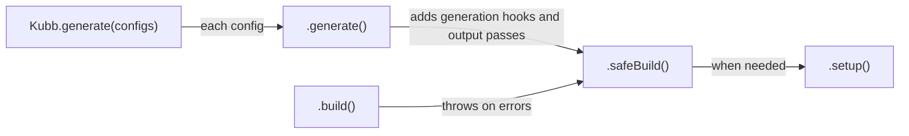

# Engine

`createKubb` from the `kubb` package runs Kubb from your own code. [Configuration](/docs/5.x/reference/configuration) covers the config shape and its defaults.

## `createKubb` {#createkubb}

`createKubb(config, options?)` returns a `Kubb` instance with the same defaults as `defineConfig`, so a config generates the same files from the CLI and from a script. `createKubb` from `@kubb/core` skips those defaults.

| Option     | Type                  | Does                                                              |
| ---------- | --------------------- | ----------------------------------------------------------------- |
| `hooks`    | `Hookable<KubbHooks>` | Shares one [hook](/docs/5.x/reference/kit/hooks) emitter between builds. |
| `signal`   | `AbortSignal`         | Stops the build at the next safe checkpoint.                      |
| `fileRefs` | `Array<string>`       | The only folders a `$ref` may read local files from. Unset, a `$ref` reads any file. |

This script builds `petStore.yaml` and exits on any error:

```typescript [build.ts]
import { createKubb } from 'kubb'
import { Diagnostics } from 'kubb/kit'
import { pluginTs } from '@kubb/plugin-ts'
import { pluginAxios } from '@kubb/plugin-axios'

const kubb = createKubb({
  input: './petStore.yaml',
  output: { path: './gen' },
  plugins: [pluginTs(), pluginAxios()],
})

const { files, diagnostics } = await kubb.safeBuild()

if (Diagnostics.hasError(diagnostics)) {
  for (const diagnostic of diagnostics.filter(Diagnostics.isProblem)) {
    if (diagnostic.severity === 'error') {
      console.error(`${diagnostic.plugin ?? 'kubb'}: ${diagnostic.message}`)
    }
  }
  process.exit(1)
}

for (const { plugin, duration } of diagnostics.filter(Diagnostics.isPerformance)) {
  console.log(`${plugin}: ${duration}ms`)
}
console.log(`Generated ${files.length} files`)
```

> [!WARNING]
> `safeBuild()` does not throw when the pipeline fails. Check `Diagnostics.hasError(diagnostics)` before you use the files. Setup can still reject, for example when a plugin's `dependencies` callback throws or the signal aborts, so wrap the call in `try`/`catch`.

### `Kubb` instance members

The build methods build on each other:



| Member         | Type                                    | Description                                                                                                                                      |
| -------------- | --------------------------------------- | ------------------------------------------------------------------------------------------------------------------------------------------------ |
| `.safeBuild()` | `() => Promise<BuildOutput>`            | The main call. Runs the pipeline and collects its problems in `diagnostics` instead of throwing. Setup can still reject, for example when a plugin's `dependencies` callback throws or the signal aborts, so catch it. |
| `.build()`     | `() => Promise<BuildOutput>`            | Runs `safeBuild()`, then throws an `AggregateError` of every error diagnostic.                                                                    |
| `.generate()`  | `(options?) => Promise<GenerateResult>` | Runs one full generation: the `kubb:generation:*` and `kubb:setup:*` hooks, the build, and the output passes. Returns `{ success, files, diagnostics, input }` and never throws on a build error. |
| `.setup()`     | `() => Promise<void>`                   | Sets up the driver and storage. The build methods call it when needed.                                                                          |
| `.dispose()`   | `() => void`                            | Releases the driver. The next build sets up a new one. `using kubb = createKubb(config)` disposes it too.                                        |
| `.hooks`       | `Hookable<KubbHooks>`                   | Read-only. The hook emitter. Call `.hook(name, handler)` before a build.                                                                         |
| `.config`      | `Config`                                | Read-only. The resolved config, available right after `createKubb`.                                                                              |
| `.storage`     | `Storage`                               | Read-only. The [storage](/docs/5.x/reference/kit/storage) backend, keyed by absolute path.                                                        |
| `.driver`      | driver handle                           | The plugin driver, from `setup()` until the build ends. Throws outside that window.                                                              |

### `Kubb.generate(configs)` {#kubb-generate}

The static `Kubb.generate` from `@kubb/core` builds every config in a [`defineConfig([...])` array](/docs/5.x/reference/configuration#multiple-configurations-array), as `kubb generate` does. Pass `hooks` and `signal` as the second argument.

```typescript [build.ts]
import { Kubb } from '@kubb/core'
import configs from './kubb.config.ts'

for await (const { success, files, kubb } of Kubb.generate(configs)) {
  console.log(kubb.config.name, success ? `${files.length} files` : 'failed')
}
```

- Kubb builds one config at a time and yields its result when it finishes.
- Each result is a `GenerateResult` plus the `kubb` instance that built it.
- A failing config does not stop the others. Its result has `success: false`. Only an aborted `signal` rejects.

### `BuildOutput` fields {#buildoutput-fields}

| Field         | Type                | Description                                                                     |
| ------------- | ------------------- | ------------------------------------------------------------------------------- |
| `files`       | `Array<FileNode>`   | The generated files.                                                            |
| `storage`     | `Storage`           | The storage backend.                                                            |
| `driver`      | driver handle       | The plugin driver, for introspection.                                           |
| `diagnostics` | `Array<Diagnostic>` | Problems from the build, plus a `performance` diagnostic per plugin.            |
| `input`       | `InputNode \| null` | The parsed spec, or `null` when there was none to parse.                        |

A problem diagnostic has a `code`, a `severity` (`error`, `warning`, or `info`), a `message`, and the `plugin` that produced it. It can add a `location`, `help`, and an `issues` URL. A failed plugin keeps its original error on `cause`.

## `Diagnostics` {#diagnostics}

`Diagnostics` from `kubb/kit` creates and narrows the problems a build collects. To give an error a stable code, a severity, and a location, throw a `Diagnostics.Error` instead of a bare `Error`. [Diagnostics](/docs/5.x/reference/diagnostics) lists every code.

| Member                      | Does                                                                                                         |
| --------------------------- | ------------------------------------------------------------------------------------------------------------ |
| `Diagnostics.Error`         | Error class that carries a problem diagnostic.                                                               |
| `Diagnostics.code`          | The code catalog, such as `Diagnostics.code.refNotFound`.                                                    |
| `Diagnostics.report`        | Adds a diagnostic to the running build without throwing. Returns `false` outside a build.                    |
| `Diagnostics.from`          | Turns any thrown value into a problem diagnostic, `KUBB_UNKNOWN` unless it is a `Diagnostics.Error`.         |
| `Diagnostics.hasError`      | `true` when any diagnostic has `severity: 'error'`.                                                          |
| `Diagnostics.isProblem`     | Narrows to the `problem` kind.                                                                               |
| `Diagnostics.isPerformance` | Narrows to the `performance` kind, with a per-plugin `duration` in milliseconds.                             |
| `Diagnostics.isUpdate`      | Narrows to the `update` kind, emitted when a newer Kubb version exists.                                      |
| `Diagnostics.count`         | Counts errors, warnings, and infos.                                                                          |
| `Diagnostics.explain`       | Returns a code's catalog entry: `title`, `cause`, and `fix`.                                                 |
| `Diagnostics.docsUrl`       | Returns a code's kubb.dev URL.                                                                               |

An adapter throws this error when a `$ref` has no target:

```typescript [adapter.ts]
import { Diagnostics } from 'kubb/kit'

throw new Diagnostics.Error({
  code: Diagnostics.code.refNotFound,
  severity: 'error',
  message: 'Could not find a definition for #/components/schemas/Pet.',
  location: { kind: 'schema', pointer: '#/components/schemas/Pet', ref: '#/components/schemas/Pet' },
})
```

## Less common cases {#less-common-cases}

### Programmatic builds {#programmatic-builds}

- A config needs `input` whenever it has an adapter. `defineConfig` always sets one, so a config without `input` stops with [`KUBB_INPUT_REQUIRED`](/docs/5.x/reference/diagnostics#kubb-input-required).
- Only `createKubb` from `@kubb/core` runs without an adapter, in plugin-only mode.
- On `.generate()`, `options.processOutput` replaces the output passes.
- [`Kubb.generate(configs)`](#kubb-generate) holds one config in memory at a time. A failing config's result has `error`, with what it threw outside its diagnostics.
