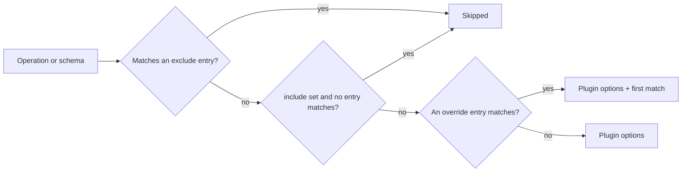

# Shared plugin options

Every generator plugin takes these options to set where it writes, what it generates, and how it names files. A plugin's own options page lists only its defaults. `@kubb/plugin-barrel` takes none and reads [`output.barrel`](#output-barrel). `@kubb/plugin-redoc` takes only `output.path`.

## output {#output}

::field-group

:::field{type="Output"}
Where the plugin writes its files and how it exports them. Default: set by each plugin, such as `{ path: 'types', barrel: { type: 'named' } }` on `@kubb/plugin-ts`.
:::

::

> [!WARNING]
> An `output` you pass replaces the plugin default whole. Repeat `barrel` in it, or the plugin falls back to the root `output.barrel`, which is `false` unless you set it.

```typescript [kubb.config.ts]
import { pluginTs } from '@kubb/plugin-ts'

pluginTs({
  output: { path: 'models', barrel: { type: 'named' }, banner: '/* eslint-disable */' },
})
```

### output.path {#output-path}

::field-group

:::field{type="string" required}
The plugin's folder or file, resolved inside the root `output.path`. Required in `output`. Default: set by each plugin.
:::

::

### output.mode {#output-mode}

::field-group

:::field{type="'directory' | 'file'"}
How the plugin splits its code into files. Default: `'file'` when `output.path` has an extension, `'directory'` otherwise.
:::

::

::field-group

:::field{name="'directory'"}
Writes one file per operation or schema under `output.path`. Add [`group`](#group) to split them into subfolders.
:::

:::field{name="'file'"}
Writes everything into one file. `output.path` must include the extension, such as `'types.ts'`.
:::

::

Set `mode: 'directory'` only for a folder name with a dot, such as `'clients.v2'`.

```typescript [kubb.config.ts]
import { defineConfig } from 'kubb/config'
import { pluginTs } from '@kubb/plugin-ts'
import { pluginAxios } from '@kubb/plugin-axios'

export default defineConfig({
  input: './petStore.yaml',
  output: { path: './src/gen' },
  plugins: [
    pluginTs({ output: { path: 'types.ts' } }), // src/gen/types.ts
    pluginAxios({ output: { path: 'clients' }, group: { type: 'tag' } }), // src/gen/clients/pet/, src/gen/clients/store/
  ],
})
```

### output.barrel {#output-barrel}

::field-group

:::field{type="{ type: 'all' | 'named', nested?: boolean, namespace?: boolean } | false"}
How the plugin's `index.ts` files re-export its output. Default: `{ type: 'named' }` in the plugin's default `output`.
:::

::

::barrel-tree
::

::field-group

:::field{name="'named'"}
Re-exports each symbol by name, for explicit imports and tree-shaking.
:::

:::field{name="'all'"}
Re-exports every file with `export *`.
:::

:::field{name="false"}
Writes no barrel for this plugin and leaves its files out of the root barrel.
:::

::

See [`@kubb/plugin-barrel` options](/extensions/kubb-labs/plugin-barrel/options) for `nested` and `namespace`, and [Barrel rules](/extensions/kubb-labs/plugin-barrel/guides/barrel-rules) for the fallback to the root `output.barrel`.

```typescript [kubb.config.ts]
import { pluginZod } from '@kubb/plugin-zod'

pluginZod({ output: { path: 'zod', barrel: { type: 'all', nested: true } } })
```

### output.banner {#output-banner}

::field-group

:::field{type="string | ((meta: BannerMeta) => string)"}
Text at the top of every generated file, such as a license header or `'use server'`. Default: the root [`output.defaultBanner`](/docs/5.x/reference/configuration#outputdefaultbanner).
:::

::

A string goes on every file, barrels included. A function runs per file and returns the banner, or `''` for none. Its `BannerMeta` holds the `InputMeta` fields, such as `title` and `version`, plus:

| Field | Value |
| --- | --- |
| `filePath` | The file's full output path |
| `baseName` | The file name, such as `pet.ts` |
| `isBarrel` | `true` for an `index.ts` barrel |
| `isAggregation` | `true` for a group `[dir]/[dir].ts` aggregation file |

```typescript [kubb.config.ts]
import { pluginFetch } from '@kubb/plugin-fetch'

pluginFetch({
  output: {
    path: 'clients',
    banner: (meta) => (meta.isBarrel || meta.isAggregation ? '' : "'use server'"),
  },
})
```

### output.footer {#output-footer}

::field-group

:::field{type="string | ((meta: BannerMeta) => string)"}
Text at the bottom of every generated file, with the same values as [`output.banner`](#output-banner). Default: none.
:::

::

Pair `banner: '/* eslint-disable */'` with `footer: '/* eslint-enable */'` to scope a lint disable to each file.

## group {#group}

::field-group

:::field{type="{ type: 'tag' | 'path', name?: (context: { group: string }) => string }"}
Puts each operation's files in a `{output.path}/{groupName}/` subfolder, named after its tag or URL path. Default: no grouping.
:::

::

::grouping-diagram
::

> [!IMPORTANT]
> `group` needs [directory output](#output-mode), or the build stops with [`KUBB_INVALID_PLUGIN_OPTIONS`](/docs/5.x/reference/diagnostics#kubb-invalid-plugin-options).

```typescript [kubb.config.ts]
import { pluginTs } from '@kubb/plugin-ts'

pluginTs({ group: { type: 'tag' } }) // src/gen/types/pet/, src/gen/types/store/, ...
```

### group.type {#group-type}

::field-group

:::field{type="'tag' | 'path'" required}
Which value assigns an operation to a group. Required in `group`.
:::

::

::field-group

:::field{name="'tag'"}
The operation's first tag. An operation without tags goes in the `default` group. See [Group folders](#group-folders) for OpenAPI 3.2 `parent` tags.
:::

:::field{name="'path'"}
The first segment of the URL path, such as `pet` for `/pet/{petId}`.
:::

::

### group.name {#group-name}

::field-group

:::field{type="(context: { group: string }) => string"}
Turns the group value into the folder name, which is also the suffix of aggregation files. Default: the value in camelCase, so `pet store` becomes `petStore`.
:::

::

```typescript [kubb.config.ts]
import { pluginTs } from '@kubb/plugin-ts'

pluginTs({
  group: { type: 'tag', name: ({ group }) => `${group}Api` }, // src/gen/types/petApi/
})
```

## include {#include}

::field-group

:::field{type="Array<Include>"}
Generates only the operations and schemas that match an entry. Default: everything.
:::

::

### How filters match

`include`, [`exclude`](#exclude), and [`override`](#override) entries share one shape: a `type`, and usually a `pattern`. Every type except `schemaName` matches operations.

| `type` | Tests `pattern` against |
| --- | --- |
| `tag` | Each operation tag |
| `operationId` | The `operationId` |
| `path` | The full URL path, such as `/pet/{petId}` |
| `method` | The HTTP method, ignoring case |
| `contentType` | Each request body content type |
| `schemaName` | The `#/components/schemas` name, for schemas |
| `extension` | No pattern. Matches an `x-*` `key` on the operation, and `value` by strict equality when set |

> [!WARNING]
> A string `pattern` becomes `new RegExp(pattern)`, so it matches anywhere: `'pet'` also matches `'petType'`. Write `'^pet$'` for an exact match.

Without a `schemaName` entry, `include` keeps only the schemas its operations use. See [Filters](#filters).

```typescript [Type definition]
export type Include =
  | { type: 'tag' | 'operationId' | 'path' | 'contentType' | 'schemaName'; pattern: string | RegExp }
  | { type: 'method'; pattern: HttpMethod | RegExp }
  | { type: 'extension'; key: `x-${string}`; value?: unknown }
```

```typescript [kubb.config.ts]
import { pluginTs } from '@kubb/plugin-ts'

pluginTs({
  include: [
    { type: 'tag', pattern: 'pet' },
    { type: 'path', pattern: /^\/store/ },
  ],
})
```

### Precedence



## exclude {#exclude}

::field-group

:::field{type="Array<Exclude>"}
Skips every operation or schema that matches an entry. Entries match as in [How filters match](#how-filters-match), and `exclude` wins. Default: `[]`.
:::

::

```typescript [kubb.config.ts]
import { pluginTs } from '@kubb/plugin-ts'

pluginTs({
  exclude: [
    { type: 'tag', pattern: 'internal' },
    { type: 'operationId', pattern: /^deprecated_/ },
    { type: 'extension', key: 'x-internal', value: true },
  ],
})
```

## override {#override}

::field-group

:::field{type="Array<Override>"}
Gives matching operations or schemas other plugin options. Entries match as in [How filters match](#how-filters-match), top to bottom. Only the first match applies. Default: `[]`.
:::

::

```typescript [Type definition]
export type Override = Include & {
  options: Omit<Partial<ResolvedOptions>, 'override'>
}
```

> [!WARNING]
> `options` merges shallowly over the plugin options, so an object option such as `enum` replaces the plugin's value whole. Give it every field.

```typescript [kubb.config.ts]
import { pluginTs } from '@kubb/plugin-ts'

pluginTs({
  override: [
    {
      type: 'tag',
      pattern: 'admin',
      options: {
        output: { path: 'admin' },
        enum: { type: 'enum', constCasing: 'camelCase', typeSuffix: 'Key', keyCasing: 'none' },
      },
    },
  ],
})
```

## resolver {#resolver}

::field-group

:::field{type="ResolverPartial<Resolver>"}
Changes how the plugin names generated files and symbols. Members you leave out keep the plugin's behavior. Default: the plugin's resolver.
:::

::

Every resolver has these members. A plugin's options page lists its own, such as `param` on `@kubb/plugin-ts`. In a method, `this` is the full resolver, so `this.default.name(name)` reuses the built-in casing.

```typescript [Shared members]
type ResolverPartial = {
  name?(name: string): string // the identifier for a name
  file?: {
    baseName?(params: { name: string; extname: string }): string // the file name, extension included
    path?(params: { baseName: string; output: Output }): string // the full path, which skips output.path and group
  }
  imports?(options: ResolveImportsOptions): Array<ImportNode> // the imports for the $ref schemas a node uses
}
```

```typescript [kubb.config.ts]
import { pluginTs } from '@kubb/plugin-ts'

pluginTs({
  resolver: {
    name(name) {
      return `${this.default.name(name)}Model` // Pet becomes petModel
    },
  },
})
```

See [Resolvers](/docs/5.x/how-to/customize#resolvers) for how a patch layers over the default.

## macros {#macros}

::field-group

:::field{type="Array<Macro>"}
Rewrite AST nodes before the plugin prints them, without forking its generator. Default: `[]`.
:::

::

Macros run in order, each on the previous output. `@kubb/plugin-fetch`, `@kubb/plugin-axios`, and `@kubb/plugin-client` run their built-in macros first.

```typescript [kubb.config.ts]
import { defineMacro } from 'kubb/kit'
import { pluginTs } from '@kubb/plugin-ts'

const macroUntagged = defineMacro({
  name: 'untagged',
  operation(node) {
    return node.tags?.length ? undefined : { ...node, tags: ['untagged'] }
  },
})

pluginTs({ macros: [macroUntagged] })
```

See [Macros](/docs/5.x/how-to/customize#macros) for a walkthrough, and [`ast.macro`](/docs/5.x/reference/kit/ast#macros) for callbacks and built-in macros.

## Less common cases {#less-common-cases}

### Filters {#filters}

When an `include` or `exclude` mixes operation and `schemaName` entries, schemas follow their own rules.

- Only `schemaName` entries filter schemas by name.
- An `include` with operation entries and no `schemaName` entry keeps only the schemas those operations use, also indirectly.
- An `include` with only `schemaName` entries generates no operations.

A matching [`override`](#override) entry applies its `options` like this:

- `options` takes any plugin option except `override`.
- An `output` without `mode` reads it from `output.path`.

### Group folders {#group-folders}

With [`group`](#group-type), the resolver's `groupDir(group, value)` picks each file's folder. See [Built-in members](/docs/5.x/reference/kit/resolvers#auto-injected-resolver-defaults).

| Group | Folder |
| --- | --- |
| A custom `group.name` | What `group.name` returns. It wins over `type`. |
| `type: 'tag'` | The camelCased tag, inside the folders of its OpenAPI 3.2 `parent` tags, such as `animals/cats/` |
| `type: 'path'` | The first path segment |
