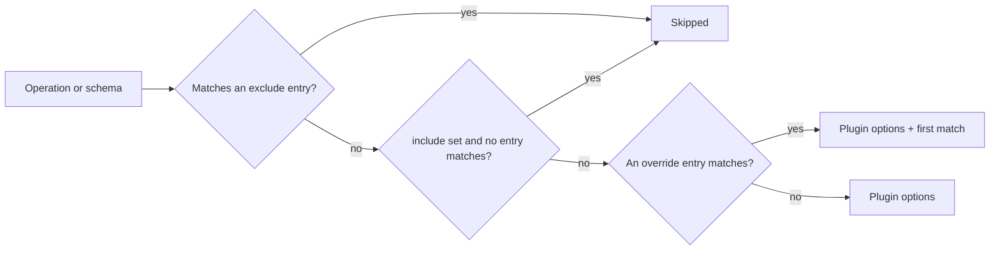

# Shared plugin options

Every generator plugin accepts the options on this page, and its own options page gives only its default for each. `@kubb/plugin-barrel` takes no options and reads [`output.barrel`](#output-barrel) instead. `@kubb/plugin-redoc` accepts only `output.path`.

## output {#output}

Where the plugin writes its files and how it exports them. `@kubb/plugin-ts`, for example, defaults to `{ path: 'types', barrel: { type: 'named' } }`.

| Type | Required | Default |
| --- | --- | --- |
| `Output` | No | Set by each plugin |

> [!WARNING]
> An `output` you pass replaces the plugin default as a whole. Repeat `barrel` in it, or the plugin falls back to the root `output.barrel`, which is `false` unless you set it.

```typescript [kubb.config.ts]
import { pluginTs } from '@kubb/plugin-ts'

pluginTs({
  output: { path: 'models', barrel: { type: 'named' }, banner: '/* eslint-disable */' },
})
```

### output.path {#output-path}

The plugin's folder or file, resolved inside the root `output.path`.

| Type | Required | Default |
| --- | --- | --- |
| `string` | Yes, in `output` | Set by each plugin |

### output.mode {#output-mode}

How the plugin splits its code into files.

| Type | Required | Default |
| --- | --- | --- |
| `'directory' \| 'file'` | No | `'file'` when `output.path` has an extension, `'directory'` otherwise |

::field-group

:::field{name="'directory'"}
Writes one file per operation or schema under `output.path`. Add [`group`](#group) to split them into subfolders.
:::

:::field{name="'file'"}
Writes everything into one file. `output.path` must include the extension, such as `'types.ts'`.
:::

::

Set `mode: 'directory'` only for a folder name with a dot, such as `'clients.v2'`.

```typescript [kubb.config.ts]
import { defineConfig } from 'kubb/config'
import { pluginTs } from '@kubb/plugin-ts'
import { pluginAxios } from '@kubb/plugin-axios'

export default defineConfig({
  input: './petStore.yaml',
  output: { path: './src/gen' },
  plugins: [
    pluginTs({ output: { path: 'types.ts' } }), // src/gen/types.ts
    pluginAxios({ output: { path: 'clients' }, group: { type: 'tag' } }), // src/gen/clients/pet/, src/gen/clients/store/
  ],
})
```

### output.barrel {#output-barrel}

How the plugin's `index.ts` files re-export its output. Toggle the export style and depth to see the generated barrels.

| Type | Required | Default |
| --- | --- | --- |
| `{ type: 'all' \| 'named', nested?: boolean, namespace?: boolean } \| false` | No | `{ type: 'named' }` in the plugin's default `output` |

::barrel-tree
::

::field-group

:::field{name="'named'"}
`{ type: 'named' }` re-exports each symbol by name, for explicit imports and tree-shaking.
:::

:::field{name="'all'"}
`{ type: 'all' }` re-exports every file with `export *`.
:::

:::field{name="false"}
Writes no barrel for this plugin and leaves its files out of the root barrel.
:::

::

`nested: true` writes an `index.ts` in every subfolder. `namespace: true` also exports each subfolder as a named namespace, such as `PetService`. See [`@kubb/plugin-barrel` options](/extensions/kubb-labs/plugin-barrel/options) for both, and [Barrel files](EDGE:barrel-files) for the fallback to the root [`output.barrel`](/docs/5.x/reference/configuration#outputbarrel).

```typescript [kubb.config.ts]
import { pluginZod } from '@kubb/plugin-zod'

pluginZod({ output: { path: 'zod', barrel: { type: 'all', nested: true } } })
```

### output.banner {#output-banner}

Text at the top of every generated file, such as a license header or a `'use server'` directive. It replaces the [default banner](/docs/5.x/reference/configuration#outputdefaultbanner).

| Type | Required | Default |
| --- | --- | --- |
| `string \| ((meta: BannerMeta) => string)` | No | The default banner |

A string goes on every file, barrels included. A function runs once per file and returns the banner, or `''` for none. Its `BannerMeta` holds the document info (`title`, `description`, `version`, `baseURL`, and the rest of `InputMeta`) plus:

| Field | Type | Value |
| --- | --- | --- |
| `filePath` | `string` | The full output path of the file |
| `baseName` | `string` | The file name, such as `pet.ts` |
| `isBarrel` | `boolean` | `true` for an `index.ts` barrel |
| `isAggregation` | `boolean` | `true` for a group `[dir]/[dir].ts` aggregation file |

```typescript [kubb.config.ts]
import { pluginFetch } from '@kubb/plugin-fetch'

pluginFetch({
  output: {
    path: 'clients',
    banner: (meta) => (meta.isBarrel || meta.isAggregation ? '' : "'use server'"),
  },
})
```

### output.footer {#output-footer}

Text at the bottom of every generated file. It takes the same values as [`output.banner`](#output-banner).

| Type | Required | Default |
| --- | --- | --- |
| `string \| ((meta: BannerMeta) => string)` | No | None |

Pair `banner: '/* eslint-disable */'` with `footer: '/* eslint-enable */'` to scope a lint disable to each file.

## group {#group}

Puts each operation's files in a subfolder, `{output.path}/{groupName}/`, named after its tag or URL path. Switch the mode to see where operations land.

| Type | Required | Default |
| --- | --- | --- |
| `{ type: 'tag' \| 'path', name?: (context: { group: string }) => string }` | No | No grouping |

::grouping-diagram
::

> [!IMPORTANT]
> `group` needs [directory output](#output-mode). A `group` with file output, set or read from an extension, stops the build with [`KUBB_INVALID_PLUGIN_OPTIONS`](/docs/5.x/reference/diagnostics#kubb-invalid-plugin-options).

```typescript [kubb.config.ts]
import { pluginTs } from '@kubb/plugin-ts'

pluginTs({ group: { type: 'tag' } }) // src/gen/types/pet/, src/gen/types/store/, ...
```

### group.type {#group-type}

Which value assigns an operation to a group.

| Type | Required | Default |
| --- | --- | --- |
| `'tag' \| 'path'` | Yes, in `group` | None |

::field-group

:::field{name="'tag'"}
The operation's first tag. An operation without tags goes in the `default` group. See [Group folders](EDGE:group-folders) for OpenAPI 3.2 `parent` tags.
:::

:::field{name="'path'"}
The first segment of the URL path, such as `pet` for `/pet/{petId}`.
:::

::

### group.name {#group-name}

Turns the group value into the folder name, which is also the suffix of aggregation files.

| Type | Required | Default |
| --- | --- | --- |
| `(context: { group: string }) => string` | No | The tag or path segment in camelCase, so `pet store` becomes `petStore` |

```typescript [kubb.config.ts]
import { pluginTs } from '@kubb/plugin-ts'

pluginTs({
  group: { type: 'tag', name: ({ group }) => `${group}Api` }, // src/gen/types/petApi/
})
```

## include {#include}

Generates only the operations and schemas that match at least one entry.

| Type | Required | Default |
| --- | --- | --- |
| `Array<Include>` | No | Everything |

### How filters match

`include`, [`exclude`](#exclude), and [`override`](#override) entries share one shape. Each entry sets a `type`, and most take a `pattern`:

| `type` | Tests `pattern` against | Applies to |
| --- | --- | --- |
| `tag` | Each of the operation's tags | Operations |
| `operationId` | The `operationId` | Operations |
| `path` | The full URL path, such as `/pet/{petId}` | Operations |
| `method` | The HTTP method, ignoring case | Operations |
| `contentType` | Each request body content type | Operations |
| `schemaName` | The `#/components/schemas` name | Schemas |
| `extension` | No pattern: `key` is an `x-*` key on the operation, and the optional `value` must be strictly equal | Operations |

> [!WARNING]
> A string `pattern` becomes `new RegExp(pattern)`, so it matches anywhere: `'pet'` also matches `'petType'`. Write `'^pet$'` for an exact match.

Without a `schemaName` entry, `include` keeps only the schemas the included operations use. See [Filters](EDGE:filters) for schema-only filters.

```typescript [Type definition]
export type Include =
  | { type: 'tag' | 'operationId' | 'path' | 'contentType' | 'schemaName'; pattern: string | RegExp }
  | { type: 'method'; pattern: HttpMethod | RegExp }
  | { type: 'extension'; key: `x-${string}`; value?: unknown }
```

```typescript [kubb.config.ts]
import { pluginTs } from '@kubb/plugin-ts'

pluginTs({
  include: [
    { type: 'tag', pattern: 'pet' },
    { type: 'path', pattern: /^\/store/ },
  ],
})
```

### Precedence



## exclude {#exclude}

Skips every operation or schema that matches at least one entry. Entries [match like `include` entries](#how-filters-match), and `exclude` wins over `include`.

| Type | Required | Default |
| --- | --- | --- |
| `Array<Exclude>` | No | `[]` |

```typescript [kubb.config.ts]
import { pluginTs } from '@kubb/plugin-ts'

pluginTs({
  exclude: [
    { type: 'tag', pattern: 'internal' },
    { type: 'operationId', pattern: /^deprecated_/ },
    { type: 'extension', key: 'x-internal', value: true },
  ],
})
```

See [Client and query plugins](EDGE:client-and-query-plugins) for how query plugins follow a client plugin's `exclude`.

## override {#override}

Gives the operations or schemas that match an entry different plugin options. Entries [match like `include` entries](#how-filters-match) and run top to bottom. Only the first match applies, so entries never stack.

| Type | Required | Default |
| --- | --- | --- |
| `Array<Override>` | No | `[]` |

```typescript [Type definition]
export type Override = Include & {
  options: Omit<Partial<ResolvedOptions>, 'override'>
}
```

> [!WARNING]
> `options` merges shallowly over the plugin options, so an object option such as `enum` replaces the plugin's value whole. Give it every field.

```typescript [kubb.config.ts]
import { pluginTs } from '@kubb/plugin-ts'

pluginTs({
  override: [
    {
      type: 'tag',
      pattern: 'admin',
      options: {
        output: { path: 'admin' },
        enum: { type: 'enum', constCasing: 'camelCase', typeSuffix: 'Key', keyCasing: 'none' },
      },
    },
  ],
})
```

See [Client and query plugins](EDGE:client-and-query-plugins) for how query plugins follow a client plugin's `override`.

## resolver {#resolver}

Changes how the plugin names generated files and symbols. Members you leave out keep the plugin's behavior.

| Type | Required | Default |
| --- | --- | --- |
| `ResolverPatch<Resolver>`, such as `ResolverPatch<ResolverTs>` | No | The plugin's resolver |

Every resolver has the members below, and a plugin's options page lists its own namespaces, such as `param` and `response` on `@kubb/plugin-ts`. Inside a method, `this` is the full resolver, so `this.default.name(name)` reuses the built-in casing.

```typescript [Shared members]
type ResolverPatch = {
  name?(name: string): string // the identifier for a name
  file?: {
    baseName?(params: { name: string; extname: string }): string // the file name, extension included
    path?(params: { baseName: string; output: Output }): string // the full path, which skips output.path and group
  }
  imports?(options: ResolveImportsOptions): Array<ImportNode> // the imports for the $ref schemas a node uses
}
```

```typescript [kubb.config.ts]
import { pluginTs } from '@kubb/plugin-ts'

pluginTs({
  resolver: {
    name(name) {
      return `${this.default.name(name)}Model` // Pet becomes petModel
    },
  },
})
```

See [Customize resolvers](/docs/5.x/how-to/customize#resolvers) for how a patch layers over the default.

## macros {#macros}

Rewrite AST nodes before the plugin prints them, without forking its generator.

| Type | Required | Default |
| --- | --- | --- |
| `Array<Macro>` | No | `[]` |

A macro callback such as `schema` or `operation` receives a node and returns a replacement, or `undefined` to keep it. Macros run in order, so each sees the output of the one before. The client plugins (`@kubb/plugin-fetch`, `@kubb/plugin-axios`, `@kubb/plugin-client`) run their built-in macros before yours. `kubb/kit` exports the built-in `macroDedupeUnion`, `macroDiscriminatorEnum`, and `macroEnumName`.

```typescript [kubb.config.ts]
import { defineMacro } from 'kubb/kit'
import { pluginTs } from '@kubb/plugin-ts'

const macroUntagged = defineMacro({
  name: 'untagged',
  operation(node) {
    return node.tags?.length ? undefined : { ...node, tags: ['untagged'] }
  },
})

pluginTs({ macros: [macroUntagged] })
```

See [Customize macros](/docs/5.x/how-to/customize#macros) for a walkthrough and [Macros](/docs/5.x/reference/kit/ast#macros) for the `Macro` type.
