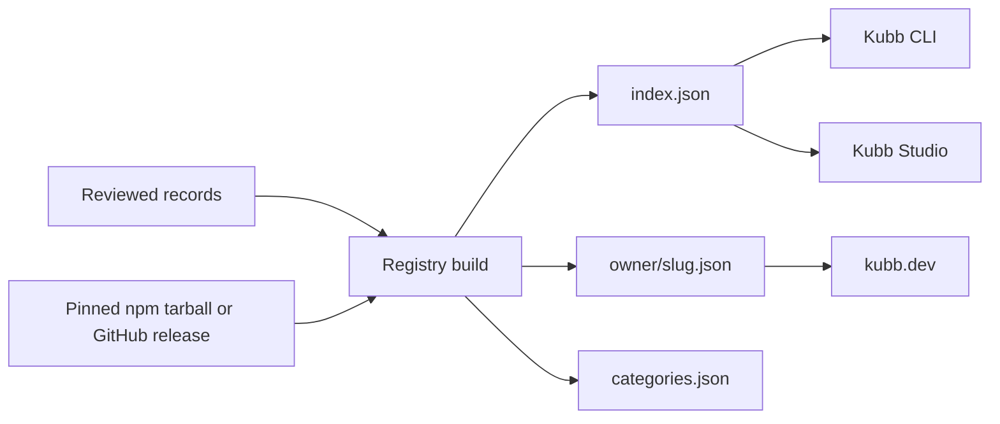

# Extension registry

The Kubb extension registry lists reviewed plugins, adapters, and parsers, each pinned to one npm version or one GitHub release. The [Kubb CLI](/docs/5.x/reference/commands#extension-commands), Kubb Studio, and kubb.dev read it.



[kubb-labs/registry](https://github.com/kubb-labs/registry) builds the documents on every merge and once a day, which also refreshes download and star counts.

## Endpoints

The base URL is `https://kubb.dev/registry`. Every document is static JSON, served as `application/json` with CORS allowed, never through a redirect, and cached for 10 minutes (`cache-control: max-age=600`).

| Request | Returns | Read by |
| --- | --- | --- |
| [`GET <base>/index.json`](#index) | Every listed extension | The CLI, Kubb Studio |
| [`GET <base>/<owner>/<slug>.json`](#detail) | One extension and its docs. An unknown id answers 404. | kubb.dev |
| [`GET <base>/categories.json`](#categories) | The category list | kubb.dev |

## Registry ids

An id is `<owner>/<slug>`, such as `kubb-labs/plugin-zod`:

- `<owner>` is the GitHub owner of the source repository, in lowercase.
- `<slug>` is the package name without its scope, so `@kubb/plugin-zod` gives `plugin-zod`.
- Both parts match `[a-z0-9]+(?:-[a-z0-9]+)*`.
- An entry owned by `kubb-labs` has `type: "official"`. Every other entry is `community`.

The CLI reads a bare `<slug>` as `kubb-labs/<slug>`.

## `GET <base>/index.json` {#index}

```typescript
type RegistryIndex = {
  version: 1
  generatedAt: string
  extensions: Array<RegistryEntry>
}
```

A client rejects an index whose `version` is not `1`, skips an entry whose `artifact.kind` it does not know, and ignores unknown keys. See [How the CLI reads the index](/docs/5.x/topics/extension-commands#registry-client-rules).

## `GET <base>/<owner>/<slug>.json` {#detail}

One [`RegistryEntry`](#registry-entry) plus the docs its pinned version ships. The index leaves these doc fields out.

```typescript
type RegistryDetail = RegistryEntry & {
  overview: string | null
  options?: string | null
  guides?: Array<RegistryGuide>
}

type RegistryGuide = {
  id: string // the file name without .md
  title: string // the first # heading
  description: string // the first paragraph after the title
  content: string // the whole file
}
```

| Field | Comes from |
| --- | --- |
| `overview` | `docs/overview.md`, else the reviewer's overview, or `null` |
| `options` | `docs/options.md`, or `null` |
| `guides` | Each `docs/guides/<id>.md`, sorted by file name, at most 50. A guide that fails a check is left out. |

> [!WARNING]
> The Markdown comes from the package author. Render it as untrusted. [Extension docs](/docs/5.x/reference/kit/extension-docs) lists the file rules and the Markdown that renders.

See [How the CLI reads the index](/docs/5.x/topics/extension-commands#registry-client-rules) for older registries and older package versions.

## `RegistryEntry` {#registry-entry}

`@kubb/core` exports the `RegistryEntry`, `RegistryArtifact`, `RegistryIndex`, `RegistryDetail`, and `RegistryGuide` types.

| Field | Type | Value |
| --- | --- | --- |
| `id` | `string` | The [registry id](#registry-ids), such as `kubb-labs/plugin-zod` |
| `kind` | `'plugin' \| 'adapter' \| 'parser'` | The extension kind. It always equals `manifest.kind`. |
| `type` | `'official' \| 'community'` | `official` when the owner is `kubb-labs` |
| `artifact` | `RegistryArtifact` | The approved install pin, see below |
| `repository?` | `{ url: string }` | The source on GitHub |
| `manifest` | `ExtensionManifest` | The pinned version's [`kubb-extension.json`](/docs/5.x/reference/kit/manifest), with the record's [categories](#categories) and `listing` applied |
| `stats?` | `{ downloads?: number; weekly?: number; stars?: number }` | Download and star counts, when known |
| `submittedAt` | `string` | When the extension was submitted. It never changes. |
| `publishedAt` | `string` | When the first version was approved and listed. It never changes. |
| `reviewedAt` | `string` | When the pinned version was approved. Every version bump moves it. |

Timestamps are UTC to the second, such as `2026-10-12T20:00:00Z`. An `artifact` has one of two kinds:

| `kind` | Fields | `kubb add` and `kubb update` install |
| --- | --- | --- |
| `npm` | `package`, `version` | `<package>@<version>` |
| `github` | `package`, `version`, `owner`, `repo`, `tag`, `commit` | `github:<owner>/<repo>#<commit>`, never the tag |

A GitHub artifact is a release of a package at the repository root. `package` is the `name` in its `package.json`, and `tag` names `version`.

## Records

The reviewed records live in [kubb-labs/registry](https://github.com/kubb-labs/registry) at `extensions/<owner>/<slug>.json`. Merging a record approves its pinned version. To add one, follow [Submit to the registry](/docs/5.x/how-to/publish-a-plugin#submit-to-the-registry).

```json [extensions/kubb-labs/plugin-zod.json]
{
  "$schema": "https://kubb.dev/schemas/registry-record.json",
  "id": "kubb-labs/plugin-zod",
  "artifact": { "kind": "npm", "package": "@kubb/plugin-zod", "version": "5.4.4" },
  "repository": { "url": "https://github.com/kubb-labs/plugins/tree/main/packages/plugin-zod" },
  "submittedAt": "2026-10-12T20:11:53Z",
  "submittedBy": "stijnvanhulle",
  "publishedAt": "2026-10-12T20:11:53Z",
  "reviewedAt": "2026-10-12T20:11:53Z",
  "categories": ["validation"]
}
```

| Field | Written by | Meaning |
| --- | --- | --- |
| `id`, `artifact`, `repository`, `submittedAt`, `publishedAt`, `reviewedAt` | Bot | As in [`RegistryEntry`](#registry-entry). `id` must equal the file path. |
| `submittedBy` | Bot | The GitHub user who opened the submission |
| `categories` | Reviewer | Category slugs. The first is the main one and replaces the manifest's `category`. |
| `listing` | Reviewer | Optional overrides for `displayName`, `description`, `tags`, and `icon` |

The record JSON Schema is [`https://kubb.dev/schemas/registry-record.json`](https://kubb.dev/schemas/registry-record.json).

### Categories {#categories}

`GET <base>/categories.json` returns `Array<{ slug: string; label: string; description: string }>`, the categories a record may use:

| Slug | Use for |
| --- | --- |
| `types` | Generate TypeScript types and interfaces. |
| `validation` | Validate data at runtime with schemas. |
| `client` | Generate HTTP clients that call the API. |
| `framework` | Generate hooks and composables for UI frameworks. |
| `mocks` | Generate mock data and mock servers. |
| `testing` | Generate tests and test helpers. |
| `documentation` | Generate API documentation. |
| `ai` | Expose the API to AI agents and tools. |
| `output` | Shape the generated files, such as barrel files. |
| `openapi` | Read OpenAPI and Swagger specs. |
| `typescript` | Print generated code as TypeScript. |
| `docs` | Print generated code as Markdown. |

## Host your own registry

The CLI reads only `index.json`, so any static host that serves it can be a registry. Point the CLI at it with `KUBB_REGISTRY`, an `http://` or `https://` URL:

```shell [Terminal]
KUBB_REGISTRY=https://registry.example.com kubb add acme/plugin-graphql
```

To build every document from your own records:

1. Fork [kubb-labs/registry](https://github.com/kubb-labs/registry).
2. Replace `extensions/` with your own records.
3. Run `pnpm build`. The `dist/` folder is the whole registry, detail documents included.
4. Serve `dist/` from any static host, following the rules in [Endpoints](#endpoints).

> [!NOTE]
> kubb.dev and Studio always read the kubb.dev registry. A private registry changes what the CLI installs, not what kubb.dev or Studio lists.
