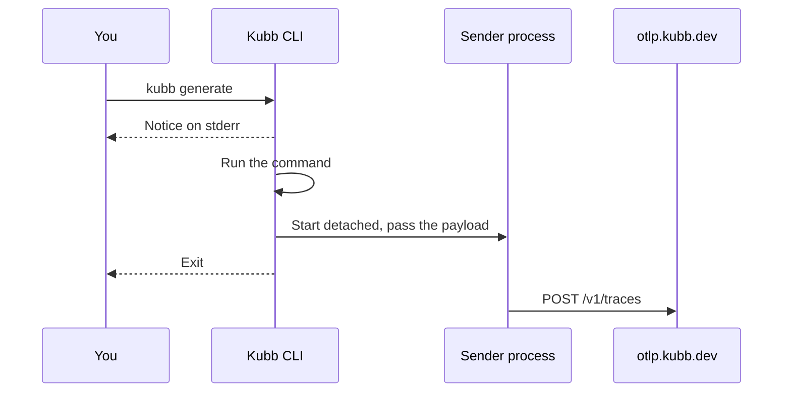

# Telemetry

The Kubb CLI sends anonymous data about each command run: which command, which plugins and options, how long it took, and whether it succeeded.

> [!IMPORTANT]
> Telemetry is on by default. Set `DO_NOT_TRACK` or `KUBB_DISABLE_TELEMETRY` to `1` or `true` to turn it off.

## When Kubb sends it



A detached process sends the request, so the CLI exits without waiting. The request fails silently after 5 seconds, so an offline machine never interrupts a run.

| Command | Sends one event |
| --- | --- |
| `kubb generate` | Per config, when that config finishes or fails |
| `kubb validate` | When validation finishes or fails |
| `kubb mcp` | When an MCP client connects, or when the server fails to start |
| `kubb studio` | When the Studio command finishes or fails |

Each command prints a telemetry notice to stderr when it starts. `--help`, `-h`, `--version`, `-v`, and `--json` skip it.

## What is collected

Each event is an [OpenTelemetry OTLP](https://opentelemetry.io/docs/languages/sdk-configuration/otlp-exporter/) trace with one span, sent as JSON to `https://otlp.kubb.dev/v1/traces`. The span carries the command as its name, the run's start and end times, an OK or error status, and random trace and span ids.

| Span attribute | Value | Example |
| --- | --- | --- |
| `kubb.command` | The command | `"generate"` |
| `kubb.version` | The Kubb CLI version | `"5.0.0"` |
| `kubb.node_version` | The Node.js major version | `"22"` |
| `kubb.runtime` | The JavaScript runtime | `"node"`, `"bun"`, `"deno"` |
| `kubb.runtime_version` | The runtime major version | `"22"` |
| `kubb.platform` | The operating system | `"linux"`, `"darwin"`, `"win32"` |
| `kubb.ci` | Whether the run is in CI | `true` |
| `kubb.tty` | Whether stdin is a terminal, which usually means a person typed the command | `true` |
| `kubb.agent` | The AI coding agent that ran the command, when Kubb detects one | `"claude"` |
| `kubb.mcp_client` | The name the MCP client reports, up to 64 characters. `kubb mcp` only. | `"claude-code"` |
| `kubb.files_created` | Files generated. `0` outside `kubb generate`. | `47` |
| `kubb.status` | The outcome | `"success"`, `"failed"` |
| `kubb.plugins` | The plugin names, sorted | `["plugin-ts", "plugin-zod"]` |
| `kubb.plugin.<name>` | `true` for each plugin, such as `kubb.plugin.plugin-ts` | `true` |
| `kubb.plugin_options` | Each plugin's `name` and its options as a JSON string | `{ "name": "plugin-ts", "options": "{\"output\":{\"path\":\"types\"}}" }` |

The resource attributes are `service.name: "kubb"`, `service.version` (the Kubb version), and `telemetry.sdk.language: "nodejs"`. The request carries the headers `Kubb-Telemetry-Version: 1` and `Kubb-Telemetry-Source: kubb-cli`.

> [!WARNING]
> `kubb.plugin_options` holds the JSON form of every option value your config passes to a plugin, without functions. That includes values that name your project, such as `output.path`, `importPath`, `baseURL`, or a string `banner`. It also includes a secret in a plugin option, whether `kubb.config.ts` writes it as a literal or reads it from `process.env`.

## What is not collected

- The spec contents
- The input path, the project root, or the names of generated files
- Source code or generated code
- A user, machine, or project identifier

Kubb does not read environment variables or credential files for telemetry.

## How to opt out

Set `DO_NOT_TRACK` or `KUBB_DISABLE_TELEMETRY` to `1` or `true`. Kubb then sends nothing and prints no notice.

```shell [Terminal]
DO_NOT_TRACK=1 kubb generate
```

`DO_NOT_TRACK` follows the [cross-tool convention](https://consoledonottrack.com/).
