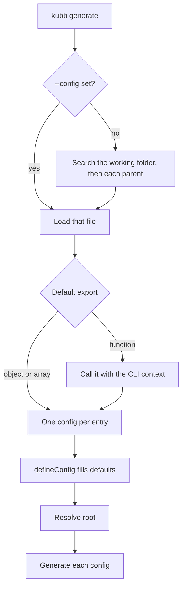

# Config and inputs

Use these rules when Kubb loads a config, reads an input, filters operations, or prints a file in a way the reference pages do not explain.

## Config loading {#config-loading}

When you run `kubb generate` without `--config`, Kubb searches for a config file and turns its default export into one config per entry. Source: [How Kubb loads a config](/docs/5.x/reference/configuration#how-kubb-loads-a-config).



- In each folder, Kubb checks `.kubbrc.*` before `kubb.config.*`, and the folder itself before its `.config/` and `configs/` subfolders.
- It tries `.ts`, `.mts`, `.cts`, `.js`, `.mjs`, and `.cjs`, in that order.
- When nothing matches, the CLI stops and suggests `kubb init`.

### Root folder

When you leave out [`root`](/docs/5.x/reference/configuration#root), it is the config file's folder, or the folder above it for a config in `.config/` or `configs/`.

- A relative `root` resolves from that folder.
- `createKubb` without a config file uses `process.cwd()`.

### Defaults outside the CLI

When you build without `kubb generate`, fewer of the [defaults](/docs/5.x/reference/configuration#defaults) can apply:

- `createKubb` from `@kubb/core` applies only the `root`, `storage`, `output.format`, `output.lint`, and `output.defaultBanner` defaults.
- [Build tool integrations](/docs/5.x/integrations/overview#build-tools) apply the same defaults as `defineConfig`, but run only the summary reporter, not `json`, `file`, or `html`.

### Extension commands

`kubb add`, `kubb update`, `kubb list`, and `kubb remove` read `--config`, or the first `.kubbrc` or `kubb.config` file in the current folder, its `.config/` and `configs/` folders, then each parent folder. That is the same search as `kubb generate`, with the same extensions. With several config entries, `add` and `remove` edit the first one. See [Project files](/docs/5.x/reference/commands#project-files).

### kubb validate

When you run `kubb validate`, the adapter depends on the config it finds. See [Which adapter runs](/docs/5.x/reference/commands/validate#which-adapter-runs).

| Situation | Adapter |
| --- | --- |
| A config is found or passed | The adapter of each config entry. A local path resolves from that entry's `root`, or the current folder without one. A URL or git input is passed unchanged. |
| A config entry has no adapter | None. The command fails instead of using the OpenAPI adapter. |
| No config, or a found config that fails to load | `@kubb/adapter-oas`, for OpenAPI and Swagger documents. A config passed with `--config` that fails to load fails the command. |

- An array config that repeats one adapter and input validates that pair once.
- Kubb fetches a git input into a temporary folder with `git`, validates it, and deletes the folder.

## Inline sources {#inline-sources}

When a plugin writes a `File` with `copy`, or a `File.Source` with `inline`, Kubb copies or absorbs that file instead of printing its sources. Sources: [`File`](/docs/5.x/reference/jsx#file), [`File.Source`](/docs/5.x/reference/jsx#file-source), and [Parsers](/docs/5.x/reference/kit/parsers).

- `copy` on `File` is an absolute path to a file to copy into the output, through the parser's `copy` hook when it has one. The file's sources still count for barrels but are not printed.
- `inline.expression` on `File.Source` is the right-hand side of the declaration.
- A file whose sources are all inline is not written. Files that import from it get the expression and the imports it needs.

```tsx
<File.Source name="AddPetStatus200" isTypeOnly isExportable inline={{ expression: 'Pet' }}>
  {`export type AddPetStatus200 = Pet`}
</File.Source>
```

The parser's `inline` member (`InlineLanguage`) decides how. It runs before barrels, finds names (`replaceIdentifiers`), and makes a definition safe to put where a name was (`wrap`). Files of a parser with `inline` can absorb inline sources. `parserTs` has it.

With the `kubb/jsx` [setup](/docs/5.x/reference/jsx#setup), `.tsx` files load `jsx-runtime` and `jsx-dev-runtime` from `kubb/jsx`.

## External `$ref` files {#external-refs}

When your spec points at another file with `$ref`, Kubb resolves it against `root`. Relative `$ref` files in an object or inline content resolve against `root` too. Sources: [`input`](/docs/5.x/reference/configuration#input) and [`KUBB_REF_NOT_FOUND`](/docs/5.x/reference/diagnostics#kubb-ref-not-found).

Some runs refuse local files:

| Run | Local `$ref` files it reads |
| --- | --- |
| A URL input, anywhere | None, so a fetched spec cannot point at files on your machine |
| A Kubb Studio agent | Only files inside the project or the input's folder |
| A sandbox agent | None |
| A managed agent | Only files in the repository of a git input |

To fix a refused file, move it inside the project, start your own agent with [`--allow-file-refs`](/docs/5.x/reference/commands/studio#permissions), or inline the schema.

## Git input {#git-input}

When `input` points at a spec in a git repository, write it as `git+<repo>#<ref>:<path>`. Source: [`input`](/docs/5.x/reference/configuration#input).

- `<ref>` is a branch, a tag, or a full commit SHA where the host allows fetching by SHA. GitHub and GitLab do.
- Leave out `<ref>:` to use the default branch.
- Kubb runs a shallow `git fetch` into a temporary folder. It needs `git` on the `PATH` and uses your own git credentials for a private repository.

See [Read the spec from a git repository](/docs/5.x/how-to/recipes#read-the-spec-from-a-git-repository) for a config.

## Filters {#filters}

When an `include` or `exclude` mixes operation entries with `schemaName` entries, schemas follow their own rules. Source: [How filters match](/docs/5.x/reference/plugin-options#how-filters-match).

- Only `schemaName` entries filter schemas by name.
- An `include` with operation entries and no `schemaName` entry keeps only the schemas the included operations use, directly or through other schemas.
- An `include` with only `schemaName` entries generates no operations.

When an [`override`](/docs/5.x/reference/plugin-options#override) entry matches, its `options` apply like this:

- `options` takes any plugin option except `override`.
- It merges shallowly over the plugin options. An object option such as `enum` replaces the plugin's value whole, so give it every field.
- An `output` without `mode` reads it from `output.path`.

## Override patterns {#override-patterns}

When you want an option for some schemas only, add an [`override`](/docs/5.x/reference/plugin-options#override) entry. String patterns are regular expressions, so `'Order'` also matches `OrderItem`, and `'^Order$'` matches only the `Order` schema. This example sets the Faker [`typeMode`](/extensions/kubb-labs/plugin-faker/options#typemode) for `Order` alone:

```typescript [kubb.config.ts]
import { defineConfig } from 'kubb/config'
import { pluginFaker } from '@kubb/plugin-faker'
import { pluginTs } from '@kubb/plugin-ts'

export default defineConfig({
  input: './petStore.yaml',
  output: { path: './src/gen' },
  plugins: [
    pluginTs(),
    pluginFaker({
      override: [{ type: 'schemaName', pattern: '^Order$', options: { typeMode: 'schema' } }],
    }),
  ],
})
```

## Group folders {#group-folders}

When a plugin sets [`group`](/docs/5.x/reference/plugin-options#group-type), the resolver's `groupDir(group, value)` picks the folder for each file. See [Resolvers](/docs/5.x/reference/kit/resolvers#auto-injected-resolver-defaults).

| Group | Folder |
| --- | --- |
| A custom `group.name` | What `group.name` returns. It wins over `type`. |
| `type: 'tag'` | The camelCased tag, inside the folders of its `parent` tags |
| `type: 'path'` | The first path segment |

When an OpenAPI 3.2 tag declares a `parent`, its folder sits inside the parent's folder, such as `animals/cats/`.

## Parser selection {#parser-selection}

When two parsers in [`parsers`](/docs/5.x/reference/configuration#parsers) register the same file extension, Kubb uses one of them. Source: [Parsers](/docs/5.x/reference/kit/parsers).

> [!IMPORTANT]
> When two parsers register the same extension, the last one in the `parsers` array wins. Put the parser you want for that extension last.

## Parser fallback {#parser-fallback}

When no parser handles a file's extension, Kubb writes the file's sources joined together, as they are. Add a parser for that extension to control the output. Source: [How Kubb works](/docs/5.x/explanation/architecture#parsers).

## Import extensions {#import-extensions}

When your output needs `.js` or `.ts` on its relative imports, set [`extension`](/extensions/kubb-labs/parser-ts/options#extension) on the TypeScript parser, such as `parserTs({ extension: { '.ts': '.js' } })`.

- The map's key is the extension of a generated file, and its value is the extension that file's relative specifiers get.
- `''` drops the extension, and so does a file whose extension has no key.
- The map only replaces an extension. A relative specifier without one stays as written.
- Package specifiers and the file names on disk never change.
- The same map applies to runtime templates that a plugin copies into the output, such as the `.kubb/` files of `@kubb/plugin-fetch`. Their top-level `import` and `export … from` statements are rewritten too, so the whole output follows one convention.
