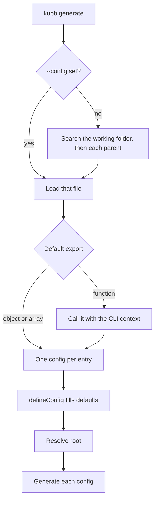

# Config and inputs

Rules for how Kubb loads a config, reads an input, filters operations, and prints files, beyond what the reference pages cover.

## Config loading {#config-loading}

Without `--config`, `kubb generate` searches for a config file and turns its default export into one config per entry. Source: [How Kubb loads a config](/docs/5.x/reference/configuration#how-kubb-loads-a-config).



- In each folder, `.kubbrc.*` comes before `kubb.config.*`, and the folder before its `.config/` and `configs/` subfolders.
- Extensions are tried in the order `.ts`, `.mts`, `.cts`, `.js`, `.mjs`, `.cjs`.
- When nothing matches, the CLI stops and suggests `kubb init`.

### Root folder

Without [`root`](/docs/5.x/reference/configuration#root), the root is the config file's folder, or its parent for a config in `.config/` or `configs/`.

- A relative `root` resolves from that folder.
- `createKubb` without a config file uses `process.cwd()`.

### Defaults outside the CLI

Without `kubb generate`, fewer [defaults](/docs/5.x/reference/configuration#defaults) apply:

- `createKubb` from `@kubb/core` applies only the `root`, `storage`, `output.format`, `output.lint`, and `output.defaultBanner` defaults.
- [Build tool integrations](/docs/5.x/integrations/overview#build-tools) apply the `defineConfig` defaults, but run only the summary reporter.

### Extension commands

`kubb add`, `kubb update`, `kubb list`, and `kubb remove` read `--config`, or search for a config the same way as `kubb generate`. With several config entries, `add` and `remove` edit the first one. See [Project files](/docs/5.x/reference/commands#project-files).

### kubb validate

Which adapter `kubb validate` runs depends on the config it finds. See [Which adapter runs](/docs/5.x/reference/commands/validate#which-adapter-runs).

| Situation | Adapter |
| --- | --- |
| A config is found or passed | Each entry's adapter. A local path resolves from the entry's `root`, or the current folder. |
| A config entry has no adapter | None. The command fails. |
| No config, or a found config that fails to load | `@kubb/adapter-oas`. A `--config` file that fails to load fails the command. |

- An array config that repeats one adapter and input validates that pair once.
- A URL or git input is passed unchanged. A git input is fetched into a temporary folder, validated, and deleted.

## Inline sources {#inline-sources}

When a plugin writes a `File` with `copy` or a `File.Source` with `inline`, Kubb copies or absorbs it instead of printing it. Sources: [`File`](/docs/5.x/reference/jsx#file), [`File.Source`](/docs/5.x/reference/jsx#file-source), and [Parsers](/docs/5.x/reference/kit/parsers).

- `copy` on `File` is an absolute path to copy into the output, through the parser's `copy` hook if it has one. Its sources count for barrels but are not printed.
- `inline.expression` on `File.Source` is the right-hand side of the declaration.
- A file whose sources are all inline is not written. Files that import it get the expression and its imports.

```tsx
<File.Source name="AddPetStatus200" isTypeOnly isExportable inline={{ expression: 'Pet' }}>
  {`export type AddPetStatus200 = Pet`}
</File.Source>
```

The parser's `inline` member (`InlineLanguage`) runs before barrels. It finds names (`replaceIdentifiers`) and makes a definition safe to put where a name was (`wrap`). Only files of a parser with `inline`, such as `parserTs`, absorb inline sources.

With the `kubb/jsx` [setup](/docs/5.x/reference/jsx#setup), `.tsx` files load `jsx-runtime` and `jsx-dev-runtime` from `kubb/jsx`.

## External `$ref` files {#external-refs}

When your spec points at another file with a relative `$ref`, Kubb resolves it from the input file's folder. An object or inline input has no file, so its refs resolve from `root`. An OpenAPI 3.2 `$self` changes the base. Sources: [`input`](/docs/5.x/reference/configuration#input) and [`KUBB_REF_NOT_FOUND`](/docs/5.x/reference/diagnostics#kubb-ref-not-found).

Some runs refuse local files:

| Run | Local `$ref` files it reads |
| --- | --- |
| A URL input | None, so a fetched spec cannot read your files |
| A Kubb Studio agent | Only files inside the project or the input's folder |
| A sandbox agent | None |
| A managed agent | Only files in the repository of a git input |

To fix a refused file, move it into the project, start your agent with [`--allow-file-refs`](/docs/5.x/reference/commands/studio#permissions), or inline the schema.

## Git input {#git-input}

For a spec in a git repository, write `input` as `git+<repo>#<ref>:<path>`. Source: [`input`](/docs/5.x/reference/configuration#input).

- `<ref>` is a branch, a tag, or a full commit SHA on hosts that fetch by SHA, such as GitHub and GitLab.
- Leave out `<ref>:` to use the default branch.
- Kubb runs a shallow `git fetch` into a temporary folder. It needs `git` on the `PATH` and uses your git credentials for a private repository.

See [Read the spec from a git repository](/docs/5.x/how-to/recipes#read-the-spec-from-a-git-repository) for a config.

## Filters {#filters}

When an `include` or `exclude` mixes operation and `schemaName` entries, schemas follow their own rules. Source: [How filters match](/docs/5.x/reference/plugin-options#how-filters-match).

- Only `schemaName` entries filter schemas by name.
- An `include` with operation entries and no `schemaName` entry keeps only the schemas those operations use, also indirectly.
- An `include` with only `schemaName` entries generates no operations.

A matching [`override`](/docs/5.x/reference/plugin-options#override) entry applies its `options` like this:

- `options` takes any plugin option except `override`.
- It merges shallowly. An object option such as `enum` replaces the plugin's value whole, so give it every field.
- An `output` without `mode` reads it from `output.path`.

## Override patterns {#override-patterns}

To set an option for some schemas only, add an [`override`](/docs/5.x/reference/plugin-options#override) entry. String patterns are regular expressions, so `'Order'` also matches `OrderItem`, and `'^Order$'` matches `Order` only. This sets the Faker [`typeMode`](/extensions/kubb-labs/plugin-faker/options#typemode) for `Order` alone:

```typescript [kubb.config.ts]
import { defineConfig } from 'kubb/config'
import { pluginFaker } from '@kubb/plugin-faker'
import { pluginTs } from '@kubb/plugin-ts'

export default defineConfig({
  input: './petStore.yaml',
  output: { path: './src/gen' },
  plugins: [
    pluginTs(),
    pluginFaker({
      override: [{ type: 'schemaName', pattern: '^Order$', options: { typeMode: 'schema' } }],
    }),
  ],
})
```

## Group folders {#group-folders}

With [`group`](/docs/5.x/reference/plugin-options#group-type), the resolver's `groupDir(group, value)` picks each file's folder. See [Resolvers](/docs/5.x/reference/kit/resolvers#auto-injected-resolver-defaults).

| Group | Folder |
| --- | --- |
| A custom `group.name` | What `group.name` returns. It wins over `type`. |
| `type: 'tag'` | The camelCased tag, inside the folders of its OpenAPI 3.2 `parent` tags, such as `animals/cats/` |
| `type: 'path'` | The first path segment |

## Parser selection {#parser-selection}

When two parsers in [`parsers`](/docs/5.x/reference/configuration#parsers) register the same file extension, Kubb uses one of them. Source: [Parsers](/docs/5.x/reference/kit/parsers).

> [!IMPORTANT]
> The last parser in the `parsers` array wins. Put the one you want for that extension last.

## Parser fallback {#parser-fallback}

When no parser handles a file's extension, Kubb joins its sources as they are. Add a parser for that extension to control the output. Source: [How Kubb works](/docs/5.x/explanation/architecture#parsers).

## Import extensions {#import-extensions}

When relative imports need `.js` or `.ts`, set [`extension`](/extensions/kubb-labs/parser-ts/options#extension) on the TypeScript parser, such as `parserTs({ extension: { '.ts': '.js' } })`.

- The key is a generated file's extension, and the value is the extension its relative specifiers get.
- `''` drops the extension, and so does a file whose extension has no key.
- A relative specifier without an extension stays as written.
- Package specifiers and file names on disk never change.
- The map also rewrites the top-level `import` and `export … from` statements of runtime templates a plugin copies, such as the `.kubb/` files of `@kubb/plugin-fetch`.
