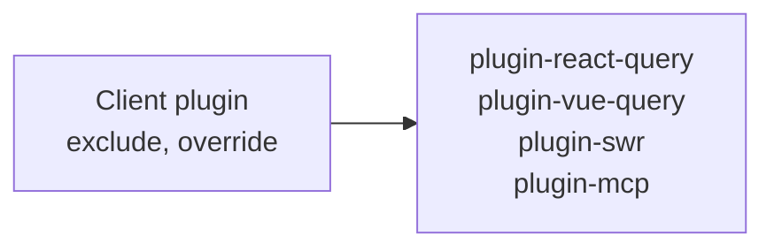

# Query plugins

Compare what `@kubb/plugin-react-query`, `@kubb/plugin-vue-query`, and `@kubb/plugin-swr` generate, and how they follow the client plugin they build on. Read it when you pick a query plugin or switch between them.

## Compare the query plugins {#query-plugins-compared}

| Plugin | Library | Trade-off |
| --- | --- | --- |
| [`@kubb/plugin-react-query`](/extensions/kubb-labs/plugin-react-query) | `@tanstack/react-query` | Every export, including infinite and suspense hooks. Hooks need `hooks`. |
| [`@kubb/plugin-vue-query`](/extensions/kubb-labs/plugin-vue-query) | `@tanstack/vue-query` | No suspense hooks and no mutation options factory. Composables need `hooks`. |
| [`@kubb/plugin-swr`](/extensions/kubb-labs/plugin-swr) | `swr` | Always writes hooks. No infinite or suspense hooks. |

Each hook and its helpers live in a file named after the hook, such as `src/gen/hooks/useGetPetById.ts`. The three plugins generate these exports:

| Operation | React Query | Vue Query | SWR |
| --- | --- | --- | --- |
| Query (`GET`, `QUERY`) | `getPetByIdQueryKey`, `getPetByIdQueryOptions`, plus `useGetPetById` with `hooks` | `getPetByIdQueryKey`, `getPetByIdQueryOptions`, plus `useGetPetById` with `hooks` | `getPetByIdQueryKey`, `getPetByIdQueryOptions`, `useGetPetById` |
| Mutation (`POST`, `PUT`, `PATCH`, `DELETE`) | `updatePetMutationKey`, `updatePetMutationOptions`, plus `useUpdatePet` with `hooks` | `updatePetMutationKey`, plus `useUpdatePet` with `hooks` | `updatePetMutationKey`, `useUpdatePet` |
| Infinite, with `infinite` and `hooks` | `findPetsByTagsInfiniteQueryKey`, `findPetsByTagsInfiniteQueryOptions`, `useFindPetsByTagsInfinite` | Same as React Query | Not generated |
| Suspense, with `suspense` and `hooks` | `useGetPetByIdSuspense`, and `useFindPetsByTagsSuspenseInfinite` when `infinite` is set too | Not generated | Not generated |
| Server-Sent Events or JSON Lines | Nothing. Call the client function directly. | Nothing | Nothing |

## Client and query plugins {#client-and-query-plugins}

The query plugins and `@kubb/plugin-mcp` build on a client plugin: `@kubb/plugin-fetch`, `@kubb/plugin-axios`, or `@kubb/plugin-client`. They follow its filters:

| Set on the client plugin | What the plugins built on it do |
| --- | --- |
| [`exclude`](/docs/5.x/reference/plugin-options#exclude) an operation | Skip it too |
| [`override`](/docs/5.x/reference/plugin-options#override) `returnType`, `output`, or `group` for an operation | Follow that override |
